# 大稻埕食光街：走進170年的飲食記憶

以第三人稱 3D 探索遊戲的方式走進大稻埕：玩家扮演一位旅人，在街道中漫步、走近具有歷史意義的店家，透過店家與食物理解大稻埕的歷史、經濟與社會變遷。

> 目前為 **第二版**：同一條街可以在五個年代之間切換，並支援 iPad 觸控操作。互動店家「林復振」在五個年代都可以探索，其他店家以建築與「即將開放」標示呈現。
> 第三版（V3）精修「1895–1930 酒樓繁華」的街景與江山樓，並加入可隨時切換的畫質設定。

## 新增：大稻埕戲苑（第 7 階段 C：只加章節與出處）

依 `docs/research/da-dao-cheng-xi-yuan.md` 的結論，在「老屋新生」年代的永樂市場故事裡加三章（資料在 `src/data/xiyuanData.js`）；沒有新的店家、建築、地段或碰撞，市場大樓的 8、9 樓不做 3D、不開放探索。

- **「大稻埕戲苑」**：位置是永樂市場大樓的 **8、9 樓**（不是 4 樓）——9 樓劇場（約 500 席；500／506／501–1000 席三說並列、待核）、8 樓曲藝場（約 100 席）與布袋戲常設展區；演出類型（歌仔戲、京劇、南管、北管、客家戲、說唱、布袋戲）與管理單位（臺北市藝文推廣處）依臺北市政府劇場整合資訊平臺。明寫放在市場故事裡只因同在一棟大樓，不表示由市場經營。
- **「從延平活動中心到戲苑」**：1987 年 2 月延平活動中心 → 2009 年 10 月 31 日更名 → 2010 年試營運 → 2011 年正式營運，年份來自百科與《PAR 表演藝術》2011、2014 兩篇，**並列、開幕年份標待核**（不單寫「2011 年啟用」或「2010 年成立」）。前身所在的兩說（延平區行政中心 9 樓／永樂市場內）不推論；2015 年改隸藝文推廣處只有百科、待核；「大稻埕古城重現專案」只記名稱。
- **「大稻埕曾經的戲窟」**：獨立的背景一節，只列有出處的淡水戲館（1909 建、後為臺灣新舞臺、1945 毀於空襲）、永樂座（1924 開幕、1960 歇業、今迪化街一段 46 巷）、第一劇場（1935 建於太平町）；標題與內文**明寫戲苑並非這些戲院的延續**，「延續戲窟文化」只寫成館方自述。
- **不寫**（查無出處）：北投／臺北戲棚遷移、百年傳統、與歷史戲院的傳承或「永樂座後身」、4 樓、由文化局或市場處營運、二三樓布市的歷史推論、8、9 樓在 1987 年以前的用途。
- 出處新增 6 筆（劇場整合資訊平臺、《PAR 表演藝術》2011 與 2014、藝文推廣處活動頁、維基百科〈大稻埕戲苑〉〈永樂座〉），都有出版時間、用途與檢核說明。年表加入 2011 年「正式營運」一條（文字並列 2010 試營運、標待核；1987、2009 只有百科，不上年表）；地圖不加地點（與永樂市場同一門牌）。

## 新增：小藝埕補章節與李亭香（第 7 階段 B：只加章節、出處與名錄的年代限縮）

依 `docs/research/xiao-yi-cheng.md` 與 `docs/research/li-ting-xiang.md` 的結論寫兩項內容；沒有新的建築、地段或碰撞，五個年代的地段切分不變。

- **小藝埕**（補在爐鍋咖啡既有的「第二章｜小藝埕與老屋再利用」，章節數不變、不新增 3D）：老屋新生的營運模式（「創業助成、街區營造、文化運動」，標**官方自述**；民間向屋主承租，不寫成政府計畫、不寫承租條件）、小藝埕是藝埕系列的第一棟（2011 年開幕，官方頁列十棟）、兩棟相鄰藝埕的對照（小藝埕是街角洋樓＝屈臣氏大藥房舊址；民藝埕是迪化街 67 號的三進式街屋＝茂元中藥行舊址，只有文字、明寫是不同的建築）、樓層業者隨時間調整。「從屈臣氏大藥房到小藝埕」只列有出處的節點（1928／1917 興建、1996 大火、修復、2010 出租、2011 開幕、2014 二樓是爐鍋咖啡），節點之間的因果**不推論**。地址兩說並列（32 巷 1 號／34 號，待核）；興建年份、登錄身分、爐鍋咖啡進駐年份維持待核。**不寫**：民藝埕就是小藝埕、「最古老建築」、租期租金、市府推動、現況入駐名單。**民藝埕不做**（只有一篇報導與官方簡介，沒有建模所需的資料）。
- **李亭香**（`li-ting-xiang`，開放探索，章節在 `src/data/liTingXiangData.js`）：只做現代與店家自述——「現況與傳承」（1895 年為店家自述、標待核；創立地點蘆洲／大稻埕兩說並列；現任經營者從面板工程師返家接班、不寫世代序號；門牌未能從可開啟的來源核對，地圖不標）、「店名由來與招牌餅」（騎樓亭仔腳飄出餅香，兩篇一致、標店家說法；平西餅的「27 層餅皮」與口味對應世代僅一篇、待核；現售商品不寫成老味）、「大稻埕沒落時期兼賣雜貨」（兩篇報導互證，年代只有「約 40 年前」）。**不寫**：「1895 年創於迪化街」、第 N 代、綠豆糕／牡丹餅為老味、與其他糕餅店的傳承或師承、與年貨大街的關係、建築的年代與登錄身分。
- **李亭香的年代限縮**：查證指出日治時期的店可能在蘆洲、1951 年才到大稻埕（單一低可信度來源），所以店家名錄只在「老屋新生」列出李亭香（酒樓繁華、摩登、庶民生活移出 `availableStores`）；同一地段的店屋在那三個年代**保留**（地段座標與建築尺寸不變），招牌改成與背景街屋相同的一般行業字「餅舖」，不寫店名。章節與年代說明寫明其他年代的餅舖是情境示意、不代表李亭香當時在此。
- 出處新增 6 筆（大藝埕官方 HOUSES 頁；李亭香的今周刊、ETtoday、鏡週刊、小島裡專欄、窩客島食記），都有出版時間、用途與檢核說明。糕餅主線「李亭香 → 滋養 → 年貨大街」查無任何傳承關係，不做成傳承線。

## 新增：迪化街年貨大街與呷二嘴（第 6 階段 C：只加章節與出處）

依 `docs/research/dihua-nianhuo.md` 與 `docs/research/xia-er-zui.md` 的結論寫兩項內容；沒有新的店家條目、建築、地段或碰撞（五個年代的碰撞與建築與 main 逐位元組相同），章節內容在 `src/data/dihuaNianhuoData.js`。

- **迪化街年貨大街**（掛在「老屋新生」的永樂市場故事裡）：「迪化街年貨大街」一章寫 1996 年起的緣起——市府新聞稿的「1996 年、市府首創」與報導（重現 1995 年民生報）的「民間迪化街工作室提出、市府協辦」**並列**，1996 年的做法標「預定、原報未查閱、待核」；現況只寫「農曆春節前約半個月」，**不寫日期**。另一章「過年前買南北貨」是獨立的背景（二手整理、標待核），標題與內文明說與 1996 年的活動無關，也不寫戰前至戰後的南北貨商家。**不寫**：百年傳統、世界第一、遊客與交易額數字、主辦與承辦單位、農曆日期區間。年表加入 1996 年（有出處，落在年代之間）。與糕餅主線的銜接只有一句：年貨大街是市府與商家自 1996 年起辦理的活動，不把任何店家寫成創辦者。
- **呷二嘴**（甘州街 34 號）：只掛在米苔目主題的 `related`（`getThemeRelated` 回傳 `place`，`shop` 為 `null`），一章「同樣賣米苔目的店」寫位置、夏季米苔目冰與冬季熱食；1954 年創立標「未見文件佐證」；創辦人、世代、早期攤位位置查無不寫；不寫排名或「推薦」，不寫與其他店家或廟口的關係，不使用店家商標，也沒有 3D 模型。
- 出處新增 6 筆（市府新聞稿、報時光、BIOS monthly、三篇呷二嘴食記），都有檢核說明。意麵王與林合發維持不做。

## 新增：慈聖宮與廟口小吃（第 6 階段 B：章節與開放探索）

依 `docs/research/ci-sheng-gong-miaokou.md` 的結論把慈聖宮（`ci-sheng-gong`）開放探索。沒有新的建築或攤位：廟的模型與廟埕原有的四攤不變，只加章節、熱點與出處；同一個店家 ID 用 `eras` 套用各年代的版本（做法同稻舍），章節內容在 `src/data/ciShengMiaokouData.js`。

- **酒樓繁華、摩登大稻埕**：文化據點「慈聖宮」（`kind: 'heritage'`，加入這兩個年代的店家名錄）。一章「廟與廟埕」＋文獻：嘉慶年間分靈、1853 遷大稻埕；初建年份 1855／1864／1866／1869 **各說不一**、市區改正遷建 1909／1910、重建完成 1914／1916 **並列標待核**；古蹟身分只有維基百科一個來源，不寫成事實。
- **庶民生活**：「慈聖宮廟口小吃」（標「歷史情境重建」）。「廟口小吃」一章寫攤販聚集的年代只有中研院 GIS 專題一句「民國 50 年間」（待核、不寫成「戰後初期」）；「四種小吃」食物圖鑑：原汁排骨湯、肉粥、豬腳麵線、四神湯，**描述只限做法特色**，不寫任何具名老店的店名／招牌／店史、攤主與各攤年份；四神湯「攤家早年在迪化街口擺攤、後遷廟口」只當單一官方稿的待核例子，不點名。
- **老屋新生**：「現在的廟口」一章只寫「現在廟口仍有此類攤販」，不點名。
- 熱點在廟埕前的街邊、中央通道的延長線上（連同離開緩衝不和魷魚羹攤、米苔目攤的互動範圍重疊），各年代開不同的章節；介紹鏡頭從街上沿中央通道看進廟埕。
- 總覽年表加入 1914 遷建完成（標待核，兩個出處）；對照地圖的慈聖宮地點不變。出處新增中研院 GIS 專題、臺北市市場處、食尚玩家、ETtoday 四筆（含檢核說明）。
- 限制：四種小吃沒有專屬插圖（`FoodIllustration.jsx` 另有未提交的修改，本次不動，暫用預設插圖）；沒有新的 3D 攤位——廟埕的空間已被四攤佔滿，四種小吃以文字與圖鑑呈現。

## 新增：霞海城隍廟與乾元藥行（第 5 階段 B：章節與開放探索）

兩個新的文化據點（`kind: 'heritage'`，店家名錄標「文化據點」，沒有食物圖鑑或點餐），依 `docs/research/xia-hai-cheng-huang.md` 與 `docs/research/qian-yuan-yao-hang.md` 的查證紀錄撰寫章節：

- **霞海城隍廟**（迪化街一段61號，1859 完工）：只出現在「港口商街」。三章文字＋文獻：從同安、艋舺到大稻埕（1821 渡臺標單一來源、1853 頂下郊拚、1856–1859 建廟）、五月十三迎城隍（1879 起源，依官方民俗登錄的放軍／暗訪／遶境／收軍流程）、月老與古蹟（1971 增祀、1985 指定古蹟，級別沿革標「待核」）。**祭祀供品與廟口飲食查無可靠出處，一律不寫**；坪數兩說矛盾不寫。建築用既有的 `temple` 原型，以 `site` 取代北側 `north-6` 與波麗路地段上的一般街屋（只在這個年代），廟埕可以走進去（`SITE_COLLISION.temple`）。
- **乾元藥行**（1896 創立、一說 1875 **並列標示**；創辦人張清河）：只出現在「酒樓繁華」。三章文字＋文獻：創立與傳承（陳茂通、朱樹勳與陳福、1960 陳金清富）、藥材街（迪化街的中藥材集散、藥郊；與林復振「同為百年老店、各自經營」，不寫成隸屬）、店屋與立面（牛眼窗與人蔘窗框、三進店身標單一來源）。門牌 71 號未核實（地圖標示意）；建築年代與文資身分查無不寫；立面為「歷史情境重建」，以 `site` 取代 `north-6`（只在這個年代；同一塊地段港口商街是城隍廟、老屋新生是永樂米苔目，各在自己的年代取代，互不影響）。
- 總覽年表加入 1879 迎城隍起源與 1971 增祀月老（都有出處）；對照地圖加入兩個地點（城隍廟依門牌、乾元標示意）。

## 修正：畫面閃爍（Z-fighting 與依距離顯示切換）

走路、轉鏡頭或在觀賞模式繞行時，牆面、招牌、地面與屋頂有時會快速閃爍。原因分成幾類，都改在幾何與顯示邏輯上處理，不靠降低畫質或把物件藏起來：

- **共面的面**（`builders/coplanar.js`）：合併網格之前，找出不同零件、同一個朝向、同一個平面而且互相重疊的面。完全重複的方塊刪掉一層；其他重疊由較小的零件（飾條、窗框、鋪面、招牌底板…）往外長 5 mm。只會往外長，不會往內縮，所以相鄰建築之間不會出現縫隙。室內產生時拿同一棟建築的外殼來比較（外殼不修改），室內的面長 10 mm，和外殼原本與長過的位置都錯開。
- **招牌**：招牌文字沿著招牌的法線往前移 6 mm，材質加上 `polygonOffset`（只有招牌這類貼花才開）；托特包外側的印刷改用 `alphaTest` 裁切，不再和袋身互相排序。
- **深度精度**：鏡頭的 `far` 從 1600 m 改為 900 m（仍涵蓋最遠的山與雲），描邊與景深的 `uFar` 同步；`near` 維持 0.3 m，因為室內鏡頭離牆只有 0.45 m。
- **依距離顯示的遲滯**（`src/game/visibility.js`）：人物、老潘店裡的貓、室內細部走近到顯示距離以內才出現，退到再遠 2 m 才隱藏，在臨界距離附近來回走動時不會每個影格切換一次。
- 永樂米苔目：捲門箱已經頂到騎樓天花時，不再產生負高度（翻面）的牆。
- **閃爍除錯面板**（`?debug=flicker`，預設關閉）：顯示網格外框、在主控台列出網格名稱與數量，以及關閉陰影、透明物件、距離切換，或單獨隱藏立面、貼花，用來判斷閃爍屬於哪一類。

## 新增：十字軒糕餅舖（延平北路二段68號）——同一家店的三個年代

依〈鏡週刊〉2024年8月的報導：創辦人邱炳星約在1920年代創業，先賣西點麵包，後來接做婚嫁用的漢餅，又因鄰近霞海城隍廟做起壽桃生意。同一個店家 ID（`shizixuan`）、同一個地段（迪化街北側的 `north-2`／`north-3` 一般地段），依年代改用 `site` 取代不同範圍的地段，面寬隨年代擴大。

| 年代 | 版本（`variant`） | 名稱 | 面寬 | 取代的地段 |
| --- | --- | --- | --- | --- |
| 1930–1945 摩登大稻埕 | `earlyShop` | 十字軒（糕餅店） | 4.6 m（單一店面） | `north-3` |
| 1945–1980 庶民生活 | `postwarShop` | 十字軒餅舖 | 9.2 m（兩個店面） | `north-2`、`north-3` |
| 2000–現在 老屋新生 | `modernShop` | 十字軒糕餅舖 | 9.2 m（兩個店面） | `north-2`、`north-3` |

- **整合方式**：年代設定在 `src/data/shizixuanEraConfig.js`；位置、尺寸、各年代的空間、家具與熱點在 `src/data/shizixuanLayout.js`（`EARLY_SITE`／`WIDE_SITE` 兩種 `site`，由 `shops.js` 的 `eras[eraId].site` 依年代切換，`getShopBuilding` 的 `buildingByEra` 則切換面寬）；資料與章節在 `src/data/shizixuanData.js`；建模在 `src/game/builders/shizixuan/`（`shizixuanExterior.js` 外觀、招牌、遮擋方塊、碰撞、室內範圍；`shizixuanInterior.js` 依版本分派的室內）；產生器登記在 `buildWorld.js`（`BUILDING_BUILDERS`、`BUILDING_INTERIORS`），碰撞與佔地範圍在 `eraLayout.js`（`SITE_COLLISION`、`SITE_FOOTPRINT`）。
- **外觀**：
  - 1930：窄身的閩南式街屋（紅磚、木構、雙坡瓦屋頂與兩側山牆），木框玻璃門窗、簡單的木製「十字軒」招牌。
  - 1945：擴大為兩個店面寬的兩層樓，土黃／米黃灰泥立面、木窗、傳統橫式手繪招牌「十字軒餅舖」；平屋頂四面都有女兒牆，屋頂上一個封閉的玻璃天窗暗示後方工坊。
  - 2000（依使用者提供的實拍照片）：三層樓、淡米黃小磁磚立面，樓上懸挑到騎樓外緣、一樓店面退在騎樓後；兩個開間與中央一道柱；木框格子窗、窗的下段是黑色鐵窗花；左開間紅色招牌盒上是金色徽章與「TEN CAKE」「SINCE 1930」，右開間是金色圓框的「十字軒糕餅舖」與「SHI ZI XUAN CAKE & PASTRY」；右側立面外的紅色直式招牌（圓框「十字軒」與徽章）；平屋頂上的盆栽與綠籬；騎樓下停三台機車、中央柱前有電箱。不使用紅磚、瓦屋頂或木板招牌。
  - 1930、1945 都沒有「TEN CAKE」「SINCE 1930」與「十字軒糕餅舖」這個 2000 年代才有的品牌全名。
- **建築殼體**（`builders/shizixuan/shizixuanShell.js`）：三個年代都是完整的封閉殼體——四面牆、地板、每一層樓板、屋頂（1930 加兩側山牆、1945／2000 加四面女兒牆）；正面牆依開口切段，窗戶嵌在牆的開口裡；樓上沒有做室內的部分，窗後 0.35 m 是暗色的室內背板；側牆（與鄰棟交界的 party wall）往內退 1.2 cm，不和隔壁街屋的山牆共面；屋頂不超出自己的地段。門是往內推開的玻璃門扇，門洞暢通（人物不會穿過玻璃）。沒有剖面（cutaway）模式：正常遊戲狀態下建築一律完整封閉，走進店裡時鏡頭本來就在室內。共面的處理靠實際的位置與厚度分開，不使用 polygonOffset／renderOrder／透明。
- **室內**（按需載入）：
  - 1930：前舖（帳桌、兩層展示架）＋隔牆後的製餅工作間。
  - 1945：擴大的前舖（三層木製餅櫃、右牆的紙盒竹籮櫥櫃）＋後段。
  - 2000（依實拍照片：現代糕餅店＋品牌歷史展示）：
    - 天花與牆：米白天花加兩塊凹進的方格木天花、凹槽燈帶、16 盞嵌燈、空調出風口；米白內牆、櫃台後方左牆的深灰褐不規則石材。
    - 地板：深灰人字拼地磚（細部網格，精緻模式才顯示）。
    - 展示：靠窗的長型展示架（木底座、黑色檯面、階梯木架、四盞黃銅吊燈）；中央展示島（鏡面柱、壽桃吉祥物立牌）；右牆與後牆的商品層架（層板燈帶、價卡）；後牆上方六塊歷史金屬展板（十字軒博物館、1930年大稻埕、走過一甲子、十字軒 TEN CAKE、生命禮俗）。
    - 櫃台：深色木櫃、收銀機、包裝區，前方玻璃展示櫃裡外都是黃色與紅色托盤上的金元寶與壽桃。
    - 獎狀牆：左牆的深木多格展示，有獎狀、老電話、木箱、福祿壽、玻璃盒與鐵壺。
    - 商品：14 種糕餅與包裝外觀（酥餅、綠豆糕、鳳梨酥、米香、紅龜粿、壽桃、金元寶、長條糕、透明袋裝、紅色禮盒、鐵罐、托盤組、散裝小糕點、盒裝喜餅），依材質合併；最前排在主網格，後排與貼紙、印記在細部網格。
    - 圖集：展板、獎狀、價卡與貼紙在 `rendering/szxAtlas.js`／`szxTexture.js`，是原創的簡化圖樣。展板只寫主題字，內文是示意線條；獎狀只有「獎狀」「感謝狀」字樣，不寫頒發單位、得獎內容或年份。
    - 照明：明亮的暖色零售照明。
    - 頂點數：室內主網格約 11.8 萬、細部約 11.7 萬（細部只在精緻模式顯示）。
- **五個生命禮俗的文化節點**（每個年代都有：1930／1945 在展示架上，2000 在後牆「生命禮俗」展板下方的展台上）：滿月（彌月紅圓）、收涎（收瀾鹹光餅）、婚嫁（訂婚喜餅）、祝壽（做壽壽桃）、祭祀（祭祀紅龜粿）。各是一張短篇介紹（標題＋40–80字＋辭典釋義與文獻連結），點選店內對應的擺件開啟，沿用既有的熱點／章節與介紹視窗系統，沒有另外做新的卡片元件。
- **互動**：延續既有店家的做法——走近門口（騎樓）出現提示，按 E／點選開啟介紹；開放的店面讓人物直接走進去，沒有另外的「進入」按鍵或「返回街道」按鈕，走出門口就回到街上。
- **資料來源與界線**：創辦人、傳承與店史整理自〈鏡週刊〉2024年8月的報導（`sourceIds: ['mirrormedia-2024-shizixuan']`）；五個文化節點的釋義整理自教育部《重編國語辭典修訂本》與《臺灣台語常用詞辭典》。1930、1945 的店面與擺設沒有查到實際配置紀錄，是依報導描述與一般糕餅店樣貌重建的**歷史情境示意**；2000 的外觀依實地照片的立面語彙重建，尺寸為估算，不是逐一測繪。

### 截圖（實際渲染，`docs/shizixuan/`）

| 1930 高角度（山牆與屋頂） | 1930 室內（祭祀節點） | 文化節點介紹卡 | 1945 平屋頂與鄰棟交界 |
| --- | --- | --- | --- |
| 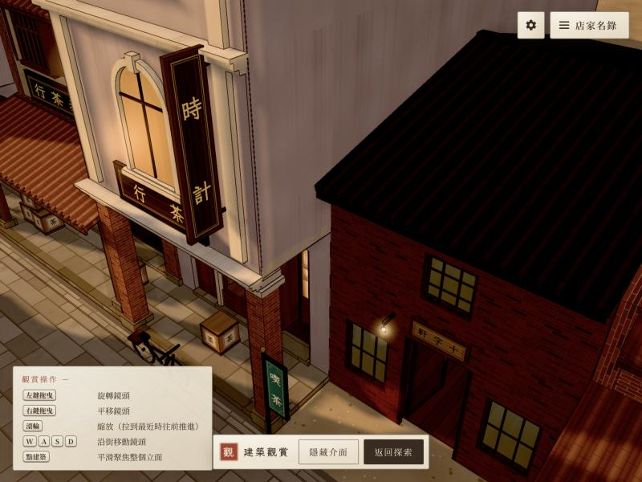 | 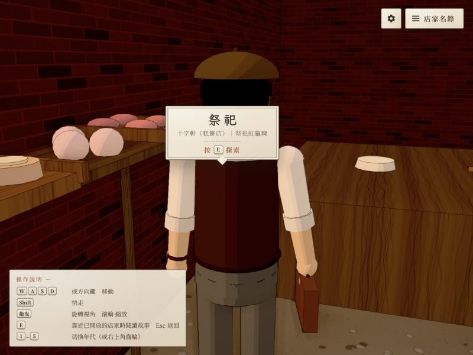 | 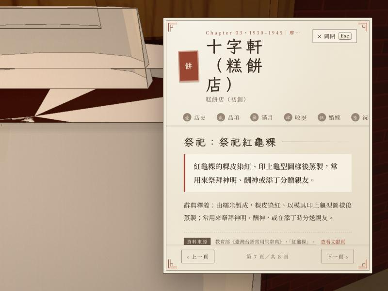 | 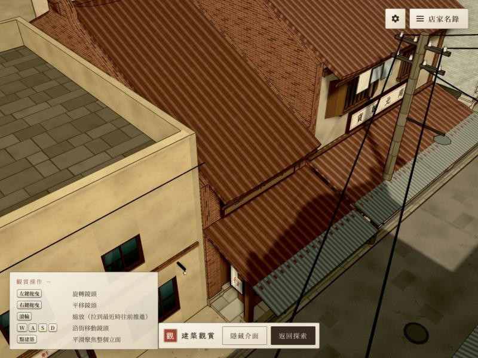 |
| **1945 室內（收涎節點）** | **2000 高角度** | **2000 招牌** | **2000 樓上立面** |
| 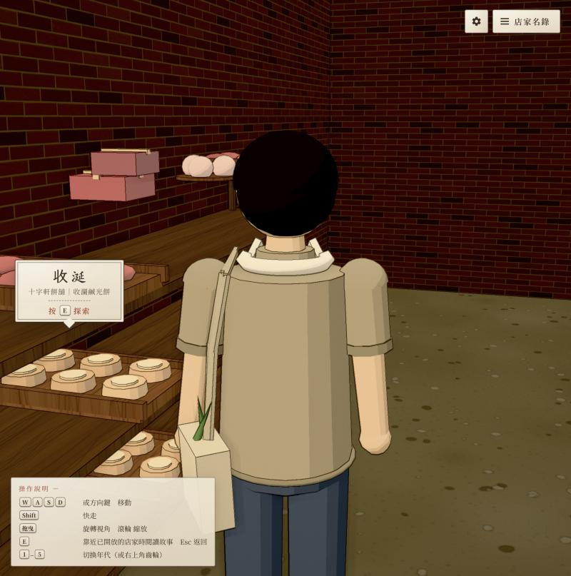 | 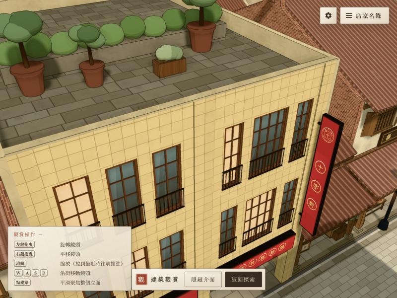 | 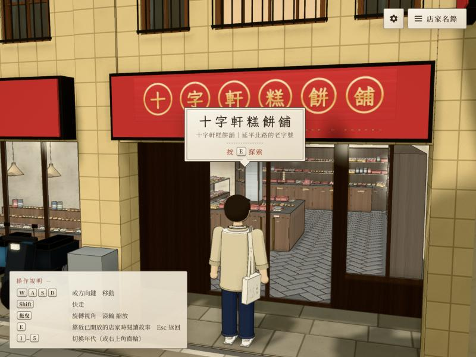 | 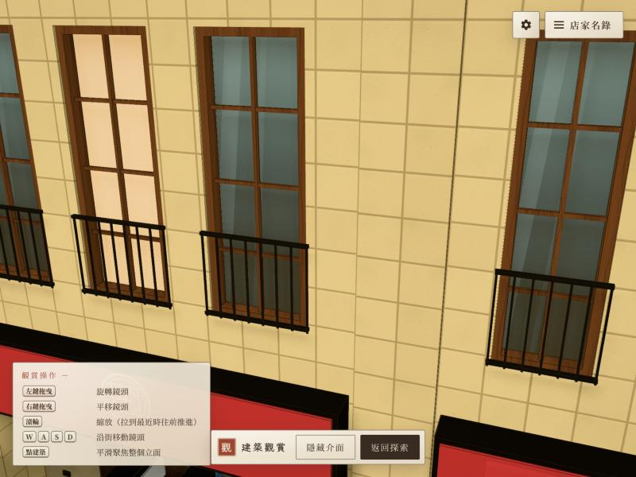 |
| **2000 入口（推開的玻璃門）** | **2000 櫃台與獎狀牆** | **2000 商品牆與歷史展板** | |
| 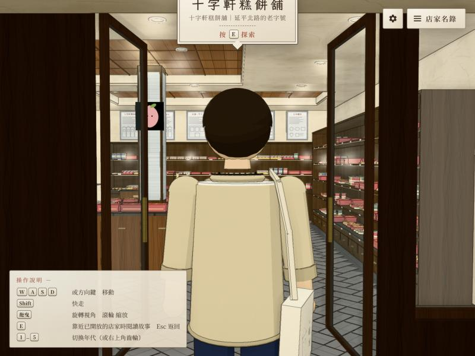 | 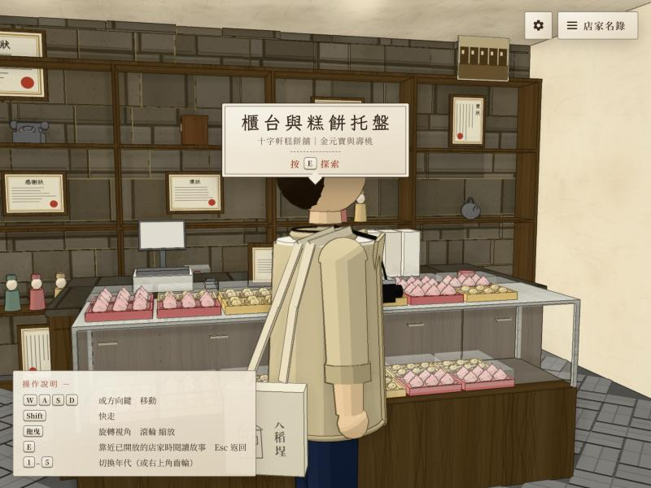 | 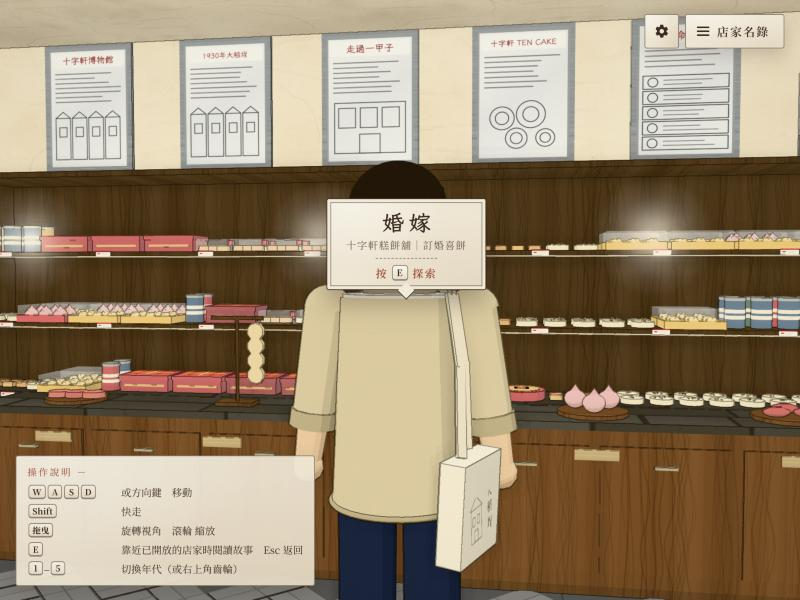 | |

## 新增：摩登大稻埕——波麗路開放探索

第 4 階段把早就在街上的波麗路（1934，Art Deco 二層街屋）補上章節與文獻、開放探索。查證紀錄在 `docs/research/bolero.md`，同一份紀錄也交代了山水亭與維特咖啡為什麼不做。

- **章節**：「西餐與咖啡的年代」（1931 維特咖啡、1934 波麗路與新芳春同年、山水亭只提一句並說明資料不足）、「廖水來」（赴日學西餐、原在維特任主廚、店名相傳取自〈Boléro〉、民生西路 314 號、本店未搬遷、1976 隔壁開第二店、2006-05-17 登錄歷史建築）、「沙龍與相親」（進口磁磚、沙發椅、78 轉電唱機、黑西裝領結的服務員；張萬傳、楊三郎、郭雪湖等畫家常客標「單一來源」；相親）、「代表菜」（法國鴨子飯、咖哩飯、牛排，三張新插圖）、文獻。
- **寫法的界線**：門牌依官方登錄採 314 號，鏡週刊同文的 134 號與維基的 308 號不採用；多數媒體稱歷史建築、鏡週刊一處稱市定古蹟，依官方登錄寫歷史建築；店名由來、畫家常客、鴨子飯的研發經過各只有一個來源，寫「相傳」「文章提到」並標出處；三道菜開始販售的年份文獻未載，只寫「代表菜」，不說 1934 年就有（維基的「1934 年鄉村咖哩飯」不採用）；1961 年鴨子飯 25 元是歷史記載，不列現價；維基獨有的 1947 年顏雲連改建、1976 年兄弟分家不採用。
- **建築不變**：位置、Art Deco 立面、西餐廳櫥窗沿用「摩登大稻埕精修」的設定，只把 `status` 改為 `open`、加上 `eraNotes`（modern、postwar、revival）、`camera`（`distance: 6.4, side: 4.5, lookHeight: 3.2`）與 `chapters`。
- **對照地圖**：波麗路依官方登錄的門牌（民生西路 314 號）加到地圖上，與新芳春茶行（309 號）相鄰；「地圖上沒有標示」的名單剩林復振、李亭香、江山樓。
- 文獻：`src/data/sources.js` 新增鏡週刊（2025）、食力（魚夫 2020）、遠見城市（魚夫 2024）、遠見雜誌（王思涵 2011）、三立新聞網（維特咖啡）、新頭殼（山水亭）與維基百科（只作對照）七筆，加上原有的文化部國家文化資產網歷史建築登錄。

### 限制

- 文化部、臺北市文化局、國家文化記憶庫、臺灣大百科這次都沒有搜到波麗路的頁面；官方歷史建築登錄沿用先前的摘錄（頁面需 JavaScript，本次未能重新開啟）。
- 山水亭（王井泉）只讀到一篇回憶性的媒體文章，維特咖啡只讀到一篇新聞報導，兩家都沒有兩個獨立的官方／學術／主流媒體來源，路線圖標「資料不足，不做」；若日後開啟中研院週報、天下雜誌全文或臺灣大百科的條目再補。
- 沒有室內。店內的沙發、電唱機與菜單只在章節文字與插圖裡。

## 新增：酒樓繁華——江山樓開放探索

第 3 階段把早就在街上的江山樓補上章節與文獻、開放探索。查證紀錄在 `docs/research/jiang-shan-lou.md`，同一份紀錄也交代了東薈芳、春風得意樓、蓬萊閣三家為什麼不做。

- **章節**：「酒樓的年代」（東薈芳 1884、春風得意樓 1914、蓬萊閣 1927 的背景與「四大旗亭」的並稱；說明三家資料不足只在這裡交代）、「吳江山」（原東薈芳合夥人、赴廈門福州上海考察、1921 年 11 月 20 日開業、紅磚四層連棟街屋、宴會廳 14 間約容 500 人、日新町二丁目、1935 年病逝、1970 年代拆除）、「宴席與藝旦」（1923 年 4 月 24 日皇太子的臺灣料理午宴：江山樓與東薈芳承辦、十二道大菜、收尾點心兩說；1927 年〈臺灣料理之話〉23 篇、192 道菜的菜單；藝旦俗諺標「相傳」；聚會與題詠）、「宴席菜」（雪白官燕、金錢火雞、水晶鴿蛋、杏仁茶，只有菜名與食材見於文獻，造型是示意）、文獻。
- **年份並列**：開業年份改以 1921 年為主（莊永明；政大碩士論文題名年段 1921–1940 亦同），並列 1917 年（史博館典藏說明、維基百科），`yearLabel` 為「1921年開業（一說1917年）」；拆除寫「1970 年代（維基百科記 1976 年）」。皇太子午宴的承辦者（吳江山主廚／江山樓與東薈芳共同）與收尾點心（杏仁茶／八寶飯與杏仁茶）兩說並列，並寫明都是研究者的二手整理、沒有讀到《臺灣日日新報》原報。門牌查無，不寫。
- **情境重建**：江山樓原址在日新町二丁目（今歸綏街、甘州街一帶），不在迪化街；`note`、文獻章的 `disclaimer` 與背景章都寫明是搬到這條街上的情境重建。建築、位置、招牌沿用第三版的設定，只把 `status` 改為 `open`、加上 `eraNotes`、`camera` 與 `chapters`；介紹鏡頭因為街道只有約 5.6 公尺寬、樓有四層，退到路緣並往側邊拉開（`distance: 6.8, side: 8, lookHeight: 4.8`）。
- **其他酒樓不做**：蓬萊閣、春風得意樓、東薈芳只讀到媒體與維基層級的來源，官方與學術佐證沒有開啟成功，創辦人、年份、門牌與菜色互相矛盾（例如「蓬萊閣由陳天來創辦」、「春風得意樓由蔣渭水創辦」兩種常見說法，讀到的來源都只寫「接手」或「1920 年入股」），路線圖標「資料不足，不做」。
- 新增四張食物圖鑑插圖：雪白官燕、金錢火雞、水晶鴿蛋、杏仁茶（`src/ui/FoodIllustration.jsx`）。
- 文獻：`src/data/sources.js` 新增莊永明〈大稻埕名酒樓之三：江山樓〉、簡伃君政大碩士論文、中央社〈台菜的身世〉、陳玉箴〈1923年皇太子的臺灣料理宴〉四筆，加上第三版已有的史博館典藏、維基百科、求真百科。

### 限制

- 莊永明的專文是個人部落格，但作者是臺灣史作者、文末列有日治報刊出處；建築規模、位置、吳江山生平多半只有這一個來源，介面都標明「莊永明」。
- 藝旦與江山樓的實際關係、日常宴席的菜單與價目，沒有查到可靠記載，章節只寫到文獻有的部分。
- 沒有室內；第三版做的門內宴席燈光與圓桌只是從門口看進去的示意。

## 新增：年表與對照地圖（總覽頁）

右上角多了「年表與地圖」按鈕（`src/ui/OverviewPanel.jsx`），打開和故事視窗同樣的紙張視窗，兩個分頁：

- **年表**：五個年代各一段，裡面依年份排所有有創立年份的店家（年份記載不一的店家顯示 `yearLabel` 的說明；還在準備中的店家顯示「即將開放」；文化據點有標記）和有出處的大事（第一版 12 件：1853 頂下郊拚、1862 滬尾設關、1868 陶德茶廠遷大稻埕、1869 烏龍茶運往紐約、1881 源隆行、1889 建昌公司、1896 茶商 252 店、1935 李春生紀念教會、1976 江山樓拆除、1985 永樂市場大樓、2009 新芳春古蹟、2016 新芳春開放；之後各階段陸續加入 1879 迎城隍、1914 慈聖宮遷建、1971 月老、1996 年貨大街、2011 大稻埕戲苑、1866 李春生來臺、1915 大稻埕教會禮拜堂），每件大事附出處連結。1980–2000 之間沒有年代，落在這段的項目另立一段；沒有創立年份的店家與情境攤位列在最後。
- **對照地圖**：遊戲裡的街是情境示意，店家的相對位置不是真實的。地圖是簡化的街道示意圖（淡水河、貴德街、西寧北路、迪化街、民樂街、延平北路、重慶北路、民權西路、涼州街、保安街、歸綏街、民生西路、南京西路；不按比例），依文獻裡的門牌標出 15 個地點，點一下顯示門牌、對應的店家與出處。文獻只寫到巷名或門牌未核實的地點（224 巷的豆花店與文史館、建昌街的洋行區）用虛線圈標「位置示意」；沒有查到門牌的店家（林復振、李亭香、江山樓）列在「地圖上沒有標示」，不會被亂標。
- 資料在純邏輯模組 `src/data/overview.js`（`getTimeline`、`getTimelineByEra`、`eraForYear`、`MAP_STREETS`、`MAP_PLACES`、`getUnmappedShops`），可以直接單測。
- 測試：`tests/overview.test.js` 7 項（有年份的店家都在年表上且排序正確、大事都有出處、年份歸到正確的年代且店家的年代和名錄一致、地點都對應存在的店家並有門牌與出處、依門牌標示的地點其門牌真的出現在該店家的資料或文獻裡、必要的街道都有畫、沒有門牌的店家不會被標）。

### 限制

- 街道示意圖是手繪的相對位置，不是地理座標；申請書若要精確地圖，應另外用地圖服務。
- 總覽視窗開啟時沒有鎖住鍵盤的年代切換（1–5）；關閉用 Esc 或點背景。

## 新增：灰泥牆的風化、海報與鐵窗花（第 9 階段）

- 程式在 `src/game/builders/weathering.js`，只套用在 lineage 產生的一般街屋與洋樓（`config.weathering` = 年代 id）；店家建築與另外建模的建築（江山樓、稻舍、爐鍋咖啡、永樂市場等）不套用。
- **風化**：水漬（從牆頂往下）、剝落（露出紅磚）、牆腳髒污，以頂點色薄片貼在樓上牆面與一樓牆柱前。程度 = 年代基本值（清末 0.12 → 庶民生活 0.85，老屋新生 0.3）× condition（新建 0.5、使用多年 1、老舊 1.3、修復 0.6）；老屋新生以較亮的補土痕跡為主，呈現整修過的感覺。亂數以建築 seed 固定。
- **海報**：只在庶民生活年代，貼在牆面與騎樓柱（老舊建築部分撕破）。只用不具名的色塊圖案（電影、藥品、選舉三種泛稱主題），不寫字、不用真實品牌、商標或人名；屬於歷史情境重建的示意。
- **鐵窗花**：庶民生活（約 55%）與老屋新生（約 35%）的部分窗戶加上鐵窗（直條＋花瓣或菱形花樣，撐桿固定在窗前）；戰後鋼筋混凝土樓原本就有的鐵窗不重複加。清末、酒樓、摩登年代不加。
- 窗、招牌、燈籠與布幡的位置由 `rectWindow`／`archWindow`／`roundWindow`／`signBoard`／`projectingSign` 登記（`b.openings`），風化與海報會避開。
- 效能：全部用既有的 `plain` 材質，依材質合併，不增加繪製批次；海報與鐵窗放在 detail（低畫質不顯示）。不改變地段切分、碰撞、鏡頭遮擋、招牌與燈籠。

## 新增：操作說明面板自動收起（第 9 階段）

- 桌面版：玩家第一次實際移動（WASD／方向鍵／按住拖曳視角），或面板展開約 12 秒沒有互動，面板自動收起成「操作說明 ＋」按鈕（淡入動畫，`prefers-reduced-motion` 時關閉）。
- 使用者手動展開或收起後以手動為準，不再自動收起；切換建築觀賞、閱讀模式不會重設。觸控裝置維持預設收起，不自動變更。
- 最後的狀態記在 `sessionStorage`（同一次造訪重新整理沿用，不永久記住；讀寫失敗退回預設）。
- 判斷邏輯在純函式模組 `src/ui/controlsHint.js`，`Hud.jsx` 的 `ControlsHint` 只負責接事件。

## 新增：在地經營者群像——庶民生活與老屋新生（第 8 階段 C）

第 8 階段最後兩個年代不硬湊單一人物（黃玉階的活動全在 1850–1918，不在庶民生活年代，見 `docs/research/huang-yu-jie.md`；現在營業中的店家也不宜寫成歷史人物），改各加一章純文字的「群像：在地經營者」，把街上各家店章節裡**已有出處**的經營者行動收在一起：誰接手、誰搬廠、誰開第二家店、誰把老屋捐給市府、誰承租老屋開店。視角是「這條街上，是誰在把飲食留下來」，只寫文獻記下的行動、傳承與轉變，逐項標出處，不評價、不推論動機，沒有經營者姓名出處的不點名。資料在 `src/data/operatorsData.js`，素材盤點與取捨在 `docs/research/operators-group-portrait.md`；只用 `sources.js` 既有的出處，年表與地圖不加，沒有新的 3D、店家、地段或碰撞。

- **庶民生活（1945–1980）**掛在林復振 `lin-fu-zhen` 的 postwar 年代版本（`eras.postwar.chapters`，其他四個年代的章節不變；林復振是五個年代都在街上的南北貨商號，〈林復振商行〉記家族商號交由子侄輩、侄孫輩延續至今，但它自己這段時間的經營者文獻未載，章節裡明寫只是借位置）。用到：有記（第三代王澄清、1949 遷廠、1975 內銷門市）、新芳春（1950 改組、1974 第三代王國忠接手、停歇時間並列待核）、林華泰（第三代林大村接下批發、1977 孝行楷模匾額，家族口述、分家年份未載）、波麗路（1976 隔壁第二店）、山水亭（1953 遷、1955 歇業，指向「人物：王井泉」）、十字軒（戰後兩個店面寬與壽桃，單一來源，各代接手年份未載）、慈聖宮廟口（「民國 50 年間」聚集與四神湯攤從迪化街口遷入都待核、不點名）。查無而不寫：林復振、329 號店屋與李亭香在這段時間的店況。
- **老屋新生（2000–現在）**掛在永樂市場 `yong-le-market`，放在「背景：年前買南北貨」之後、戲苑三章之前（永樂市場的故事已承擔年貨大街、戲苑這類跨店家章節；市場是公有市場，沒有單一經營者）。用到：滋養（第三代林濬彤承租 247 號遷入，遷入年未載）、十字軒（邱獻德、邱易為接手，單一來源）、李亭香（李佳陽返家接班、父李榮華，店家自述，不寫世代與接班年、不與滋養串連）、有記（王連源 2004 門市與清源堂、王聖鈞 2012 接班、2020 WANGTEA LAB）、林華泰（2011 分家、林茂森另開茶行）、波麗路（仍由家族經營）、新芳春（王國忠捐贈、2016 開放、2018 基金會經營）、稻舍／329 號（唐家 2014 捐屋、葉守倫接手、2022 老房子文化運動）、小藝埕（2010 屋主出租、周奕成創立；爐鍋咖啡的進駐年與經營者不寫）、導演的豆花店（何明瑞、2019 豆花車、2021 登記）、年貨大街（市府與商家合辦、構想由民間提出，並列待核、不點名商家）、黃玉階文史館（營運單位未核實、不點名）。不點名與查無：永樂米苔目的創立年與世代、老潘魷魚羹與好粿緣的店史、慈聖宮廟口各攤、林復振的現任經營者。
- 一律不寫：廟口具名老店、李亭香與滋養的傳承、林合發、意麵王、呷二嘴的創辦人與世代、米其林、評價與宣傳語、各店之間的師承或合作、經營者的動機。永樂市場的文獻章要求全部 https，所以林華泰官網與波麗路的官方登錄頁（http）不列在老屋新生這一章。
- 測試：`tests/operators.test.js`。第 8 階段至此全部完成（清末李春生、酒樓繁華蔣渭水、摩登王井泉、庶民生活與老屋新生群像）。

## 新增：人物小節——蔣渭水與王井泉（第 8 階段 B，方案 1）

延續李春生的作法（不新增 3D 人物、不新增店家，只加純文字的「人物」分頁，排在食物圖鑑之後、文獻章之前），第 8 階段的第二、三位人物：

- **蔣渭水**（`src/data/jiangWeiShuiData.js`，掛在「酒樓繁華」江山樓 `jiang-shan-lou` 的故事裡，分頁「人物：蔣渭水」）。依 `docs/research/jiang-wei-shui.md`（含補查）：大安醫院 1916 年設於太平町（國家文化記憶庫已讀頁＋碑記摘要兩個獨立來源）、也是《臺灣民報》總批發處；春風得意樓 1920 年入股、1922 年買下全部並歇業、大安醫院在對街（莊永明一篇，照引出處；明寫不是創辦人）；臺灣文化協會 1921 年 10 月成立、1927 年退出協會運作；「今日可去的地方」渭水驛站（延平北路二段 27 號、文化局館所、前身 URS27W、2020-10-07 開幕、緊鄰大安醫院舊址，有文化局新聞稿原文）。章節開頭就註明他的活動多在年代後半（1916–1930）。待核並列：生年 1888／1890／1891、文協成立日 17 日與靜修女學校地點、大安醫院門牌（27／31／33／35 號各說，網站只寫太平町、不寫門牌）。不寫：墓地遷葬與登錄、紀念公園、路線之爭、政治或歷史評價、稱號、〈臨床講義〉、渭水驛站的歷史建築登錄年份。語氣只寫行動與事件。出處新增 9 筆（含檢核欄位；莊永明的春風得意樓專文與江山樓專文是兩篇不同文章）；年表加 1916 大安醫院、1921 文協、2020 渭水驛站；地圖加渭水驛站（依官方新聞稿的門牌；`shopIds` 留空，江山樓本身仍在「地圖上沒有標示」）。
- **王井泉**（`src/data/wangJingQuanData.js`，掛在「摩登大稻埕」波麗路 `bolero` 的故事裡，分頁「人物：王井泉」）。專案沒有山水亭店家（門牌查無、無法對應街景地段），所以掛在同年代、同一條太平町上的波麗路：背景章本來就提到山水亭，而曾品滄（中研院）記王井泉協助好友廖水來創設波麗路，章節裡也寫明這個理由。依 `docs/research/wang-jing-quan.md`：1905 年生於大龍峒、1931–1934 任維特酒家經理、1935 年開西式茶室、1930 年代末在延平北路一帶的街屋二樓開設「純臺灣菜」的山水亭、樓上供文藝界人士食宿、代表菜（曾品滄一篇，註明單一來源）、常客與楊三郎／呂赫若的具體參與（只列有出處者）、1941 年啟文社創刊《台灣文學》社址設於山水亭、1943 年厚生演劇研究會會址設於山水亭、戰時仍營業；1945 年以後只寫一句（1953 遷址、1955 歇業、榮星花園、1965 病逝）。開業年 1937（曾品滄）／1938-03-03（林振莖引其子王古勳回憶）／1939（臺灣記憶）三說並列不定案；町名太平町／永樂町並列、只寫「延平北路一帶」；維特的經營者與他的角色並列待核；「梁山泊」只作後人稱號引述。不寫：門牌、1940 年照片（授權未確認）、「樓下是日光堂書局」與「前身錦茂行」（單一摘要）、陳逸松出資的說法、享年（59／61 兩說）、戰後政治立場。出處新增 5 筆（曾品滄、林振莖、國圖臺灣記憶、莊永明書坊、維基）；波麗路背景章的山水亭一句改為指向人物章；年表加 1941《台灣文學》、1943 厚生演劇研究會（都有兩個以上出處；開業年不上年表）；地圖不標山水亭。
- 測試：`tests/jiangWeiShui.test.js`、`tests/wangJingQuan.test.js`；`tests/jiangShanLou.test.js`、`tests/bolero.test.js` 的章節數改為六章。第 8 階段「庶民生活」「老屋新生」的人物仍待選，要先與使用者討論人選（見 `docs/roadmap.md`）。

## 新增：人物小節——李春生（第 8 階段 A，方案 1：不做 3D 人物）

第 8 階段「人物」採「方案 1」：不新增 3D 歷史人物（沒有可靠的外貌史料，容易變成虛構）、不新增店家，只在既有章節加純文字的「人物」小節。第一位是清末的李春生，掛在「港口商街」寶順洋行（`dodd-tea-house`）的故事裡，新分頁「人物：李春生」排在「建昌街與揀茶女」之後、文獻章之前；章節版型沿用既有的 `text`，沒有改任何 UI。資料在 `src/data/liChunShengData.js`，查證紀錄在 `docs/research/li-chun-sheng.md`（沿用 `tea-export-origins.md`）。

- 內容依查證結論的四點：(1) 一個人的一條路——廈門長大、1851 受洗、學英語、1857 怡記洋行 → 1865／1866 受寶順行之聘來臺任買辦 → 1866 自安溪採辦茶苗 → 自營茶商「李節記」；(2) 人與街——1878 臺北城、1889 建昌公司、建昌街與千秋街（今貴德街）的洋樓街與「茶街」、揀茶女；(3) 人與教會——大稻埕教會（甘州街 40 號，1915 年遷建禮拜堂由他出資、規劃並監造，與前一章「獨資捐建」的寫法並列）、李春生紀念教會（貴德街 44 號，1935 年 5 月 5 日設立，孫輩李延旭、李延弼與信徒所建）；(4) 稱號只寫當時的稱呼並標出處（「清季台灣北部最有名富紳」國史館；「台灣茶業之父」陳慈玉引杜聰明、《走讀大稻埕》、公視台語）。
- 敘事：買辦「站在兩邊的中間」（出資要茶的洋行、種茶賣毛茶的農民與茶販），只寫文獻記下的行動，明寫「他當時怎麼想，文獻沒有寫，本站也不替他補」；後代建紀念教會只寫誰建、哪一年、以誰為名，「沒有記建教會的理由，本站照錄，不替後人補上動機」。
- 待核：來臺年 1865／1866／1868 並列；建昌公司 1886（央廣）對 1889（多數來源）；1861 四達商行（央廣）；1896 赴日的陪同與月份（維基）；1901 任長老（維基）；各著作的出版年只寫書名、不寫年份；過世只寫 1924 年（9 月 7 日與 10 月 5 日兩說）。
- 不寫（免責文字列出）：住址／故居（查無門牌）、紀念教會的文化資產身分與設計者（查無公告）、「首富」（單一來源）、「總辦」（只見央廣，其他來源都寫買辦）、思想評價與「第一位思想家」、1900 年會面。
- 文獻：既有的陳慈玉、國史館自敘、《走讀大稻埕》、《臺北畫刊》、長老教會教會資料、文化局 2002 年大事紀優先沿用；新增 6 筆（含 `sourceDate`／`accessedAt`／`supports`／`usage` 檢核欄位）：《宇宙光》〈李春生長老與大稻埕教會〉、臺北市政府文化局日文頁、公視台語 2024 年報導、臺大學術資料庫《李春生著作集》書目、中央廣播電臺（只作旁證）、維基〈李春生〉（只作線索）。
- 年表加 2 件有出處的大事：1866 受寶順行之聘來臺（並列 1865）、1915 大稻埕教會遷建禮拜堂；1861、1886、1901 只有單一來源，不上年表。對照地圖加「大稻埕教會」（甘州街 40 號，依門牌，兩個出處都有門牌）；李春生的住處查無門牌，不標「故居」。
- 測試：`tests/liChunSheng.test.js` 12 項；`tests/doddTeaHouse.test.js` 的章節數改為五章。蔣渭水的人物小節要等補查三項（臺灣大百科、文化局新聞稿、國家文化記憶庫）後再寫（見 `docs/roadmap.md`）。

## 新增：寶順洋行與李春生——茶葉外銷起點的文化據點（1853–1895）

「港口商街」年代多了一個文化據點 `dodd-tea-house`（`kind: 'heritage'`，店家名錄顯示「文化據點」，沒有食物圖鑑）：英商陶德（John Dodd）的寶順洋行與買辦李春生，把臺灣烏龍茶賣到紐約的故事。

- 三章文字加文獻：「洋行與茶」（1866 安溪茶苗、1868 大稻埕設廠、1869 烏龍茶運往紐約、1872 後五家洋行）、「買辦李春生」（1838 廈門、1851 受洗、1857 怡記洋行、1866 寶順洋行買辦、自營茶商「李節記」1896 年資本額第三、「臺灣茶業之父」）、「建昌街與揀茶女」（1878 臺北城、1889 建昌公司與貴德街洋樓街、大稻埕教會與 1935 年的李春生紀念教會、揀茶女）。
- 年份並列：陶德來臺（1860／1864／1865）與寶順洋行設立（1865／1866／1869）各資料不一，`yearNote` 與章節並列出處；1869 年的運量各資料數字不一，只寫「約十三萬公斤」；「首富」只見於單一來源，不用；紀念教會採「後代 1935 年所建」。
- 位置：以 `site` 取代北側林復振與有記之間的一般地段 `north-5`（x 5.15，只在港口商街；其他年代這塊地段完全不變），兩層的「洋樓」用 baroque 街屋示意，招牌「Dodd & Co. 寶順洋行」。不用 `position` 預留店面地段，因為預留會改變五個年代共用的地段編號與其他建築的種子，動到巷子與廟埕的配置。寶順洋行與李春生的事業其實在河邊的建昌街、千秋街（今貴德街），介面與 `note` 都寫明是情境示意。其他四個年代這塊地段是一般街屋。
- 文獻：`sources.js` 新增淡水古蹟博物館教案、臺北市政府英文報導、《臺北畫刊》、長老教會教會資料、文化局 2002 年大事紀、Wolf《臺灣史研究》摘要，加上茶的主線已有的陳慈玉論文、國史館李春生自敘、張建隆館學刊、文化局《走讀大稻埕》。
- 主題 `tea`（`TEA_THEME`，`src/data/shops.js`）：寶順洋行、林華泰、有記、新芳春四家標同一個主題，店家名錄顯示「飲食主題：大稻埕的茶」；五個年代各有代表店家（`versions`：清末寶順洋行、酒樓年代有記、摩登新芳春、戰後林華泰、現在新芳春），`members` 列出所有成員，`getThemeMembers(shop)` 回傳其他成員與它們出現的年代。既有的 `getThemeVersions` 對茶的主題照常可用。
- 測試：`tests/teaTheme.test.js` 3 項（代表店家在那個年代真的出現、四家都標主題且開放、從任何一家找得到其他三家與年代）；`tests/doddTeaHouse.test.js` 8 項（文化據點只在港口商街、章節與文獻、年份並列與用詞、地段不和林復振與有記重疊、其他年代沒有這個店家、不和鄰近建築重疊、互動位置與介紹鏡頭）。

## 新增：茶的主線——林華泰茶行、有記名茶、新芳春茶行開放探索

大稻埕因茶而興。這一階段把三家早就在街上的茶行補上章節與文獻、開放探索，讓「茶」貫穿五個年代：清末的開港與烏龍茶外銷美國（林華泰，1883）、日治時期的包種茶外銷南洋（有記，1890 年廈門創立、1907 年來臺）、1930 年代臺北最大的茶工廠（新芳春，1934 年落成）、戰後外銷衰退與轉內銷，到新芳春成為市定古蹟與免費開放的茶葉故事館。

- **林華泰茶行**（五個年代）：章節「茶與開港」（1858 天津條約、1862 滬尾設關、1865 臺茶出口元年、1868 陶德茶廠遷大稻埕、1869 烏龍茶運往紐約）、「百年茶行」、「前店後廠」、「代表茶品」（包種茶、烏龍茶、鐵觀音、茉莉花茶）、文獻。官網〈林華泰的歷史〉是第四代林秀全的家族回憶，介面標為「家族口述」；創辦人姓名、店名由來、最初的店址與遷到重慶北路的年份都查無，不寫成事實。
- **有記名茶**（1895 起四個年代）：章節「包種茶與南洋」（1881 源隆行、1885 王水錦與魏靜時、日治時期包種茶銷曼谷）、「從廈門到大稻埕」（五代：王敬輝、王孝謹、王澄清、王連源、王聖鈞；1949 年遷重慶北路現址、1975 年轉內銷）、「焙籠間與清源堂」（炭焙工法、揀茶樓、南管）、「代表茶品」（奇種烏龍、文山包種、鐵觀音、焙籠）、文獻。媒體曾稱老茶廠為市定古蹟，官方文化資產登錄查無，所以不寫成古蹟。
- **新芳春茶行**（1930 起三個年代）：章節「安溪茶商」、「臺北最大的茶工廠」（官方古蹟登錄的建築描述、2009-09-29 公告文號、郭三川泥塑、2011–2015 修復）、「活的茶葉故事館」（停歇、捐贈、2016 開放、免費參觀）、「包種茶外銷南洋」（文山包種茶、焙籠坑、外銷茶箱）、文獻。茶行創立年份（1918／1919／1932）與停止製茶的時間各資料記載不一，介面並列出處。
- 新增六張食物圖鑑插圖：包種茶、烏龍茶、鐵觀音、茉莉花茶、焙籠、外銷茶箱（`src/ui/FoodIllustration.jsx`）。
- 文獻：`src/data/sources.js` 新增 30 筆，包含文化部國家文化資產網的古蹟登錄、國家文化記憶庫、《臺灣工藝》季刊、新北市立淡水古蹟博物館館學刊、陳慈玉〈買辦から資本家へ〉、國史館臺灣文獻館的李春生自敘、臺北市政府文化局《走讀大稻埕》。每一筆的查證紀錄（含矛盾與查無）在 `docs/research/`：`lin-hua-tai.md`、`you-ji.md`、`xin-fang-chun.md`、`tea-export-origins.md`。
- 建築與街景不變：三家的建築、位置、各年代的招牌都沿用原本的設定，只把 `status` 改為 `open`，加上 `eraNotes`、`camera` 與 `chapters`。

### 限制

- 三家的建築是依文獻的描述示意（例如新芳春的「三開間、三層、水平帶狀女兒牆與三角形山頭」），不是精確復原；有記 1907 年來臺時的茶行與精製廠在民生西路口與建昌街，1949 年才遷到重慶北路，街上的位置是情境示意。
- 沒有室內。茶行的焙籠間、揀茶樓只在章節文字與插圖裡。
- 內容擴充的順序與進度見 `docs/roadmap.md`。

## 新增：稻舍 Rice & Shine／迪化街一段329號店屋——同一棟店屋的五個年代

臺北市大同區迪化街一段329號，2020年4月28日登錄的臺北市歷史建築（資料記載建於1907年）。這次把原本「稻舍」那個一般街屋地段，換成**同一棟建築、同一個 ID（`rice-and-shine-329`）在不同年代的版本**：切換年代時只換這棟建築的立面、招牌、街邊擺設、人物、室內擺設、燈光與店家狀態，renderer、鏡頭、操作與整個場景都不重建（沿用既有的年代切換流程）。

| 年份 | 年代 | 版本（`variant`） | 名稱 | 可以走到 |
| --- | --- | --- | --- | --- |
| 1853 | 港口商街 | `earlyStreet` | 一般街屋（不是可以探索的地點） | — |
| 1895 | 酒樓繁華 | `earlyRiceTrade` | 北街米業店屋（迪化街329號）・北街米業逐漸形成 | 街邊的米業擺設（街屋不能進去） |
| 1930 | 摩登大稻埕 | `riceMill` | 迪化街329號米行／碾米間・米行與碾米產業 | 騎樓、前店、碾米區、天井、米倉 |
| 1945 | 庶民生活 | `postwarRiceHouse` | 迪化街329號米行（戰後）・戰後米業與產業轉變 | 騎樓、店內、天井、後進的住家與倉庫 |
| 2000 | 老屋新生 | `riceAndShineModern` | 稻舍 Rice & Shine・老屋再生・稻舍 | 騎樓、用餐區、米業展示、天井、後段、木樓梯、二樓 |

- **整合方式**（沒有另造第二套系統）：
  - 年代設定在 `src/data/riceAndShineEraConfig.js`（`riceAndShineEraConfig`）；店家資料在 `shops.js` 的同一筆，新增 `eras`（各年代的名稱、章節、熱點、狀態），`getShop(id, eraId)`／`shopForEra` 依年代套用，店家名錄、提示、介紹視窗、熱點都讀年代版本。
  - 地段沿用原本稻舍的街屋地段（`lots.js` 的切分與亂數不變），建築用 `buildingByEra` 指定 `archetype: 'rice-and-shine'` 與 `variant`；產生器登記在 `buildWorld.js`（`BUILDING_BUILDERS`、`BUILDING_INTERIORS`），碰撞在 `eraLayout.js` 的店家地段裡依版本加上。
  - 位置、尺寸、各年代的空間與家具、人物、動線（`RICE_ROUTE`）、熱點與鏡頭（`RICE_HOTSPOTS`）集中在 `src/data/riceAndShineLayout.js`。
  - 建模在 `src/game/builders/riceAndShine/`：`riceAndShineExterior.js`（外觀、招牌、遮擋方塊、碰撞、室內範圍）、`riceAndShineInterior.js`（依版本分派的室內）、`riceAndShineCourtyard.js`、`riceAndShineSecondFloor.js`、`riceCultureExhibit.js`、`riceMealProps.js`、`riceMillProps.js`。
- **外觀**（2000 依使用者提供的照片建模，尺寸為估算）：二層紅磚店屋，騎樓四道厚實的磚柱、三個拱券（中央較寬）與放射狀的拱磚；二樓三組木框窗（中央是格子窗）、窗下三塊白色飾板（中間是「稻舍」）、磚砌簷口與女兒牆上的綠色花磚。2000 的磚面保留磨損與色差，騎樓是紅色地磚、中央玻璃入口與上方的「稻舍 Rice & Shine」、黑底的「稻舍米糧行」吊牌、街景壁畫（原創圖樣）。1930 是較新的紅磚、木門與「米」「碾米」木牌；1945 磚色變深、水痕與髒污、缺角的花磚、舊木門與電線；1895 是較早的閩南式街屋（紅磚、木構、瓦屋頂、亭仔腳），掛「米」「碾米」木牌與「糧」布幡，街邊有米袋、竹籮、木桶、米斗、扁擔、手推車，以及米商、搬運工、碾米工人（情境人物）。
- **室內**（按需載入、每個年代一套）：
  - 1930：前店（米袋、米桶與米斗、帳桌上的算盤、帳本、秤）、碾米區（碾米機與天花下的天軸、稻穀堆、木製農具、竹籮、米篩、右半邊的白米）、天井（曬稻穀的竹篩架、水缸）、米倉（疊高的米袋、木梯、木桁架）；灰泥牆、三和土地面、暖色裸燈泡，沒有軌道燈與玻璃門。
  - 1945：同一套格局變舊：米袋少了、碾米機蓋著布，後進一部分變成住家（方桌、板凳、碗櫃、電鍋、熱水瓶、日曆、舊報紙）與倉庫。
  - 2000：外露的紅磚牆、深色木梁、木板天花、紅陶地磚、暖色軌道燈；用餐區（小方桌、藤編木椅、四張桌子各是空桌／剛上菜／用餐中／用餐後）、櫃台、雕花舊木櫃、出口旁的「老屋再生」說明板；左牆的米業文化展示（高木架上三十多件器物：大小不一的米斗、竹籮、竹篩、陶甕、舊書、帳本、鐵罐、茶具、牛皮紙包裝、算盤、秤；土礱、蓑衣、斗笠、放米斗的小雕花桌）；天井（潮濕的老紅磚、青苔、盆栽、小樹、石臼、原創的大稻埕生活壁畫、上方的日光）；後段的舊碾米機與出菜櫃台；沿後牆往上的木樓梯、天井旁的過廊；二樓（紅磚牆、三扇大窗的日光、兩張長木桌與藤編木椅、書架、圓几與電扇、講座用的投影幕、《南街殷賑》說明板）。
  - 套餐（`RiceMealSet`）：木托盤、白飯（不平的飯堆與米粒）、控肉（肥瘦分層、醬汁）、青菜（葉與梗分開）、豆腐（醬油、柴魚）、小菜、湯（半透明、浮油、液面）、茶杯、筷子與筷架、紙巾；五種配置、碗有厚度（青花、米白、淺綠釉、深色陶）。
- **互動與文化點**：每個區域至少一個熱點。「北街為什麼曾經都是米行？」（米業展示、1930 的天井）、碾米（舊碾米機，介紹裡是稻穀 → 脫殼 → 糙米 → 精米的步驟動畫，一輪約 6 秒）、米斗（點米斗桌，介紹裡是可以拖曳旋轉的立體模型）、老屋再生（出口旁，米行 → 產業衰退 → 歷史建築保存 → 稻舍的時間軸），另外有米食料理、竹籮與竹篩、天井、二樓的郭雪湖《南街殷賑》。介紹視窗新增兩種章節版型：`process`（步驟動畫）與 `object`（可以拖曳旋轉的器物，CSS 立體，不另開 Canvas）。
- **禁止事項的處理**：1895–1945 的名稱、分類、招牌都沒有「稻舍」；1930 沒有玻璃門與現代餐桌；1945 沒有軌道燈；每個年代一套不同的室內；不是咖啡廳；紅磚立面是閩南／日治時期的店屋語彙；壁畫、展板與老照片是圖集上的原創圖樣（`rendering/riceAtlas.js`、`riceTexture.js`），不是把照片貼成整面的貼圖。
- **卡通渲染的取捨**：專案使用 `MeshToonMaterial` 與依材質合併的網格，沒有 PBR 的法線、粗糙度、AO 貼圖或玻璃透射；細節改用幾何（碗的厚度、米粒、竹編的竹篾、蓑衣的纖維束）、頂點色與既有的手繪貼圖表現。LOD 用既有的兩層：主要形體在主網格（兩種畫質都看得到），細小的米粒、蔥花、竹篾、螺栓放在細部網格（精緻模式才顯示）；室內只在接近時產生。
- **其他修正**：
  - 換年代時，原本站的地方不能走（例如隔壁店在新的年代是一般街屋），人物會移到最近的**戶外**位置，不會穿牆被推進可以走進去的店屋（`resolvePlayerPosition` 的 `relocate`，可行走範圍標示 `inBuilding`）。
  - 同一棟建築有好幾個室內範圍（稻舍的一樓與二樓）時，室內只產生、繪製一份。
  - 店家名錄顯示年代版本的標示（例如「米行與碾米產業」）。

### 資料來源與界線

- 文化部文化資產開放資料〈迪化街一段329號店屋〉：歷史建築、建立年代 1907、2020-04-28 登錄、大稻埕北段日治時期為米產業中心、與 331 號原相通（唐家米行）。
- 台灣英文新聞（中央社稿，2022-06-08）、公視新聞網（2022-06-08）、《TRAVELER Luxe 旅人誌》（2019-07-21）的報導：唐益興米行（1916，唐塗薩）、2014 年捐贈、稻舍的修復與營運、北街近五十家碾米行、兩進兩層與第一進左碾米機右白米。
- 中央社《文化+》（2020-06-20）談郭雪湖《南街殷賑》；教育部《重編國語辭典修訂本》的「斗」「礱」「糙米」「精米機」。
- 已查證史實、照片觀察、情境設計與待核資料分開存放（`src/data/riceAndShineData.js`）。1895、1930、1945 的街景與室內是**歷史情境示意**：沒有查到 329 號在這些年代的實際配置與使用紀錄；1930 的紅磚拱券立面在資料上是 1907 年的建築，用來表現米行年代。米行的經營者，文化部資料寫「唐家米行」、報導寫「唐益興米行」，都照原樣列出；家族成員與人物都是情境人物，不對應實際的人。

### 截圖（實際渲染，`docs/rice-and-shine/`）

| 2000 立面 | 騎樓 | 用餐區 | 托盤套餐 |
| --- | --- | --- | --- |
| 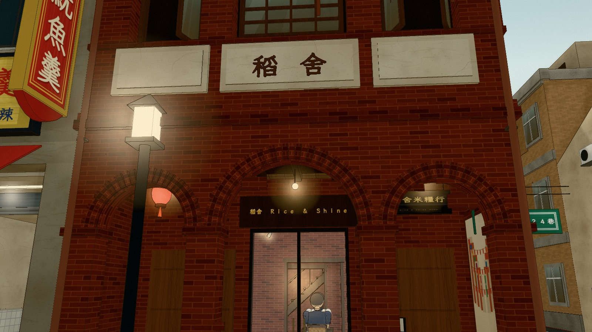 | 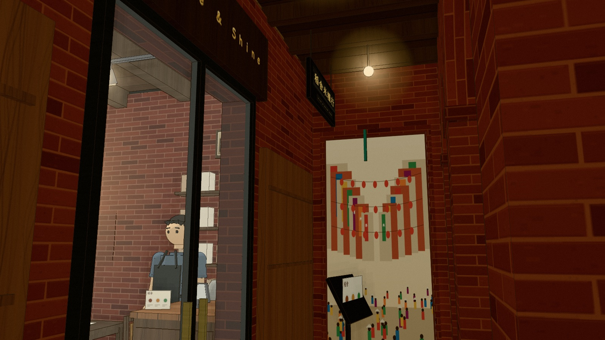 | 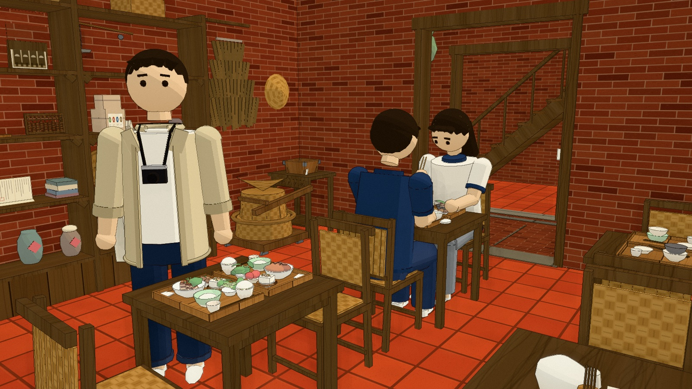 | 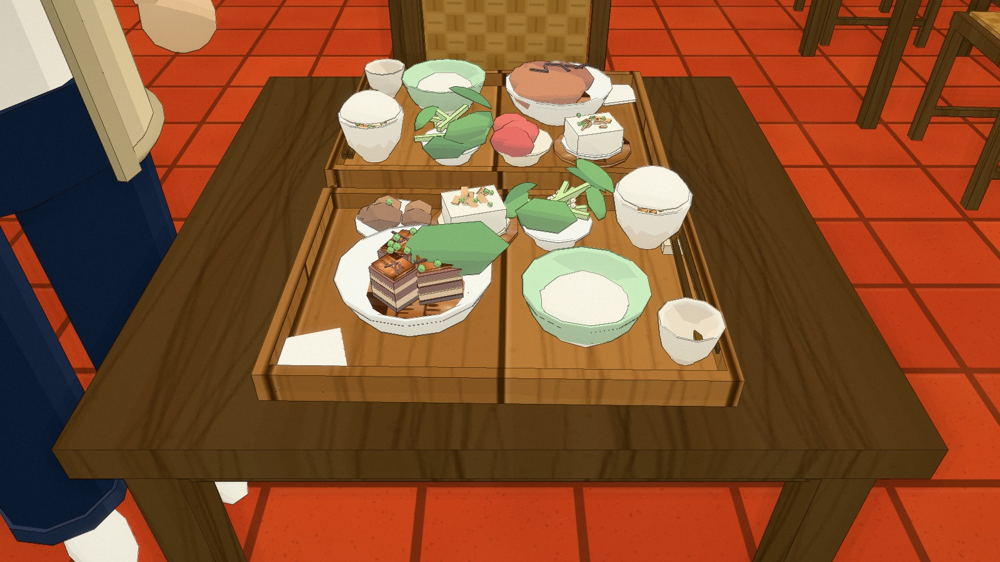 |
| **米業文化展示** | **天井** | **後段與木樓梯** | **二樓** |
| 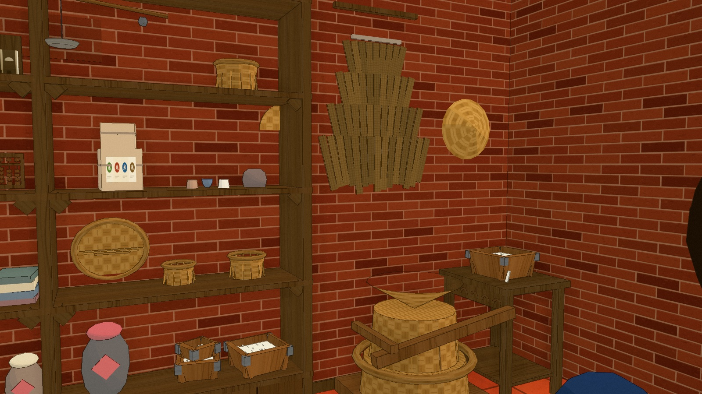 | 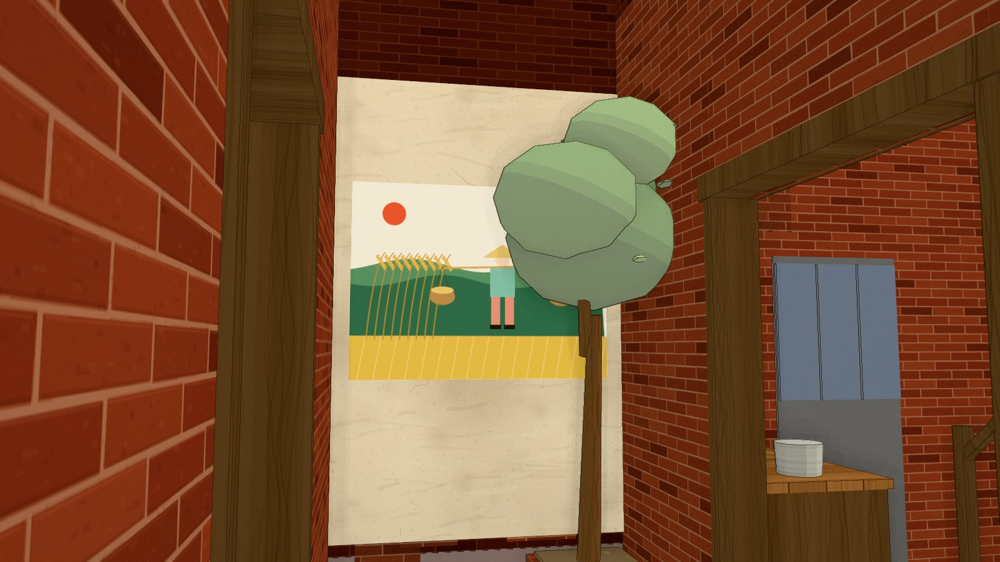 | 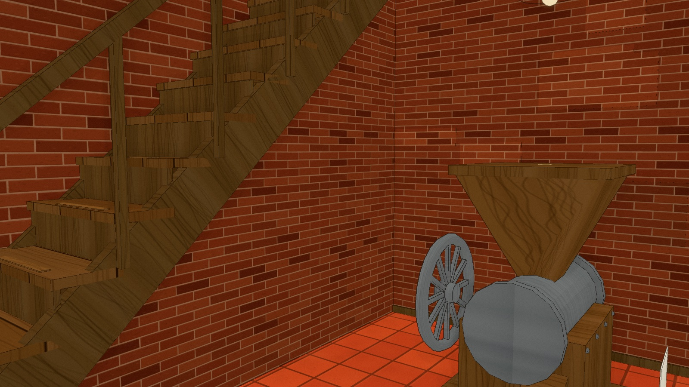 | 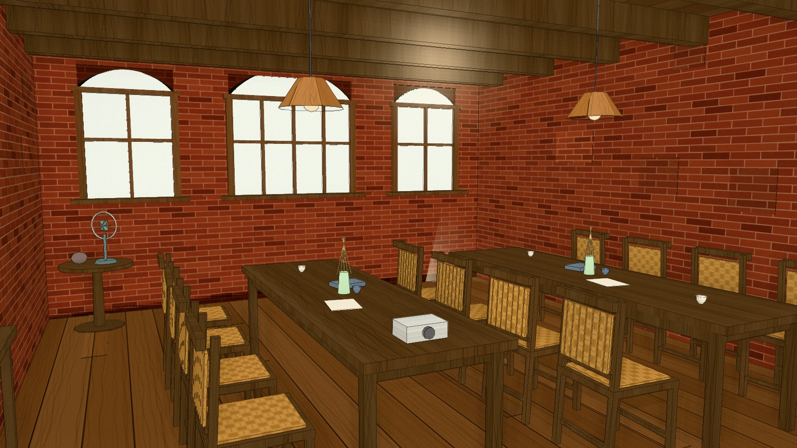 |
| **《南街殷賑》說明板** | **1895 街邊的米業** | **1930 立面** | **1930 碾米間** |
| 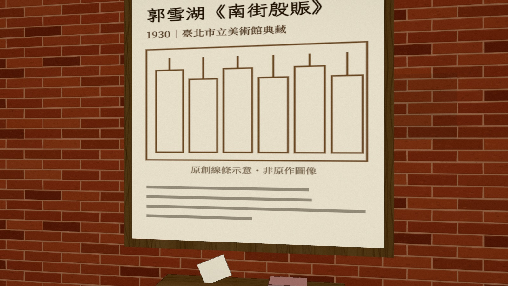 | 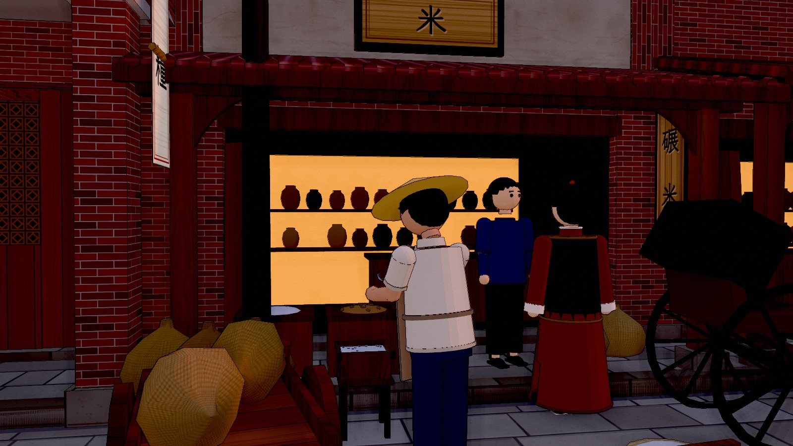 | 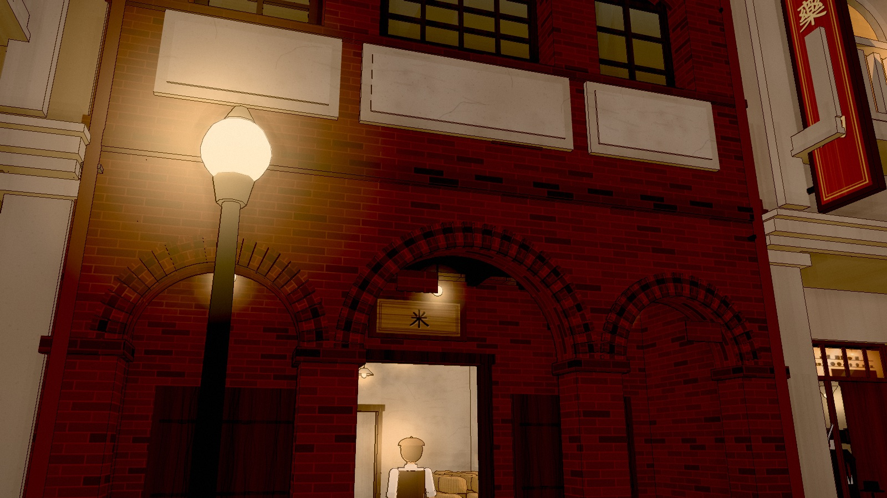 | 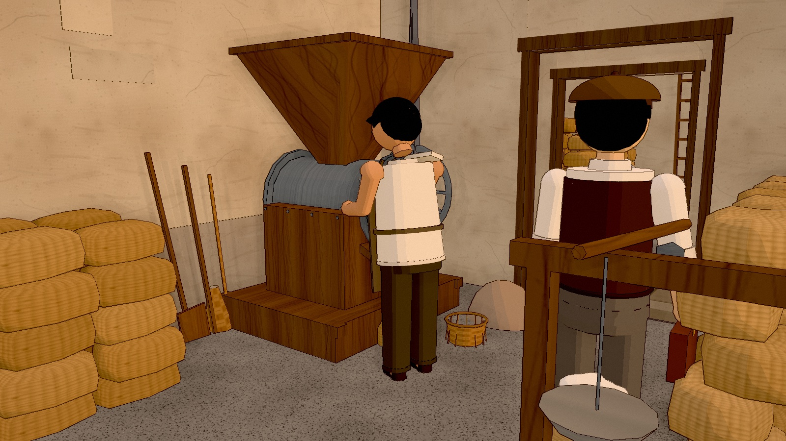 |
| **1930 米倉** | **1945 立面** | **1945 店內** | **碾米的步驟動畫／米斗模型** |
| 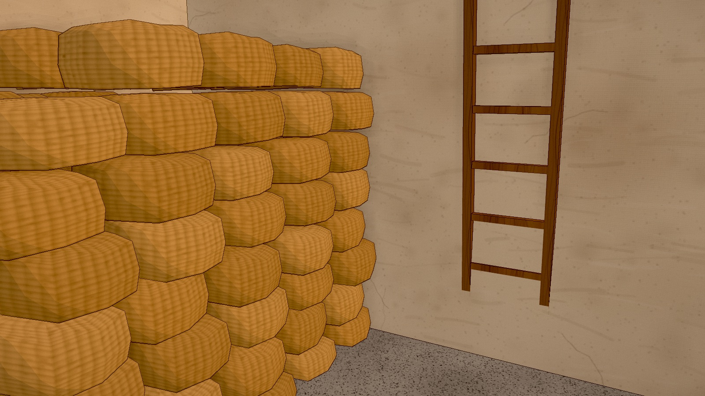 | 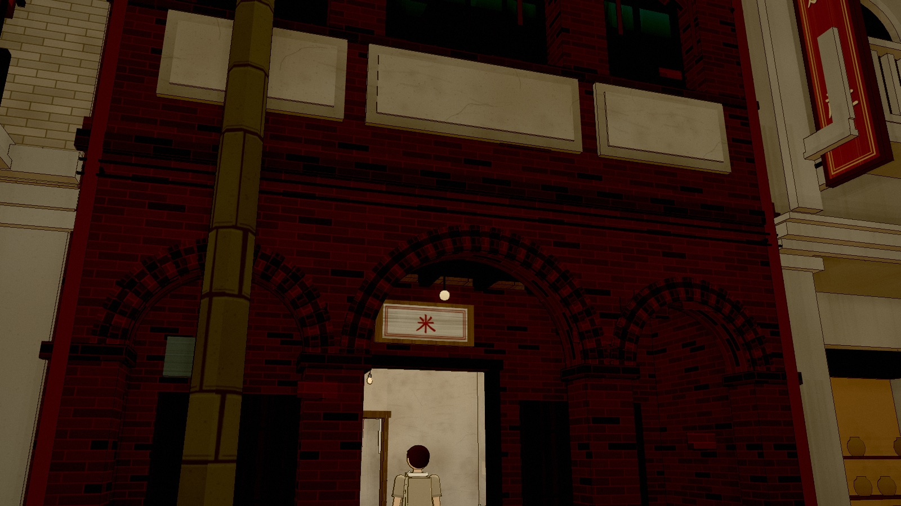 | 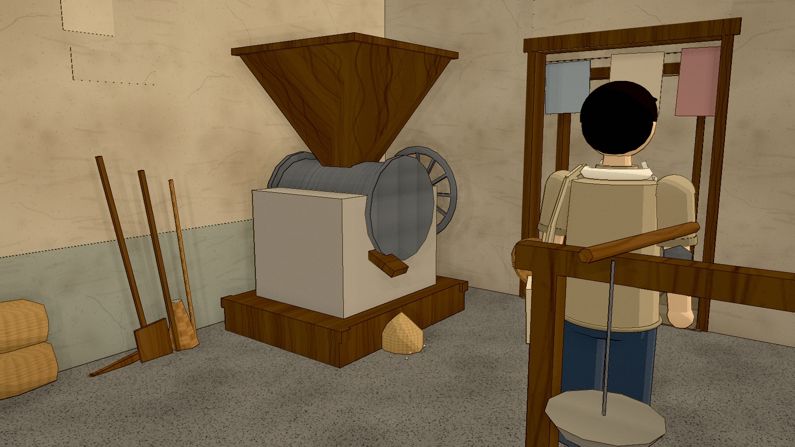 | 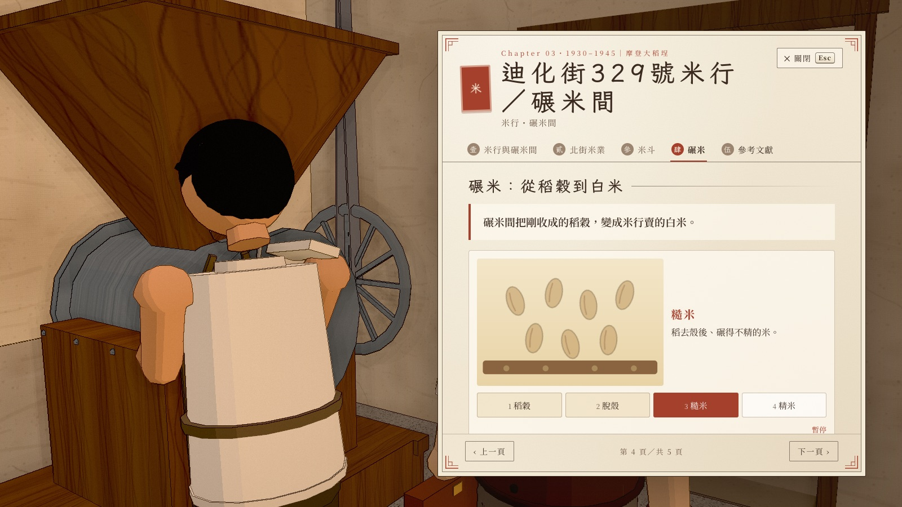 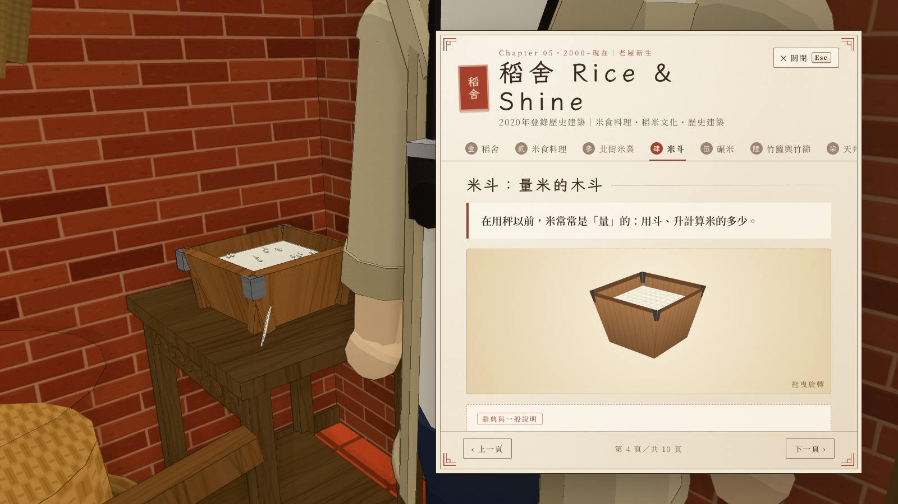 |

### 限制

- 尺寸依照片與一般大稻埕街屋的比例估算，不是測量；照片沒有拍到的部分（後段、二樓的配置、樓梯位置）是簡化的示意。
- 1895–1945 的立面、室內與人物是歷史情境示意，不代表 329 號在那些年代的實際樣子。
- 器物、套餐與壁畫是簡化的示意與原創圖樣，不是館藏、菜單或照片中作品的複製；《南街殷賑》只放說明與原創線條，不重製畫作。
- 主程式包增加約 126 kB（打包後約 2,065 kB），街景 worker 約 753 kB；稻舍的圖集只在第一次顯示時才繪製。2000 的室內約 10 萬個頂點（細部另外約 4 萬），與導演的豆花店（約 8.6 萬）相近。

## 新增：黃玉階文史館（歷史商號：元珍豆醬店）——2000–現在的文化據點

迪化街一段224巷、導演的豆花店北鄰的紅磚拱窗街屋。《人間福報》2026年的文章寫到，百年前的「元珍豆醬店」如今是「黃玉階文史館」。分類是 **文化據點（文化展示／歷史街屋）**，不是餐廳：沒有點餐、菜單或食物圖鑑。只出現在「老屋新生」，館內可以讀到清末與日治的歷史，但現代的展板與協會不會出現在其他年代，也沒有替其他年代另外做歷史版本。

- **單一配置**（`src/data/huangYujieLayout.js`）：位置、尺寸、入口、展間配置、動線（`MUSEUM_ROUTE`）、資訊熱點與鏡頭（`HUANG_YUJIE_HOTSPOTS`）都集中在這裡。場館 ID 是 `huang-yujie-museum`。
- **資料分開建檔**（`src/data/huangYujieMuseum.js`）：場館（`MUSEUM_RECORD`）、歷史商號（`HISTORIC_SHOP`）、人物（`PERSON`）與相關組織（`ORGANIZATIONS`）各自一筆。已查證史實（`VERIFIED_FACTS`）、使用者照片觀察（`PHOTO_OBSERVATIONS`）、情境設計（`SCENARIO_DESIGN`）與待核資料（`PENDING`）也分開存放。
- **與豆花店相鄰**：
  - 豆花店的巷子與店面尺寸移到 `src/data/actionBarLayout.js`，文史館依它的位置、朝向與面寬定位在北側：同一條立面線、同一個朝向，兩棟之間留 5 公分的縫。站在巷子裡正對立面時，左邊是文史館、右邊是豆花店。
  - 原本豆花店北側那棟示意的紅磚老屋（兩個拱窗、沒有招牌）移除，換成文史館。
  - 兩棟的騎樓由端牆上的拱門相連（照片：從文史館的騎樓看得到拱門另一側的豆花店）。豆花店北側的端牆分成兩段牆墩與半圓拱，文史館右側的牆墩在同一個位置開拱門（`SHOP.passage`）。
  - 兩棟各有自己的入口、碰撞、熱點與室內；室內沒有打通新的門，只從騎樓往返。
  - 為了讓騎樓走得通，豆花店騎樓裡的導演椅、小桌與盆栽移到騎樓外緣的路邊（照片1也是在路邊）。巷邊的兩台機車往巷子中間移了 40 公分，停在文史館的花槽前。
- **外觀**（`builders/huangYujieExterior.js`，依照片2的比例、照片1的相鄰關係建模，尺寸為估算）：
  - 二樓：二層紅磚街屋；三組拱形窗（中央較寬）與四道磚柱（三窗四柱），拱頂有深淺交錯、凸出牆面的放射狀磚紋，窗框是深色的，牆面有 30 公分的厚度。
  - 窗下的飾板帶：中央是黑底金字、由右往左讀的「元珍」匾額，左右是有淺色邊框的彩色陶飾板。陶飾板以簡化的浮雕保留照片的配置與色彩，左邊是花瓶與魚，右邊是花瓶與牡丹。
  - 頂部：水平簷口與女兒牆，加上深色的水痕、牆縫與屋頂邊緣的植物，兩側各有雨水管。
  - 一樓：兩根紅磚圓柱、灰色的柱頭與柱礎、灰色大梁，以及退縮的木造門面與敞開的大門。
  - 門前是木質花槽，右端留出走進騎樓的通道；另外也可以從豆花店的騎樓穿過拱門走進來。
  - 柱、拱窗、窗框、簷口都是 3D 幾何。照片上的鏡頭光斑、路人、車牌與現代雜物都沒有放進場景。
- **騎樓**：
  - 頂部露出深褐色的木梁與木板，色澤不均、局部泛白。
  - 門楣上方是木櫃式的構件，前面斜掛著綠色的「源珍」木匾（文字依照片核讀，由右往左），旁邊是暖色的鐵籠吊燈。
  - 灰色地坪；左邊木牆上掛著紅底的介紹板，右邊是粉色的直式布條「豆醬店」。
- **一樓展間**（`builders/huangYujieInterior.js`，按需載入）：可以坐下聽導覽的老屋文史空間，不是白盒子展館，也不是咖啡廳。
  - 天花：深色外露的圓木小梁、三道方形大梁與木板天花，有色差、泛白與剝落；其中一道大梁旁補上淺色的新木料，用螺栓固定鋼板。
  - 左牆：前段是黃玉階的人物展示（木板牆、肖像看板、醫療公衛與社會參與的說明板、一排裝框的文件），前面放 4 只大小不一、部分加蓋或布封的陶醬缸。後段是「日治初期大稻埕的初等教育發展」大型展板：標題、年代軸、五個欄位的段落與圖片框，底部是橘色的城市剪影。
  - 中央：兩張深色長木桌、長板凳與木椅，桌面有使用痕跡，放著竹編資料籃、書與紙卡。
  - 右牆：兩組高到天花的深色木製開放層架，每層下方有雕花托架、最下層是有門的木櫃。兩組、每一層的陳設都不一樣：牛皮紙包裝與紅紙封條、竹編與漆提籃、綁紅繩的小陶甕、鐵茶壺、不鏽鋼加木框的便當提盒、白瓷碗、茶葉罐、書、舊式電視、玻璃燈具、醬油瓶。
  - 右前方：醬缸與商號陳列區。深色木櫃台上有大陶缸（紅布封口、竹竿斜插、麻布封口），缸身貼著「醬」「醋」的紅色菱形紙；牆上的木架放著牛皮紙包裝，橫桿掛著秤、繩索與小布包；前面靠著大型竹篩，旁邊是階梯式的木收納架。
  - 後牆：「學貫中西」黑底金字匾額與木雕花邊、淺綠色的老窗框、人體解剖圖掛軸、紅色的「行善得福」，下面是鋪深藍桌布的小展桌（鐵壺、小茶壺、玻璃瓶、筆架、竹籃）與藤椅。
  - 左後方：舊式木櫃台與茶席（圓形竹托盤、黑色茶壺、杯底朝上的茶杯），牆上是舊照片，櫃台上有蒸籠與斗笠。
  - 天花下懸掛米白布面、紅色紋樣的大型布旗（花邊、團紋與雲紋），旗下掛著「源珍」小布旗。
  - 燈光：長桌上方的金屬吊燈、小展桌與茶席上方的白色玻璃燈罩，都是暖黃色。
  - 動線：入口 → 展示牆 → 中央長桌 → 右側高層木架 → 醬缸商號陳列 → 後方的小展桌與茶席 → 出口。中央通道（左牆與長桌之間）寬 1.3 公尺，至少兩個角色身寬。
- **展板**（`src/game/rendering/exhibitAtlas.js`、`exhibitTexture.js`）：只做版面示意，不逐字重建館方展板的原文，也不重製照片裡的肖像與文件；可以閱讀的文字在介紹視窗（HTML）裡。展板的圖集是 2048×1664，第一次有網格用到時才繪製，其他年代不佔記憶體。
- **互動**（沿用原本的 E 鍵／iPad 點擊與介紹視窗）：
  - 走近時出現提示的五個熱點：騎樓入口（場館與老屋）、人物展示牆（A）、文史展板（C）、醬缸商號陳列（B）、茶席（日常器物）。
  - 只能點選的物件：中央的「元珍」匾額、入口的醬缸、木梁、層架、「學貫中西」小展桌。
  - 觀賞模式點這些物件只會近距離聚焦，不開啟介紹。
- **介紹章節**（七章）：場館與老屋、A｜黃玉階與大稻埕、B｜元珍豆醬店與飲食生活、C｜社會改革與初等教育、日常器物與商號生活、D｜相關組織資料、參考文獻。
  - A–D 各有一段 80–120 字的摘要，標示「網站延伸整理」，不冒充館方展板的原文。
  - 照片觀察、情境設計與待核實的項目另外列出。
- **建築觀賞模式**：可以聚焦整個立面、二樓拱窗與陶飾帶、展間的木梁、展示牆、層架、醬缸、茶席與後牆；注視點可以從巷子移進騎樓、穿過拱門，再進到展間，不超過天花。
- **年代切換**：站在展間裡切換年代時，沿用既有的安全機制，把人物推到最近、合法的戶外位置；文史館的碰撞、熱點、招牌與展間都隨著街景一起清除。
- **其他小改動**：
  - 招牌可以前傾（`tilt`，用在斜掛的匾額）。
  - 介紹章節可以有「網站延伸整理」的摘要與分類清單。
  - 店家名錄會顯示「文化據點」標示。
  - 新增 `exhibit` 材質（展板圖集），以及五種招牌樣式：黑底金字匾額、綠色木匾、陶缸上的字、粉色布條、白色布旗。

### 資料來源與界線

- 來源（每一筆都記下 `title`、`publisher`、`url`、`sourceDate`、`accessedAt`、`supports`）：
  - 司法院網站刊登的臺灣桃園地方法院設立登記公告（2024-05-16）：協會的名稱、許可與登記日期、宗旨。
  - 國家文化記憶庫〈黃玉階〉（國家中醫藥研究所建檔）。
  - 國家圖書館「臺灣記憶」〈黃玉階〉（《臺灣歷史人物小傳》）：頁面標示「不開放授權」，本站只摘要事實。
  - 中研院臺史所檔案館〈初等教育〉。
  - 莊曉明〈黃玉階文史館〉，《人間福報》2026-07-13。
- **協會與場館分開**：社團法人臺灣文化事業發展協會只放在「相關組織資料」一章。五個來源都沒有說明協會與文史館的營運、主辦或所有權關係，所以標為待核實；場景裡沒有協會的招牌，其他章節也不提協會。
- **來源有出入時並列**：首張醫生執照的年份，臺灣記憶寫1897年、國家文化記憶庫寫1901年，兩種都列出。「元珍／源珍」兩個名稱照原樣保留：文章寫耆老口述稱「源珍」、帳冊寫「元珍」。
- **未核實、留空**：
  - 老屋的興建年、文史館的開館日、詳細門牌、開放時間與營運單位。本站不以黃玉階的遷居年份（1882）或協會的登記日代替。
  - 只見於一篇文章的說法（例如請願設立女子分校）與館內展板上的校名、年份，列為待核實。
  - 也不因為館內有教育展，就說這棟建築以前是學校。
- **醫療記載**：寫成歷史資料，註明不代表任何療法在今天的效果，也不提供藥方或配方。
- **至善堂**：豆花店的介紹提到空間提供者是財團法人台北市至善堂，臺灣記憶記載黃玉階創建「至善堂」會所；兩者是否為同一組織的延續，本站未核實，列在待核實清單。

### 截圖（實際渲染，`docs/huang-yujie/`）

| 相鄰街景 | 文史館正面 | 騎樓木梁（往豆花店的拱門） | 入口看向展間 |
| --- | --- | --- | --- |
| 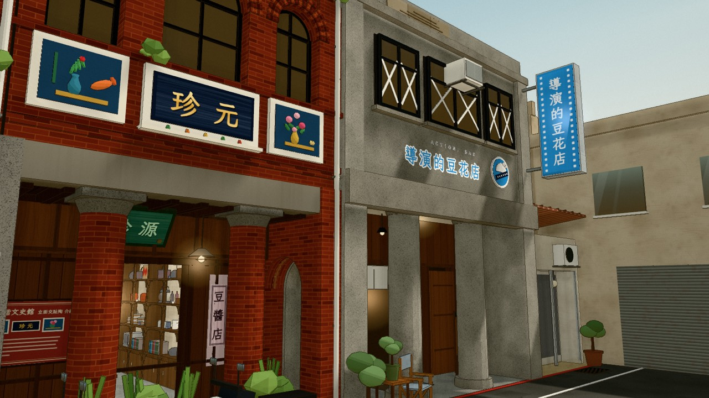 | 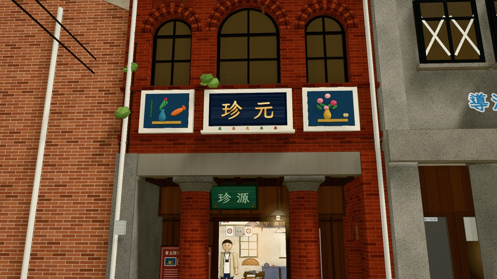 | 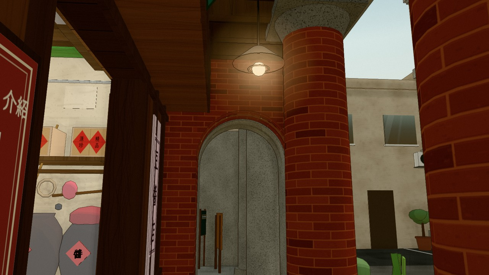 | 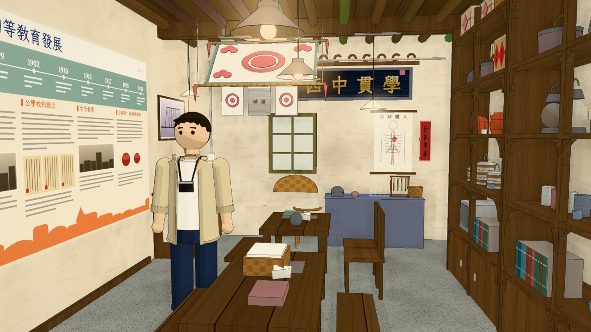 |
| **展示牆與長桌** | **木架陳列** | **醬缸展示區** | **茶席與後牆** |
| 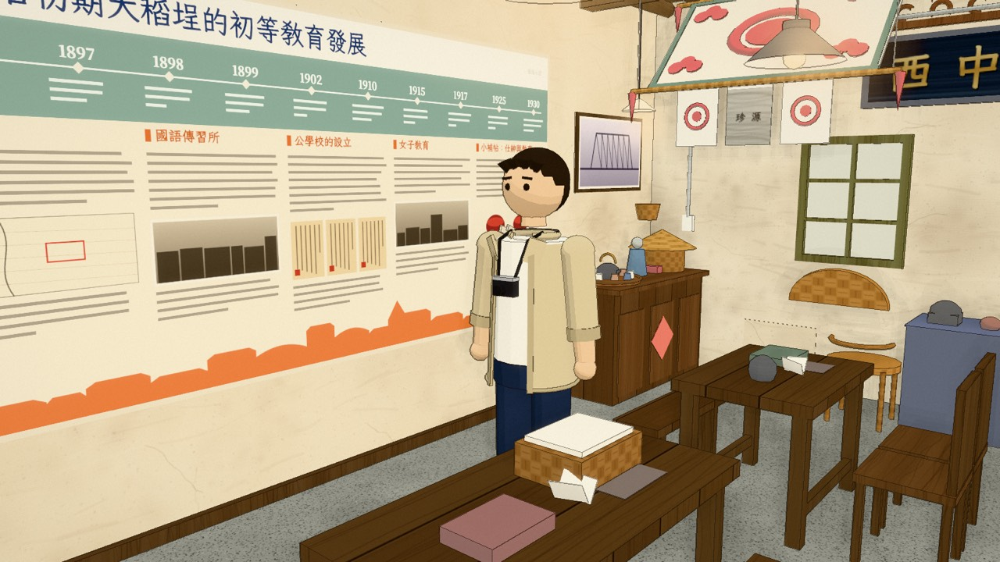 | 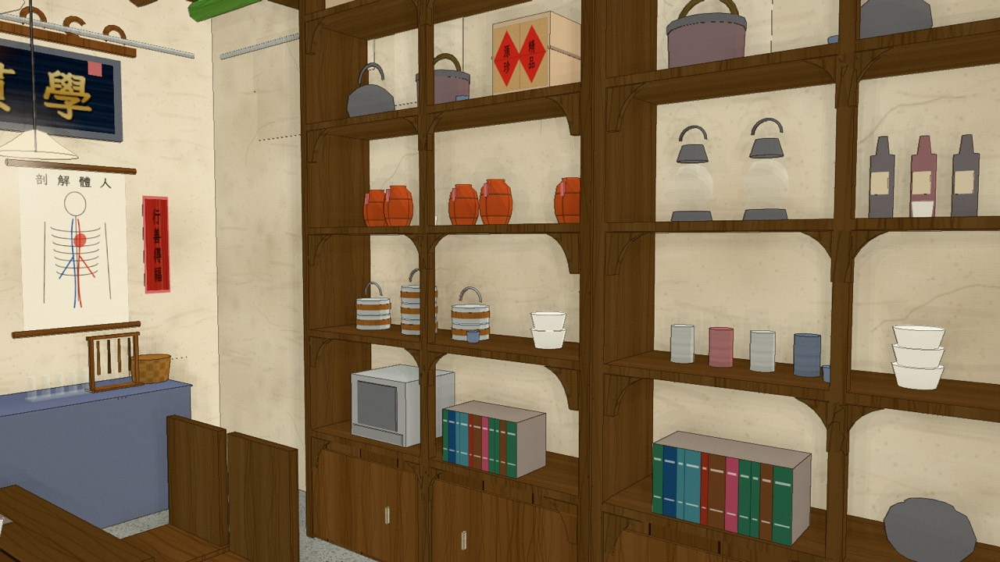 | 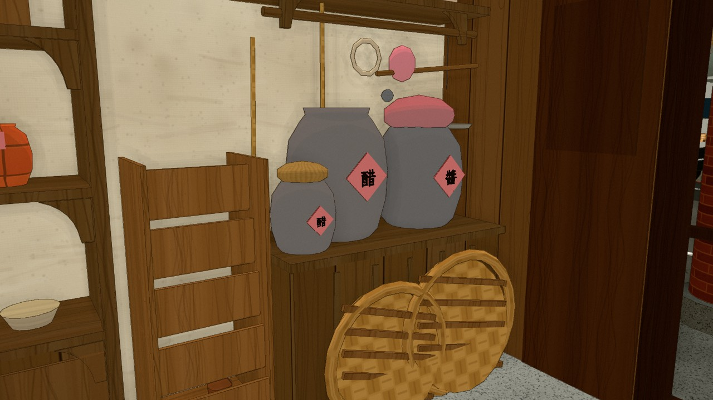 | 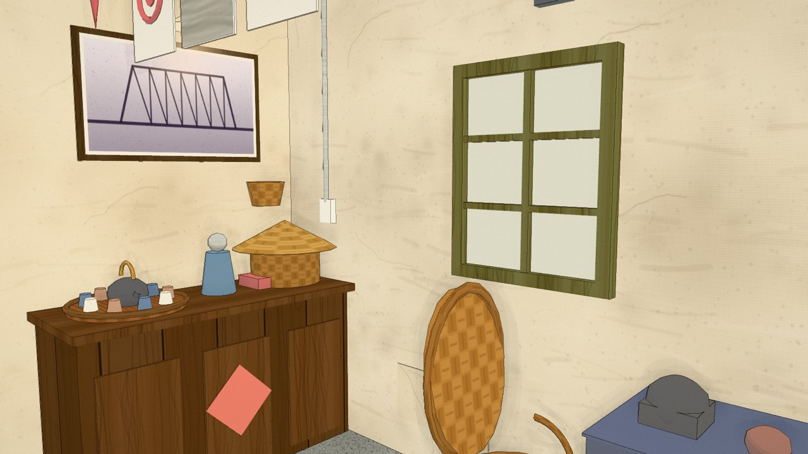 |

### 限制

- 尺寸依照片估算；照片沒有拍到的展間深處是簡化配置；二樓沒有室內。
- 陶飾板是簡化浮雕，展板與肖像看板只做版面示意，器物不是館藏的複製。
- 主程式包原本就超過專案設定的 1800 kB 警告值（main 分支 1,863 kB），這次增加約 76 kB（gzip 約 28 kB）；街景 worker 增加約 60 kB。展板圖集只在顯示文史館時才繪製。

## 新增：廟口的傳統豆花攤與傳統糕粿攤（1945–1980「庶民生活」）

慈聖宮的廟口小吃區在 1945–1980 有四攤可以辨識的攤位：前緣的 **米苔目攤**（東）與 **魷魚羹攤**（西），以及廟埕後段、天公爐兩側新增的 **傳統豆花攤**（西）與 **傳統糕粿攤**（東）。兩攤都是 **飲食文化情境示意**：沒有店名、商標與店史，不寫成慈聖宮當時已有這兩攤（本站沒有找到這樣的史料），展示在這個年代也不代表豆花或這些米食起源於1945年。

- **與現代店家只以食物主題連結**：兩攤以店家資料的 `theme`（飲食主題）連結 2000–現在的導演的豆花店與永樂市場的好粿緣，介紹裡列為「現代相關店家」，並註明是同類食物的參訪對照、沒有品牌傳承關係；戰後的版本不使用兩家現代店家的店名、商標、招牌、包裝或裝潢。導演的豆花店（224巷的店面、豆花車與電影文化內容）與好粿緣（綠色招牌與食品展示）的位置、外觀與功能都不變，也沒有移到廟口或重複建立；老屋新生的街景與修改前逐位元組相同。
- **單一配置**（`src/data/templeSnackLayout.js`）：兩攤的位置與朝向、推車／矮桌與器具的配置、碰撞、榕樹下讓出的空間、攤販與資訊熱點，以及廟埕的中央主通道（`TEMPLE_CENTRAL_PATH`）與用餐區（`TEMPLE_DINING`）都只寫一次。
- **共用的食品與器具**（`builders/templeSweetsWares.js`）：碗沿用魷魚羹、米苔目攤的有厚度的碗；豆花、花生、有厚度的瓷湯匙、豆花桶、扁平舀匙、糖水壺、配料小盆、四種米食、竹蒸籠、墊葉、分區木托盤、木板、食品夾、布巾、籃筐與糕模由兩攤共用。現代店家的模型沒有改動。

### 傳統豆花攤（`builders/templeDouhuaStall.js`）

- 木框推車式的甜食攤，與魷魚羹、米苔目的大鍋熱食攤明顯不同：一端兩個木輪（輪輻與輪軸）、另一端是腳架與兩支推把；推車背面兩根木柱撐起小小的米白布棚，棚角斜掛只寫「豆花」的米白布幌（從通道與迪化街都看得到）。
- 推車上：有蓋的圓形木豆花桶（桶蓋挪開一點，露出平整的米白色豆花）、扁平的舀匙、糖水壺、一小盆花生、泡著湯匙的水盆、藍邊白瓷的疊碗，以及展示的 **原味糖水豆花** 與 **花生豆花** 兩碗。推車前兩張木凳（靠近用餐區），推車後是攤販舀豆花的空間（不開放）。
- 豆花是米白色、薄而不規則的柔軟片狀（不是方形豆腐或圓球）；糖水是淡琥珀色、半透明；碗口與湯匙都有厚度；花生是小小的橢圓顆粒。
- 沒有現代的豆花車、電影場記板、品牌包裝、彩色粉圓或電子菜單；沒有付款、點餐或製作遊戲。

### 傳統糕粿攤（`builders/templeKuehStall.js`）

- 低矮的木桌式攤位（不是推車，也沒有布棚）：兩組 A 字形木架腳撐起的矮木桌，桌後兩根木柱撐著木製橫牌「傳統糕粿」。
- 桌上：一疊竹蒸籠（少量蒸氣）、分區的木托盤（草仔粿、紅龜粿，墊著葉子，後排用乾淨的布巾蓋著）、木板上的芋粿與蘿蔔糕、食品夾；桌後是攤販，以及少量備用的籃筐與糕模，呈現整理、販售中的樣子。
- 四種米食分盤陳列，形狀、顏色與厚度都不同：**草仔粿**（深綠、扁圓、表面略有起伏）、**紅龜粿**（紅色扁橢圓、簡化的龜甲壓紋：中央六角形與外圈的龜殼紋）、**芋粿**（灰白色厚片、少量紫灰色的芋頭顆粒）、**蘿蔔糕**（米白色長方塊，整塊與切片）。草仔粿與紅龜粿是主要的展示，芋粿與蘿蔔糕是傳統米食的示意，不是好粿緣的菜單。
- 不使用好粿緣的鮮綠色招牌、現代包裝或未查證的售價。

### 廟口配置與互動

- **位置**：兩攤取代這個年代原本在榕樹後方的兩個一般小吃攤（亂數的使用順序不變），不覆蓋米苔目攤與魷魚羹攤；位置在榕樹的樹幹與天公爐之間、朝向中央通道，從廟埕前緣看得到（不被樹幹與石座擋住）。兩側的榕樹讓出布棚與橫牌的空間（榕樹的空地可以是多個範圍）。攤位前是「貼近障礙物」的跟隨範圍，鏡頭不會退進榕樹的樹冠。
- **動線**：中央主通道從迪化街側的廟埕前緣直到天公爐前，寬度容得下兩個角色並行，天公爐兩側再繞到廟前的石階；廟門前的視線不被攤位擋住。
- **用餐區**：廟埕原本的兩組共用桌椅在這個年代集中到中央通道西側、榕樹前（旁邊是原本的板凳），桌椅與天公爐之間留出走到豆花攤的路，各攤的桌椅不互相堵住；老屋新生的共用桌椅不變。
- **人物**：兩攤各一位攤販（沒有名字的情境人物，豆花攤的攤販舀豆花、糕粿攤的攤販招呼客人），站著的攤販有碰撞；沒有加入其他人物或叫賣聲。
- **互動**：電腦靠近按 E、iPad 點提示或點攤位，開啟「豆花與甜食攤」或「糕粿與日常／節慶米食」；點推車上的兩碗開啟「兩碗豆花」，點托盤開啟「四種傳統米食」。章節分開標示 **說明**（沒有找到這兩攤的史料）、**史料**（教育部辭典、農業部、國立臺灣歷史博物館）、**情境設計** 與 **現代相關店家**。建築觀賞模式可以聚焦兩攤，點兩碗豆花或托盤近距離聚焦食物（不開啟介紹）。
- **畫質**：流暢與精緻模式都保留每一種食物；精緻模式只多了額外的份數（後排的草仔粿與紅龜粿、第三片芋粿）、更多花生粒與芋頭顆粒、蘿蔔絲紋路、蒸籠的竹條、葉脈與桌下的木箱。
- **年代切換**：兩攤、攤販、熱點與碰撞都隨著戰後的街景一起清除；在攤位前切換年代時，人物推到合法的位置。

### 資料來源

- 豆花：教育部《臺灣台語常用詞辭典》「豆花」（豆漿加鹽滷或石膏凝結，通常加糖水和花生當甜食）；農業部〈豆花凝膠機制的介紹〉（2023年4月15日）。
- 糕粿：教育部辭典「粿」「草仔粿」「紅龜粿」「芋粿」（新增）「菜頭粿」；農業部〈「粿」然如此製粿稻米品種介紹〉（2023年5月29日）、〈美味與傳統完美結合的草仔粿〉（2023年4月4日）、〈年糕＆蘿蔔糕〉（2019年3月8日）；國立臺灣歷史博物館〈紅龜粿印模轉印紙張〉。
- 廟口：教育部辭典「廟口」「點心擔」；維基百科〈大稻埕慈聖宮〉。
- 每一筆都標示出版時間與用途（這次為既有的豆花與粿食文獻補上，導演的豆花店與好粿緣的資料來源也會顯示這兩項）。

## 新增：米苔目的兩個年代版本（1945–1980 廟口的米苔目攤、2000–現在 永樂米苔目）

同一個飲食主題「米苔目飲食文化」分成兩個年代、兩種形式：**1945–1980 是廟口小吃群裡的一攤米苔目**（飲食文化情境示意），**2000–現在是永樂米苔目這家現代店面**（依使用者提供的實地照片建模）。兩者只以飲食主題串連：廟口的攤位不是永樂米苔目的前身，場景與介紹也不寫成永樂米苔目當時已經存在或在廟口擺攤；兩個版本在不同的位置（慈聖宮廟埕／迪化街北側），各自只在自己的年代產生，其他三個年代兩個都沒有。

- **單一配置**（`src/data/miTaiMuLayout.js`）：主題（`MI_TAI_MU_THEME`）、廟口攤位的位置、攤台、帆布棚、桌椅與榕樹下留出的空間（`MI_TAI_MU_STALL`）、永樂米苔目的地段、騎樓、外帶區、機車、座位、菜單板與後方的櫃台（`YONGLE_MTM`）、兩個版本的人物（`MI_TAI_MU_STALL_NPCS`、`YONGLE_MTM_NPCS`），以及資訊熱點、提示框與介紹鏡頭都只寫一次；店家資料、建築、室內、碰撞與鏡頭都從這裡換算。
- **共用的食品與餐具**（`builders/miTaiMuWares.js`，碗盤沿用魷魚羹的有厚度的碗盤）：湯米苔目（短而粗、兩端略尖的米條浮在大骨湯上，撒上韭菜段與油蔥酥）、嘴邊肉、油豆腐、菜頭、燙青菜、醬油膏與辣椒的小醬碟、筷子，以及攤台上一盆生的米苔目。
- **情境人物（NPC）**（`character/npcBuilder.js`、`components/NpcLayer.jsx`）：沿用主角的身形比例與同一張臉、同樣的頭髮做法，另外加上手肘與膝蓋，能坐在凳子上夾菜、在攤台後招手、舀湯、低頭看手機或站著排隊；衣服與配色依年代與角色不同（攤販的背心與圍裙、客人的襯衫、T 恤、背包、漁夫帽，店員的圍裙、帽子與口罩）。每個人物合併成三個網格（身體、頭、右前臂；頂點色、共用一種卡通材質，自發光與主角的服裝相同），不會走動，只有右前臂與頭的待機動作；流暢模式的動作幅度較小、每兩個影格更新一次，離鏡頭 30 m 以外不繪製。站著的人物有碰撞，坐著的客人在桌椅的碰撞範圍裡；人物都是沒有名字、沒有身分的情境人物，不對應照片裡的任何人。

### 1945–1980「庶民生活」：慈聖宮廟口的米苔目攤（飲食文化情境示意）

- 在慈聖宮廟埕東側的前緣、廟口小吃群裡：取代這個年代原本在那裡的一般小吃攤（亂數的使用順序不變，其他小吃攤、共用桌椅與西側的魷魚羹攤不變），攤台朝向迪化街；廟門與中央通道都不佔用，路燈在攤位的左前方、兩張小桌在它的兩側。`builders/templeMiTaiMuStall.js`。
- 淡綠色油漆、磨舊的木攤台與鍍鋅鐵皮的工作面，淡藍色的帆布棚（白色寬條紋的垂邊），煤球爐上的大湯鍋（掀開一半的木鍋蓋、長柄湯勺、少量蒸氣）、一盆生的米苔目、藍邊白瓷的疊碗、展示的一碗湯米苔目與兩碟小菜（油豆腐、燙青菜）、醬油膏的玻璃瓶與筷筒，以及兩張小方桌與木凳；桌上有客人的碗與小菜。招牌只寫「米苔目」，不套用現代永樂米苔目的紅色大招牌；沒有室內。
- 人物：攤台後招手招呼客人的攤販（背心、圍裙、肩上的毛巾）、兩張小桌各一位坐著吃米苔目的客人、一位站在攤台旁等的客人。
- 東側的榕樹在這個年代讓出攤位的空間（與魷魚羹攤的西側榕樹相同的做法）；原本在攤位位置的板凳移到榕樹靠矮牆的那一側。
- 攤位前的提示「廟口的米苔目」：按 E／點提示開啟「廟口的米苔目」，開頭是「米苔目是台灣常見的庶民小吃，在戰後至1980年代的大稻埕，也屬於廟口與街邊常見的日常飲食之一。」；接著分開標示 **說明**（本站沒有找到記錄戰後大稻埕廟口米苔目攤的文獻或照片）、**史料**（教育部辭典的「米篩目」、廟口、點心擔；維基百科〈大稻埕慈聖宮〉）與 **情境設計**（攤位與人物的樣子）。點攤台上的那一碗開啟「一碗米苔目」（兩張圖鑑：湯米苔目、小菜（示意））。帆布棚的遮擋方塊只包住棚頂與招牌，從高處往下看也點得到那一碗。

### 2000–現在「老屋新生」：永樂米苔目

- **位置**：取代迪化街北側的一般地段 `north-6`（出發點斜對面、往永樂市場的方向）。實際的店在臺北市大同區民樂街111號（2021、2025年的媒體整理；2013年的報導寫的是舊址永昌街7號）；場景的街道是敘事式配置，只保留「永樂市場／迪化街商圈」的關係，不是精確的地籍位置，也不與慈聖宮廟埕相鄰。地段其餘的 1.8 m 是一棟窄小的鄰屋（藍色鐵捲門）。
- **店面**（`builders/yongleMiTaiMuExterior.js`，依使用者提供的實地照片建模，尺寸為估算）：狹長、垂直感明顯的街屋，二樓以上是白色小方磚外牆（新的 `mosaicTile` 材質）；二樓木框的三扇窗與窗下的兩盞黑色圓燈，三、四樓是貼磁磚的陽台矮牆與退縮的窗，頂樓是綠色玻璃的加蓋。紅色橫式主招牌有一條一條直向的凸條，金色立體字「永樂米苔目」，右側直寫的小字「50年老店」；左右兩側各一面紅色直立招牌（右側寫「永樂米苔目」、左側的燈箱寫「米苔目」）。一樓入口內縮成騎樓：右邊是開放的入口，左邊是外帶區的木作櫃檯（湯鍋、疊碗、紅色的「外帶區」牌子）與不鏽鋼大排煙罩、兩台箱型排風扇，排煙管沿著騎樓天花接到右邊柱子旁的鼓風機；騎樓吊著兩盞藤編吊燈，左半邊停著兩台機車、放著兩個有輪子的鋁櫃；右邊的柱子貼著木板，左邊的柱子前是只有菜色圓形圖的海報板。
- **可以走進去的一樓**（`builders/yongleMiTaiMuInterior.js`，按需載入）：街道 → 騎樓 → 入口 → 店內的用餐空間 → 走道與後方，全程步行。狹長的用餐區：淺色亮面的大地磚（新的 `glossTile` 材質）、白色天花與一排一排的圓形嵌燈、木格柵的出風口與監視器圓罩、牆上的壁扇；右牆是大菜單板（直寫的店名、菜色的圓形圖，不寫品名與價格）、紅色的桌號牌與兩張只有線條的小告示，下半部是淺色木作護牆；中間與靠右牆兩排淺色木紋桌面、黑色桌腳的方桌，配黑色的圓凳；左邊沿牆是調味料與筷筒的長櫃、木作櫃門、送餐的小推車與藍色垃圾桶，左側的走道 1.4 m；後方是木作櫃台與備餐區（湯鍋、疊碗）、藍色的牆面與紅框的掛畫（不畫人物）、玻璃展示櫃、白色的冷藏櫃、毛玻璃方格的高窗與茅草裝飾邊。
- **人物**：四位坐著吃米苔目的客人、店門口右側排隊的兩個人（一人低頭看手機）、在騎樓點外帶的客人、外帶區舀湯的店員（圍裙、帽子、口罩）與後方櫃台的店員。店裡的人物放在那間店的室內群組裡，室內產生、顯示時才出現；騎樓的客人在街景裡。
- **一碗米苔目**：走道邊第一張桌子上的湯米苔目（深色碗）與三碟小菜（嘴邊肉、油豆腐、菜頭）、醬碟、筷子與湯匙。品項依2013、2021、2025年的媒體整理核對；是展示用的示意，不代表完整或即時的菜單，也不寫配方、份量與價格。
- **互動**：三個資訊熱點——騎樓下的店門口（「店家與店面」，開頭是「到了現代，大稻埕的傳統庶民飲食不只留在記憶裡，也以具體店家的形式延續下來。永樂米苔目就是其中一種代表性的小吃場景。」）、走進店門後（「店內的用餐空間」）、走道邊第一張桌子（「一碗米苔目」）；電腦按 E、iPad 點提示或點那個物件（主招牌、菜單板、桌上的米苔目）開啟對應章節。四個章節：店家與店面／店內的用餐空間／一碗米苔目／資料來源。
- **建築觀賞模式**：可以聚焦立面、招牌、菜單板與桌上的米苔目（點它們近距離聚焦，不開啟介紹）；注視點可以從街上移進騎樓與店裡，不超過天花板。
- **年代切換**：站在店裡切換到其他年代時，人物沿用既有的安全機制推到最近、合法的戶外位置；店屋、招牌、人物、熱點與碰撞都隨著街景一起清除。
- **資料**：`id: yong-le-mi-tai-mu`、地址臺北市大同區民樂街111號、類型「傳統小吃・米苔目」、只在 revival；**創立年份未核實，留空**。招牌上的「50年老店」只當作招牌上的文字；媒體的說法（2013年「40年老店」、2025年「從民國五十六年創立至今，已傳承三代」）寫在介紹裡並標明未核實，也沒有因為這些說法就把店放進1945–1980。

### 資料來源與界線

- 每一筆新的文獻都標示 **出版時間** 與 **用途**：教育部《臺灣台語常用詞辭典》「目」的用例「米篩目」（米苔目的寫法與詞義）；食尚玩家2013年的兩篇報導、Bella儂儂2021年與2025年的整理只支持當次的記錄，不當成最新的價格、營業時間或店史。
- 不寫營業時間、價格、配方與份量；菜單板只畫菜色的圓形圖。照片裡的路人、隔壁店家的招牌與廣告都沒有放進場景，照片本身也沒有放進專案。
- 專案沒有環境音系統，所以沒有加入餐具聲或交談聲。

## 新增：魷魚羹的兩個年代版本（1945–1980 廟口的魷魚羹攤、2000–現在 老潘魷魚羹）

同一個飲食主題「魷魚羹飲食文化」分成兩個年代的版本。兩者只以飲食主題串連：**廟口的攤位不是老潘的前身，老潘也不是從廟口遷出**，場景與介紹都不表示兩者有傳承關係；兩個版本在不同的位置，各自只在自己的年代產生，其他三個年代兩個都沒有。

- **單一配置**（`src/data/squidSoupLayout.js`）：主題（`SQUID_SOUP_THEME`）、廟口攤位的位置、攤台、帆布棚、桌椅與榕樹下留出的空間（`TEMPLE_STALL`）、老潘的地段、騎樓、入口、攤車、座位、貓、冰箱（`LAO_PAN`），以及兩個版本的資訊熱點、觸發距離、提示框與介紹鏡頭都只寫一次；店家資料、建築、室內、碰撞與鏡頭都從這裡換算。店家資料以 `theme` 串連兩個版本（`getTheme`、`getThemeVersions`），店家名錄標示「飲食主題：魷魚羹飲食文化」。
- **共用的餐碗、食品與器具**（`builders/squidSoupWares.js`）：有厚度的碗（外壁、碗口、內壁與內底做成旋轉體，從上面看得到碗的厚度）、淺盤、瓷湯匙、筷筒與調味料、不鏽鋼大湯鍋（掀開一半的鍋蓋）、長柄湯勺、疊碗、配料盤，以及四種食品。食材依形狀分別建模（捲起的魷魚片與刻花的扁片、裹魚漿的魷魚塊、葉菜、不規則的魚酥片、竹輪狀的管、扁片、圓片、三角、蘿蔔塊、豆芽），不是同樣的圓球。

### 1945–1980「庶民生活」：慈聖宮廟口的魷魚羹攤（飲食文化情境示意）

- 在慈聖宮廟埕西側的前緣、廟埕原本的共用桌椅與小吃攤旁邊，攤台朝向迪化街；廟門與廟前的中央通道都不佔用（東側的前緣有電線桿擋在前面，所以放在西側）。`builders/templeSquidStall.js`。
- 木框攤台與鍍鋅鐵皮的工作面、四根竹竿撐起的簡單帆布棚、湯鍋下的煤球爐、大湯鍋與長柄湯勺、藍邊白瓷的疊碗、配料盤（魷魚片、魚漿塊、葉菜）、攤台上展示的一碗魷魚羹，以及兩張小方桌與木凳；鍋口只有少量蒸氣。招牌只寫「魷魚羹」，沒有店名、商標或現代店面的照片；沒有室內。
- 西側的榕樹在這個年代讓出攤位的空間：垂到攤位裡的氣根不產生、低垂的樹冠抬高到帆布棚上方（亂數的使用順序不變，其他年代的榕樹與修改前相同）。
- 攤位前的提示「廟口的魷魚羹攤」：按 E／點提示開啟「魷魚羹與廟口飲食」，點攤台上的那一碗開啟「一碗魷魚羹」（兩張圖鑑：魷魚羹、乾魷魚）。介紹分開標示 **史料**（教育部辭典的鰇魚羹、羹、廟口、點心擔；維基百科〈大稻埕慈聖宮〉）、**專欄的說法**（《鏡週刊》裴偉專欄認為魷魚羹在1970年代於萬華、大稻埕一帶興起，標明不是學術考證）與 **情境設計**（攤位的樣子與位置）。

### 2000–現在「老屋新生」：老潘魷魚羹（迪化街一段30號）

- **位置**：取代迪化街南側街尾、永樂市場前廣場旁的一般地段（`south-18`），隔著街道與廣場面對永樂市場；街道是敘事式的配置，只保留「市場外、街道對面」的相對關係，不是精確的地籍位置。不覆蓋小藝埕、稻舍、永樂市場或其他店家。
- **店面**（`builders/laoPanExterior.js`，依需求說明中對店面照片的文字描述重建（開發時沒有直接取得照片），尺寸為估算）：褪色的黃色長方形主招牌（立體鐵框，紅色的「老潘魷魚羹」、深藍色的品名「魷魚羹・魚酥羹・甜不辣」）、右側紅底與金色裝飾框的直立招牌（垂直於立面，兩面都有店名）、紅色帆布雨棚（三支鐵架、波浪形的下緣、垂邊上的「冷氣開放」）；老街屋的二樓灰色水泥牆與鐵窗、三樓紅磚與白色窗框、女兒牆與屋頂的水塔，少量外露的排水管、冷氣管線與冷氣室外機。開放式的一樓門面與拉到頂的鐵捲門；騎樓下的不鏽鋼攤車有玻璃展示罩（配料）、疊碗、兩口湯鍋與吊掛的長柄湯勺（食記寫到「攤車在外頭」）。雨棚、招牌、柱子與攤車都有立體厚度；褪色與使用的痕跡用低對比的頂點色，照片上的舊價格沒有放進場景。
- **可以走進去的一樓**（`builders/laoPanInterior.js`，按需載入）：街道／市場前廣場 → 攤車旁的入口 → 一樓座位 → 原路返回，全程步行，沒有傳送按鈕或室內照片。狹長的用餐區：米色方形地磚（新的 `creamTile` 材質）、下半部白色磁磚的牆、三組靠牆的長方桌與紅色、深綠色的塑膠凳，中央的走道約 2 m（兩個角色身寬以上）；桌上有醋、胡椒、辣椒醬、筷筒與菜單卡（只有格線，沒有品名與價格），牆上的品名板只寫品名。攤車後方是瀝水區與碗盤架（工作區不開放），後牆旁有飲料冰箱與通往後場的布簾門（後場、樓上不開放）。前方是騎樓的自然光，店內是中性偏暖的日光燈；玻璃與不鏽鋼只用簡化的反光。照片標示「內湖店」的室內沒有用來重建這裡的平面，未拍到的部分是示意。
- **四道展示餐點**（`builders/laoPanFoodDisplay.js`）：入口旁第一張桌子上的沙茶魷魚羹（褐色羹湯、魷魚片、少量葉菜、紅褐色的沙茶油光）、魚酥羹（金黃魚酥片一部分露出湯面）、甜不辣（不同形狀的魚漿製品、蘿蔔塊與醬汁）、乾拌沙茶生魷魚（魷魚片、豆芽、深色沙茶醬與葉片）。品名依網路食記核對；是展示用的模型，不代表完整或即時的菜單，也不寫配方、份量與售價。
- **黑白貓**（`components/LaoPanCat.jsx`）：黑背、黑尾，白色的胸口、口鼻與腳，淡黃綠色的眼睛；坐在第二張桌子靠走道的桌腳旁，身體朝店裡、回頭看門口。只有眨眼、輕微轉頭與尾巴末端擺動，不走動、不跳上檯面，也不擋路（有碰撞範圍）。流暢模式保留貓的模型，尾巴只擺末端一節、轉頭幅度較小。照片參考的情境角色，沒有名字，也不表示由店家飼養。
- **互動**：三個資訊熱點——騎樓下的店門口（「店家與位置」）、攤車前（「市場周邊飲食」）、四道餐點的桌旁（「代表餐點」）；電腦按 E、iPad 點提示或點那個物件（主招牌、攤車、餐點）開啟對應章節。四個章節：店家與位置／市場周邊飲食／代表餐點／資料來源。從店家名錄「前往店門口」站在騎樓下，再自己走進店裡。
- **建築觀賞模式**：可以聚焦立面、招牌、攤車與四道餐點（點它們近距離聚焦，不開啟介紹）；注視點可以從街上移進騎樓與店裡，不超過天花板。
- **年代切換**：站在店裡切換到其他年代時，人物沿用既有的安全機制推到最近、合法的戶外位置（街上、地面高度）；老潘的店屋、招牌、貓、熱點與碰撞都隨著街景一起清除。
- **資料**：`id: lao-pan-squid-soup`、地址臺北市大同區迪化街一段30號、類型「傳統小吃・羹湯」、只在 revival；**創立年份未核實，留空**，也沒有因為是傳統小吃就放進 1945–1980。

### 資料來源與界線

- 每一筆新的文獻都標示 **出版時間** 與 **用途**（文獻頁面上另外顯示）。店家頁面（Facebook「老潘魷魚羹 Pannoodles house」）只用來核對名稱；2023年的實訪紀錄（Pudding’s Life）、2021年與2024年的食記只支持當次的記錄，不當成最新的價格、營業時間或歷史文獻。Pudding’s Life 的網站在本次開發時阻擋自動讀取，只核對了文章標題；第三方網站的圖片未確認使用權，沒有使用。
- 一般說明引用教育部《臺灣台語常用詞辭典》（鰇魚羹、鰇魚、羹、廟口、點心擔、沙茶、魚酥）與《重編國語辭典修訂本》（甜不辣）；魷魚羹的起源只引用《鏡週刊》專欄並標明是專欄作者的看法。
- 不寫營業時間、價格、配方與份量；食記標題提到的經營年數沒有其他資料可以核實，不採用。

## 新增：爐鍋咖啡 LUGUO CAFE（2000–現在，小藝埕二樓，走上樓梯就到）

「2000–現在 老屋新生」的迪化街北側街尾，新增 **小藝埕**（屈臣氏大藥房舊址）這棟轉角的三層樓洋樓，以及它面向永樂市場前廣場北邊的小巷（場景中的 **迪化街一段32巷**）。二樓是 **爐鍋咖啡 LUGUO CAFE**：從巷子側的騎樓走進樓梯入口、走上兩段樓梯、推開玻璃門就到店裡，全程是同一個 3D 場景，不切換頁面、不傳送，也不是全景圖或照片。

- **單一配置**（`src/data/luguoCafeLayout.js`）：建築的位置與尺寸（`ART_YARD`）、樓梯（`LUGUO_STAIRS`）、二樓的房間、玻璃門、吧檯與扭蛋機（`LUGUO_CAFE`）、五個資訊熱點的位置、觸發距離、提示框與介紹鏡頭（`LUGUO_HOTSPOTS`）都只寫一次；店家資料（`shops.js`）、外觀（`builders/luguoCafe.js`）、室內（`builders/luguoCafeInterior.js`）、碰撞與鏡頭都從這裡換算，不在各處重複寫座標。小藝埕只在這個年代取代北側街尾的 `north-7`、`north-8` 兩個地段，其他四個年代仍是原本的街屋。
- **小藝埕的外觀**（依實地照片，尺寸為估算）：灰色洗石子立面有實際的牆厚，二、三樓是連續的深棕色木格窗（窗台、窗框、上方的小氣窗），立面有壁柱、水平飾帶與頂部的線腳；轉角是四層的塔樓，上面有圓球柱頭的女兒牆、紅色浮雕的「屈臣氏大藥房」（舊式由右往左讀）、灰色浮雕的「A.S. WATSON & CO.」，以及簡化的寶塔與龍、麒麟浮雕。二樓窗前掛著直立的「小藝埕 ArtYard」旗幟。一樓是迪化街側與巷子側的騎樓（紅磚色地磚、木板天花、吊燈、方柱）、轉角店面只用一般的「BOOK CAFE」字樣（不使用實際店家的商標）。巷子側騎樓的牆上是木製的「爐鍋咖啡 LUGUO CAFE」招牌、「二樓」小牌、樓梯入口與門口的手寫立牌。
- **32巷**：從永樂市場前廣場北邊進去的小巷（柏油路面、排水溝、路名牌），東側是紅磚老屋（「手作雜貨」的一般招牌）與巷底的街屋。巷子的位置是情境示意，不是實際的門牌位置；小巷不覆蓋永樂市場、豆花店或其他店家。
- **真的走上樓梯**：迴轉梯分兩段，每段 12 級（看得見的踏面與級高另外建模），在半樓的平台迴轉。角色踩的是碰撞資料裡看不見的連續斜面，WASD、方向鍵與 iPad 搖桿的操作都不變；人物的高度隨樓梯連續變化，走到第二段的一半才換到二樓。
  - **分樓層的碰撞**（`src/game/collision.js`）：可行走範圍與障礙物可以標記樓層（`level`／`levels`）、地板高度（`floorY`）與樓梯斜面（`ramp`）；角色只和目前樓層的範圍碰撞，所以二樓的家具不會擋住一樓的騎樓，站在騎樓下的人也不會被當成在二樓。樓梯平台與二樓地板的邊緣有欄杆與牆，不會掉下去；樓梯的扶手矮牆與兩段之間的隔牆擋住穿越。
  - 換到其他年代時（例如站在二樓），新的年代沒有二樓：人物回到一樓、推到最近可以走的街道上，鏡頭直接跟過去，放在人物被推出去的那一側（街道上），不會留在原本建築的方向、卡在騎樓裡。
- **二樓的爐鍋咖啡**（依實地照片，畫作、海報、春聯與貼紙都換成原創的簡化圖樣）：
  - **A. 窗邊座位**：臨巷的三組深棕色木格窗（上方有小氣窗），紅磚色地磚（磚縫、每塊顏色略有不同），圓桌、方桌與老裁縫車桌，六種椅子（溫莎椅、細柱椅、皮面椅、扶手椅、曲木椅、雕花木椅），掛畫、仙人掌與桌燈；窗外看得到巷子對面的老屋，地上有窗格形狀的柔和陽光。
  - **B. 咖啡吧檯**：靠西牆的大木櫃（半透明的直紋玻璃櫃門、櫃頂一排彩色的茶壺與咖啡壺、紅色春聯與貼紙），平行的木製工作台（一列抽屜、裝咖啡豆的玻璃展示櫃），台上是不鏽鋼義式咖啡機、磨豆機、濾杯、細口壺、分享壺、杯子、濾紙、量匙、電子秤與少量商品盒；吧檯後方的工作區放著麻布咖啡豆袋。道具都不放在客人的走道上。
  - **C. 閱讀區**：書架、雜誌架、沙發與矮桌、軟椅、地毯、立燈、植物，矮桌上方掛著一串彩色紙燈籠（最下面一顆也在頭頂上方），中央保留寬的走道。
  - **D. 樓梯門與扭蛋機**：深色木框的玻璃門（門弓器、貼紙），門外就是下樓的樓梯；門邊有紅黑兩層的扭蛋機（透明圓罩、旋鈕、彩色扭蛋）、折疊腳踏車、滅火器、海報與冰滴咖啡架。
- **資訊熱點**：小藝埕外觀（迪化街上）、樓梯入口、窗邊座位、咖啡吧檯、紅色扭蛋機五個熱點；走近時提示框顯示熱點名稱與一句簡介，電腦按 E、iPad 點提示或點那個物件（例如扭蛋機本身），開啟介紹的對應章節，鏡頭移到那個熱點的介紹鏡頭。扭蛋機只是介紹，沒有付費或抽獎。不使用右下角的大型「探索店家」提示。
- **鏡頭**：走近樓梯入口時逐漸切換成室內鏡頭；在樓梯間與二樓，鏡頭拉近、壓低，高度上限在二樓天花與梁的下方，靠近牆、樓梯與天花板時自動縮短距離（停在遮擋物前面），不會穿進牆或樓板，也看得到人物。書架、大木櫃、冰滴咖啡架、桌椅、吊燈與紙燈籠、騎樓的石梁與燈箱也都有鏡頭的遮擋方塊（家具的方塊只給鏡頭用，點窗邊的椅子或吧檯上的咖啡機時仍然點到那個熱點）。鏡頭的注視點跟著人物的高度。回到街上恢復原本的第三人稱鏡頭。
- **建築觀賞模式**：注視點可以從巷子、騎樓、樓梯入口沿著樓梯移上二樓，再穿過玻璃門進到店裡（每段範圍各有高度區間，二樓不低於地板、不高於天花）；在店裡旋轉、平移、縮放時鏡頭不會鑽進牆、地板或家具。注視點一次移動很多時（畫面更新率低、往前推進）分成 0.2 m 的小步，不會一步跨過牆；某一步會讓注視點穿過樓板（例如從店裡穿過地板掉到騎樓、從騎樓穿過樓板升進店裡）或從牆的另一側出來時，那一步不走，改成沿著牆滑動；只能沿著樓梯上下樓。疊在一樓上方的二樓範圍優先：永樂市場前廣場較寬鬆的範圍蓋到店的東半部時，二樓的地板與天花仍然有效。店家名錄的「聚焦建築」從迪化街看轉角塔樓；點吧檯、窗邊或扭蛋機則依物件的大小在店裡近距離聚焦。返回探索時人物回到原本的位置與樓層。
- **按需載入與畫質**：二樓的室內（依材質合併成 12 個網格、約 5.2 萬個頂點）在人物（觀賞模式時也看鏡頭）接近小藝埕 14 公尺內時才在 Web Worker 中產生，22 公尺外不繪製；吧檯上的杯具、書架上的書、木櫃裡的茶壺等細小的擺飾另外合併成 6 個網格（約 2.1 萬個頂點），流暢模式不顯示、精緻模式顯示。外觀共用街景的卡通材質與描邊，只新增一種共用的紅磚色地磚材質；室內不投射陰影，只有幾盞暖色燈的光暈，沒有額外的動態光源。換年代時室內隨街景一起釋放。人物在另一棟建築的室內時（例如在爐鍋咖啡的二樓、在永樂市場裡），其他建築的室內看不到，不繪製也先不產生，iPad 上不會同時畫兩三棟的室內。
- **介紹章節**（沿用店家故事介面）：
  - 第一章｜屈臣氏大藥房與歷史建築：李俊啟經營的屈臣氏大藥房、大樓的興建年份（1928年，一說1917年，兩者並列）、1934年的商標訴訟與「龍麟伴塔」圖騰、1996年的大火與修復；文化部文化資產局的古蹟與歷史建築開放資料中都沒有找到這棟建築的登錄紀錄，文化資產身分標明「還需要查證」。報導中「最高」「最古老」之類沒有根據的形容不引用；《台北畫刊》轉述的1926年報紙內容寫成轉述，不加引號。
  - 第二章｜小藝埕與老屋再利用：世代文化創業群的周奕成、2011年開幕的小藝埕、「大稻埕上賣小藝」、2014年的樓層配置（二樓：爐鍋咖啡）。
  - 第三章｜爐鍋咖啡的創立及進駐：店門口海報上的「since 2004」（品牌的年份）、報導中的地址與單品咖啡；**進駐小藝埕的年份查不到可靠的資料**，只寫「2014年的資料已記載在二樓」，不推測。
  - 第四章｜咖啡製作與飲食文化：咖啡豆、手沖咖啡、義式濃縮、冰滴咖啡、冷萃咖啡五張新的插圖，以及臺灣栽培咖啡的沿革（農業部）與1930年代大稻埕的波麗路（歷史建築「波麗路餐廳」）。
  - 第五章｜參考文獻：《台北畫刊》、文化部文化資產局的古蹟與歷史建築開放資料、《今周刊》、《遠見雜誌》、大藝埕官網、國立臺北大學、《食尚玩家》、《風傳媒》、農業部、臺北市文化局、教育部辭典、美國國家咖啡協會、《食力》等 18 筆，都可以點開原始網頁。
  - 不寫營業時間、價格、經營者姓名或「首座」之類的說法。
- 截圖（`docs/luguo/`，Chromium 軟體繪圖、精緻畫質）：`exterior.jpg`（從永樂市場前廣場看小藝埕的轉角塔樓）、`exterior-front.jpg`（迪化街側的立面與旗幟）、`stairs-entrance.jpg`（巷子側騎樓的樓梯入口與木製招牌）、`stairs-landing.jpg`（從半樓平台看第二段樓梯）、`window-seats.jpg`（窗邊座位）、`bar.jpg`（咖啡吧檯與後方的大木櫃）。
- **兩輪多代理審查**：用 Claude Code 的多代理工作流程，從碰撞、鏡頭、觀賞模式、狀態與介面、資源載入、對其他店家的影響、介紹內容（逐一對照原始網頁與文化資產局的開放資料）、3D 幾何與 iPad 效能檢查這次的修改，每個發現都附上可以重現的模擬。修正的包括：樓梯平台讓人物的身體伸進牆裡、觀賞模式的注視點穿過二樓樓板或從牆的另一側出來、家具與隔間牆沒有鏡頭的遮擋方塊、店家名錄的「閱讀故事」沿用附近的熱點、提示淡出時跳回預設位置、熱點範圍和永樂市場重疊、同時繪製好幾棟室內、A 字立牌、吊燈、紙燈籠與盆栽的擺放、幾處共平面的牆面，以及介紹內容的五處用字與出處。驗證的代理因為用量上限沒有全部跑完，部分發現由我直接用程式檢查後修正。
- **沒有做的部分**：沒有做「屋頂自動隱藏」——二樓的鏡頭以高度上限與貼著牆、樓板的遮擋方塊控制，不需要隱藏屋頂也看得到人物。一樓的轉角店面、三樓與塔樓沒有室內。建築與店內的尺寸、家具的位置都是依照片估算。窗戶照進來的陽光是畫在地磚上的亮塊，桌椅下方也會有（不做真正的陰影）。壁柱、飾帶、窗台等細部比鏡頭的遮擋方塊突出幾公分，鏡頭貼著立面時可能碰到。觀賞模式從高處（街道或廣場上方的空中）把注視點移到建築範圍內時，注視點會降到那一層裡（與永樂市場相同的設計）。

## 新增：導演的豆花店 Action! Bar（2000–現在，可以走進去的夢想基地）

「2000–現在 老屋新生」的迪化街南側新增一條通往 **迪化街一段224巷** 的小巷，巷子裡是 **導演的豆花店 Action! Bar**（原名「夢想基地－導演的豆花店」，臺北市大同區迪化街一段224巷24號）：紀錄片導演何明瑞從公益豆花車出發、2021年落腳的實體店面，一家結合傳統豆花、紀錄片與兒童影像教育的「夢想基地」。店裡可以直接從巷子走進去。

- **巷子**（`src/game/builders/actionBar.js`）：迪化街南側的一個地段改成巷口（只在這個年代取代 `south-17` 地段，其他四個年代仍是原本的街屋），巷口有綠色的「迪化街一段224巷」路名牌；巷子約 7 公尺寬、25 公尺深，柏油路面、紅白標線、排水溝蓋，兩側是鄰棟的山牆、冷氣室外機、水管與電表，巷邊停著兩台機車。鄰棟（紅磚老屋、白色小屋、三層樓的磁磚大樓、巷底的二層老屋）與豆花車各自是獨立的建築，觀賞模式點它們會聚焦它們自己；後方只從高處看得到的平頂房屋屬於豆花店這棟建築，點它們時聚焦豆花店的立面。
- **店的外觀**（照片 9、10）：灰色洗石子的二層樓；一樓騎樓有兩根圓形石柱、花崗石端牆、騎樓天花的燈，裡面是木作的店面、玻璃櫥窗、推開的木門與白色門簾；二樓是三扇黑框長方形窗（貼著白色膠帶）與窗型冷氣；正面是藍白色的「導演的豆花店」立體字與「ACTION! BAR」、圓形的碗與膠卷標誌，側邊突出藍色的電影膠卷直立招牌（會發光）。門口有木製菜單架、「今日豆花」小黑板、導演椅、小桌與盆栽，以及一點使用痕跡（屋頂的水塔與加蓋）。尺寸由照片估算，並非測量。
- **導演的豆花車**（照片 1、2）：簡化的白色小貨車停在巷子西側的紅線內（留下約 5 公尺的通道），白色貨箱上是 3×3 的電影場記板格子、藍色說明看板，像小屋一樣的斜屋頂邊緣有鏽痕。車身上的人物插畫改成原創的場記板與攝影機圖示，不複製照片中的插畫。
- **可以走進去的店內**（`src/game/builders/actionBarInterior.js`，照片 3、4）：木地板、木質牆板與深色天花木樑、兩盞暖色吊燈與投向展示牆的軌道燈。
  - 左牆：「《逗。留。台灣》免費兒童影像紀錄學習營」看板（上緣膠卷格、照片示意與彩色手寫牌）、三個裝框的獎狀、「導演的公益豆花」看板與三欄五排、懸掛在橫桿上的手寫留言本，旁邊是飲水櫃（玻璃水罐、蓋著小毛巾的杯子、面紙盒）、牆上的小螢幕與三腳架上的攝影機。
  - 右牆：貼滿 30 張小朋友的畫的軟木板（太陽與房子、花、人、彩色塗鴉、一碗豆花），下面是長椅與兩張小桌。
  - 櫃台：木製櫃台、玻璃配料櫃（六盤自製配料）、兩層的展示台上五碗完成的豆花、裝豆花的木桶與湯杓、點餐平板、菜單架與疊放的碗；櫃台上方垂掛場記板；後方是不鏽鋼工作台、爐具與湯鍋、裝豆子與糖的玻璃罐、冰箱、「豆花」黑板與菜單。
  - 看板上的照片、留言、兒童畫作與獎狀都是**原創的簡化示意**，不複製店內實際的個人作品、照片或影展標誌。
- **豆花的 3D 展示**（照片 6、7、8）：有厚度的碗（旋轉成形的外壁、碗緣與內壁）、半透明的琥珀色麥芽糖水、一大匙白色豆花，配料像傳單上的照片一樣各佔碗裡的一塊——橘色與紫色的地瓜粉圓（小圓粒）、黃色與黑糖色的粉粿（方塊）、紅豆與綠豆（大小不同的橢圓豆粒）、花生（長顆粒）。櫥窗前的展示桌放著一碗只加麥芽糖水的傳統白豆花、兩碗配料不同的豆花、一碟交錯疊放的粉粿，以及地瓜粉圓、紅豆、綠豆三小碟。櫃台與展示桌都可以近距離看（觀賞模式點櫃台會拉近）。
- **走進去，不切換場景**：從迪化街走進巷子、穿過騎樓與大門，就到了店裡（同一個 3D 場景，不跳出圖片、不重新載入）。牆、柱、櫃台、豆花車、店內的桌椅與展示桌都有碰撞。iPad 搖桿與 WASD 的操作不變。
- **鏡頭**：走向大門時鏡頭逐漸拉近、壓低（巷子窄，過渡的距離較短），在店裡完全切換成店內鏡頭：高度不超過 2.45 公尺、被擋住時最近可拉到 0.7 公尺，牆與天花板不會遮住人物。在巷子、騎樓與店裡（人物完全在室內範圍裡，或在建築另外指定的 `followAreas` 裡；依人物現在的位置判斷，不看平滑後的鏡頭過渡），人物貼著牆、柱或豆花車站時，鏡頭停在障礙物前面，不會進到障礙物裡；鏡頭要移到牆的另一側時直接切過去，不從牆裡穿過。迪化街上與走向永樂市場大門的過渡範圍，跟隨鏡頭維持原本的行為（被擋住時最近 1.3 公尺），因為街道的遮擋方塊比較粗略（騎樓上方的量體涵蓋了騎樓）。開啟介紹時，鏡頭從櫃台後方看（前景是豆花，人物站在櫃台前），因為在人物的另一側，所以直接切過去，不從人物身上穿過。
- **互動**：走到櫃台前，電腦按 E 或點櫃台、iPad 點櫃台，就能開啟介紹；關閉後人物仍站在櫃台前。不使用右下角的大型「探索店家」提示。
- **建築觀賞模式**：注視點可以從迪化街移進巷子、騎樓、大門與店內（店內不超過天花板），鏡頭在店內不會鑽進牆或天花板；店家名錄的「聚焦建築」從巷子裡斜看店面，在觀賞模式點豆花櫃台則在店裡近距離看豆花。
- **按需載入**：店內細部（依材質合併成 9 個網格、約 8.6 萬個頂點）在人物（觀賞模式時也看鏡頭）接近店 18 公尺內時才在 Web Worker 中產生，24 公尺外不繪製；永樂市場與豆花店的室內各自產生，接近一棟不會連帶產生另一棟。共用同一組卡通材質與小函式（碗、配料、場記板、導演椅），店內不投射陰影。其他年代沒有這條巷子，也不會產生或繪製。
- **介紹章節**（沿用店家故事介面）：
  - 第一章｜一台豆花車的誕生：何明瑞（紀錄片導演，報導記載的金鐘獎「入圍」紀錄）、與齊柏林「你在天上飛、我在地上跑」的約定、2019年7月豆花車登場、帶偏鄉小朋友做豆花與學空拍機、巡迴金門古寧國小。
  - 第二章｜夢想基地：2021年3月12日核准設立（經濟部商工登記）、迪化街一段224巷24號、原名與輕改造後的店名、「稻埕夢想會客廳」、免費的兒童影像紀錄學習營、每月送豆花給附近的國小學生。
  - 第三章｜一碗豆花：傳統豆花、麥芽糖水、地瓜粉圓、粉粿、紅豆・綠豆五張新的食物插圖，說明整理自教育部辭典與農業部資料，店家相關的記載另外標示「文獻小記」。
  - 第四章｜用影像記錄臺灣：影像教育、地方關懷（金門的紀錄片）、電影文化（Action!／Cut!、場記板、空拍機）。
  - 第五章｜參考文獻：臺北市商業處、經濟部商工登記、聯合報系《500輯》、金門縣政府、《馬祖日報》、教育部辭典、農業部，共 11 筆，都可以點開原始網頁。
  - 不捏造人物生平、影展獎項與經營資訊：沒有可靠出處的獎項（例如照片中的影展獎狀）、營業時間與價格都不寫。
- 截圖（`docs/actionbar/`）：`facade.jpg`（建築正面）、`display-wall.jpg`（室內展示牆）、`counter.jpg`（豆花櫃台），以及 `lane.jpg`（從迪化街看巷子）、`display-table.jpg`（展示桌上的豆花）、`truck.jpg`（豆花車）、`story-foods.jpg`（一碗豆花）。

## 新增：永樂市場與好粿緣（2000–現在，可以走進去的市場）

「2000–現在 老屋新生」的迪化街街底新增 **永樂市場**（臺北市大同區迪化街一段21號）的市場大樓；一樓市場是可以直接從街上走進去、行走與探索的 3D 室內空間，**好粿緣**（一樓1020號攤位）就在市場裡面。

- **市場外觀**（`src/game/builders/yongleMarket.js`）：依實地照片建模——一樓是有厚度的粉灰色石材方柱與騎樓（柱頭線腳、騎樓天花的吸頂燈），中央是玻璃大門（兩扇推開的玻璃門、彩虹色防撞條、門楣上的「永樂市場」）與門前的紅色磁磚地坪、不鏽鋼門檻；二樓正面是灰色石材的大招牌框（凹角的雙層邊框），紅色立體字「永樂布業商場」與「各種布料批發零售／訂做／加工／外銷」，兩側是紅磚女兒牆、花崗石壓頂與木格柵；三樓以上退縮，是深色玻璃帷幕（兩側斜切）、紅磚量體與樓梯塔。門前小廣場有大樹與八角形座椅、松樹、長椅與「永樂市場」指示牌，騎樓左側是布料店的櫥窗與布捲架。尺寸由照片估算，並非測量。
- **位置**：迪化街街底原本的橫向建築改成市場大樓，立面朝西對著整條迪化街，兩側補上鄰棟的量體；只在「老屋新生」出現（店家資料的 `site` 取代街底的 `street-end` 地段），不覆蓋其他店家。其他四個年代的街景與修改前逐位元組相同。
- **可以走進去的一樓市場**（`src/game/builders/yongleInterior.js`）：門廳、3.6 公尺寬的中央走道、兩側各四個（共八個）模組化攤位與走道盡頭；灰色市場地磚、白色磁磚牆、黑色天花板上的穿孔電纜線槽、管線、雙管日光燈與監視器，門廳有「1號門／3號門／5號門」指示吊牌與「出口」燈箱。攤位由同一個模組產生（磁磚背牆、不鏽鋼隔間與柱、吊掛的招牌與日光燈、後方的層架、紙箱與塑膠籃），再放上不同的陳列：玻璃展示櫃（滷味）、斜放的水果箱、不鏽鋼工作台（麵、醬菜、粽、豆花）、乾貨。除了好粿緣，攤位招牌只用一般的品項字，不代表實際的店家或位置；平面是簡化的概念配置，並非精確復原。只做一樓，二樓以上只有外觀。
- **好粿緣**：鮮綠色大招牌（白色繁體字「好粿緣」與四角的回紋）、左邊的商品照片板、垂直掛在攤位一角的紅色攤位牌「好粿緣／攤位編號1020」；木製糕粿展示櫃與兩層木托盤（不鏽鋼網底），商品的形狀、厚度與顏色各不相同——墨綠扁圓的草仔粿（墊葉片）、印著龜殼紋的紅龜粿與綠色的艾草龜粿、米白長方塊的蘿蔔糕、彎成弧形的芋粿巧、深紫色的紫米糕、透明杯裝凍，分裝在透明袋裡，插著品名木牌，旁邊是「好粿加熱方式」壓克力立牌與少量紙盒；後方工作區有不鏽鋼工作台、蒸籠、電子秤、冰箱、層架、價目表與紅色的「福」字，招牌前有吊燈。品項依實地照片中的價目表與品名牌。
- **走進去，不切換場景**：室內就在同一個 3D 場景裡，不跳出圖片、不重新載入頁面；從迪化街一路走進大門、走道，走到好粿緣前，再沿原路走出來。人物不能穿越牆壁、攤位與展示櫃。
- **室內鏡頭**：從街底走向大門時，鏡頭逐漸拉近（7.8 → 3.8 公尺）、壓低（注視點降到 1.55 公尺），在大門前約 1 公尺完全切換；室內鏡頭的高度不超過 2.75 公尺（吊牌與日光燈下方），被攤位擋住時最近可拉到 0.8 公尺，天花板與牆面不會擋住人物。上下拖曳仍有效（對應到室內較低的角度範圍），iPad 搖桿與 WASD 的操作不變。
- **互動**：走到好粿緣前，電腦按 E 或點攤位、iPad 點攤位即可開啟介紹；關閉後人物仍站在攤位前。在大門前可以開啟永樂市場的介紹。
- **建築觀賞模式**：注視點可以從廣場移進騎樓、大門與一樓走道（高度不超過天花板），鏡頭在室內不會高過日光燈與吊牌，也不會飄到攤位上方；在市場裡進入觀賞模式時，注視點較低、鏡頭較平。店家名錄的「聚焦建築」：好粿緣從走道上斜看攤位，永樂市場從迪化街上正面看立面。中間隔著牆時（例如從市場裡聚焦外面的立面，或在市場裡返回探索），鏡頭直接切換，不從牆裡穿過。
- **按需載入**：室內細部（地磚、攤位、商品與天花設備，依材質合併成 12 個網格、約 5.5 萬個頂點）在人物（觀賞模式時也看鏡頭）接近市場 26 公尺內時，才在 Web Worker 中產生（約 0.1 秒），之後跟著這個年代的街景一起快取與釋放；離開 34 公尺外不繪製。其他年代沒有室內，不會產生也不會繪製。室內不投射陰影，改用同一組卡通材質加上一點自發光（像被日光燈均勻照亮），描邊與街景一致。招牌、遮擋方塊與碰撞屬於街景資料，室內細部還沒產生時也能正確碰撞與互動。
- **介紹章節**：
  - 永樂市場：市場歷史（1897年六館街的大稻埕市場、1908年改設蘆竹腳街、1933年改名永樂町市場、1982年拆除改建、1985年10月8日新大樓開業；說明場景中的大樓是1985年的建築，1908年的木造平房早已拆除）、市場大樓（外觀與可以走進去的一樓，說明是簡化的概念配置）、參考資料。
  - 好粿緣：店家介紹（位置、攤位編號與實地照片中的品項；沒有找到店史資料，因此不寫創立年份、創辦人或配方）、代表食品（草仔粿、紅龜粿、蘿蔔糕、芋粿巧四張食物圖鑑）、食物文化（材料、做法與節慶）、參考資料。
- 截圖（`docs/yongle/`）：`exterior.jpg`（市場外觀）、`aisle.jpg`（室內走道）、`stall.jpg`（好粿緣攤位）、`walk-in.jpg`（從街上走進大門的鏡頭變化）、`viewer.jpg`（觀賞模式在室內）、`story-foods.jpg`（好粿緣的代表食品）。

## 新增店家：滋養豆餡舖（2000–現在）

「2000–現在 老屋新生」新增可互動店家 **滋養豆餡舖（滋養製菓）**：街屋列西端（接河岸廣場）改成迪化街與涼州街的轉角，以實地拍攝的三張照片為建模依據。

- **轉角建築**（`src/game/builders/ziyang.js`）：二層樓轉角街屋，斜切的轉角立面朝向西南方的路口；灰色洗石子牆面（新增的石粒貼圖）、紅磚柱與水平紅磚飾帶。轉角兩根紅磚大柱延伸到屋頂、柱頂是三顆層疊圓球的小尖塔；中央山牆有貝殼紋、渦卷、凹字形的方形山頭、兩側小圓球短柱、大渦卷與頂端大圓球。二樓長窗有木窗框、上方三格氣窗與兩欄三列的窗格，窗下是鐵欄杆；一樓上方的橫帶嵌著「滋養豆餡舖」黑色立體字。涼州街一側三個開間、迪化街一側一個開間，各有自己的小山牆（貝殼、階梯、圓形徽飾）。山牆、柱、尖塔、簷口、托座與窗都是 3D 幾何，花草紋樣以簡化浮雕表現。
- **騎樓與店面**：連續騎樓（白色天花、圓形吸頂燈、深灰石板地、柱與楣樑交接處的弧形托座、柱到店面牆的石樑）；轉角店面有黑色遮雨棚（垂邊印「滋養」）、淺色木作、灰色石牆上的「滋養」大字與大片透明玻璃，從騎樓外看得到淺層的店內陳設（層架上的禮盒與茶具、木製櫃台與和菓子、和菓子木模、木格柵、嵌燈）；涼州街側有古董木櫃櫥窗與白色暖簾入口、騎樓下的長椅、木板門與「滋養」白色布旗；迪化街側開間是拉下的鐵捲門。
- **街道**：在原本河岸廣場北側的一間貨棧位置新增一段短短的「涼州街」（柏油路面、斑馬線、綠色路名牌），可以走進去；轉角前的三角形人行道也可以行走。原本停在這裡的兩台腳踏車移到涼州街邊。
- **只影響這個年代**：店家資料的 `site` 指定轉角建築的位置與取代的地段（`north-0`、`north-1`、`plaza--1-1`），只在店家出現的年代取代；五個年代共用的地段切分不變。其他四個年代的街景與修改前逐位元組相同（比對所有網格頂點、招牌、遮擋方塊與碰撞資料的雜湊）。
- **互動**：沿用既有的系統——靠近轉角店面後電腦按 E、iPad 直接點店面開啟介紹；不顯示右下角的大型提示。介紹的鏡頭停在西南方的路口，斜看兩側立面與山牆。觀賞模式聚焦時以斜切的轉角立面為準。
- **介紹章節**：品牌歷史（1953年創立於南京西路、製菓技術、原址都更後遷入迪化街）、建築特色（含三張實地照片，WebP，每張約 160–220 KB）、代表食品（草莓大福、最中、銅鑼燒、羊羹、鳳梨酥的食物圖鑑）、參考文獻。
- **比例**：依照片估算（一樓騎樓淨高 4 m、簷口約 9.6 m、中央山牆頂端圓球約 13.8 m），並為了配合遊戲街道略為壓縮高度；未知尺寸並非精確測量，涼州街一側只做出三個開間（實際更長）。
- 截圖（`docs/ziyang/`）：`compare-facade.jpg`、`compare-corner.jpg`、`compare-storefront.jpg`（左：實地照片，右：遊戲畫面）、`quality.jpg`（左：精緻，右：流暢）、`gable.jpg`（中央山牆）、`aerial.jpg`、`side-street.jpg`（涼州街）、`prompt.jpg`（靠近後的店名提示）、`story-desktop.jpg`、`story-photos.jpg`、`story-ipad-foods.jpg`（介紹視窗）。

## 主角的五套年代服裝

主角依目前的年代自動換裝（參考五張造型設定圖，轉成同樣的漫畫式低多邊形 3D 與 Cel Shading；不是平面圖片）。五套共用同一張臉、髮型、身形與動畫，只換衣服、帽子、鞋子與配件；衣領、袖口、衣襬與背帶都是有厚度的立體零件。

| 年代 | 服裝 |
| --- | --- |
| 1853–1895 港口商街 | 竹編斗笠（含繫繩）、靛藍對襟短衫（敞開、袖子捲起）、米白盤扣內衫、布腰帶（前側打結）、灰褐直筒褲（反摺）、草鞋、麻布斜背袋（背帶斜過胸前與背後，袋子在右後腰） |
| 1895–1930 酒樓繁華 | 黑色瓜皮帽（紅帽頂）、深棗紅及踝長衫（立領、米白反摺袖口、低對比暗紋）、黑色短馬褂（低對比提花、金色細邊、五顆盤扣）、黑褲、黑布鞋、腰間小布包（紅流蘇） |
| 1930–1945 摩登大稻埕 | 棕色報童帽、白襯衫（袖子捲到手肘）、合身深棕背心（V 領、四顆鈕扣）、藏青領帶、灰色高腰西裝褲、深棕皮鞋、小公事包（右手提）、手錶 |
| 1945–1980 庶民生活 | 不戴帽；卡其短袖襯衫（門襟、胸前口袋、襯衫領）、舊藍寬鬆直筒褲（反摺）、黑布鞋、米白肩巾（藍線）、布袋（掛左肩，露出青蔥） |
| 2000–現在 老屋新生 | 不戴帽；淺卡其敞開襯衫（翻領、袖子捲起）、米白 T-shirt、深藍直筒休閒褲、白球鞋、帆布托特包（大稻埕街景印刷）、小相機 |

- **換裝時機**：年代成功切換、霧最濃時街景換好的同時換上新服裝（接在既有的年代狀態上）；整套網格替換，上一套的帽子與包包不會殘留；角色位置、鏡頭與遊戲狀態不變。轉場失敗退回原年代時，服裝也跟著留在原年代。
- **動畫**：沿用原本的行走機制（同一個步伐相位與速度）。腳在腳踝處保持水平、跨步時髖部稍微下降，站立與走路時鞋底都貼著地面；走路時只有上半身前傾。長衫下襬分前後兩片掛在髖部，前片跟著往前的腳、後片跟著往後的腳，側邊開衩從膝蓋以下才露出黑褲；不使用布料模擬。
- **避免穿模**：每套服裝有自己的手臂張開角度與擺幅（例如背包那一側的手臂擺幅較小、長衫步伐較小），公事包保持下垂。
- **效能**：同一部位、同一材質的零件合併成一個網格，每套約 31–36 個網格（原本的角色約 30 個），幾何只產生一次並快取，切換年代不重建；材質依顏色共用。
- 截圖（正面、側面、背面與走路姿勢）：`docs/costumes/overview.jpg` 與各年代的 `docs/costumes/<年代 id>.jpg`。
- 程式：`src/game/character/outfits.js`（五套服裝）、`outfitBuilder.js`（骨架與組裝工具）、`outfitMaterials.js`（材質與低對比紋理），`src/game/components/Player.jsx`（骨架與動畫）。

## 介面簡化與建築觀賞模式

### 更簡潔的畫面

- 移除左上角的標誌卡片與上方中央的年代時間軸；右下角不再出現「探索店家」按鈕或「即將開放」卡片（不論店家是否開放）。
- 右上角的**設定（齒輪）**統一包含：**年代**（五個年代，點一下切換，切換後面板保持開啟，可連續切換；鍵盤 1–5 仍可用）、**觀看模式**（探索／建築觀賞）、**畫質**、**背景音樂**。
- 已開放的店家：走近時店面上方浮現店名提示，**電腦按 E**、**iPad 直接點店面**（或點提示）即可開啟介紹。未開放的店家不顯示提示、也不觸發介紹。

### 建築觀賞模式（設定 →「觀看模式」→「建築觀賞」）

- 人物停在原地並隱藏，搖桿與屋頂的店家標記也隱藏；鏡頭脫離第三人稱，從目前的位置平滑移到人物附近、略高於街道的位置。
- 保留目前的年代街景，不重新載入；觀賞模式中仍可從設定切換五個年代，鏡頭位置與方向不變（只有當新年代的建築剛好佔到鏡頭所在的位置時，鏡頭會沿著視線拉近到最近的空位，避免卡進牆裡）。

| 電腦 | iPad／觸控 | 功能 |
| --- | --- | --- |
| 左鍵拖曳 | 單指拖曳 | 旋轉鏡頭 |
| 右鍵（或中鍵）拖曳 | 雙指拖曳 | 平移鏡頭 |
| 滾輪 | 雙指捏合 | 縮放（拉到最近時改為往前推進，方便沿街移動） |
| W A S D | — | 沿街移動鏡頭 |
| 點建築 | 點建築 | 平滑聚焦整個立面（不開啟故事） |

- **聚焦建築**：依建築的寬度與高度算出看得見整個立面的距離，再從多個角度與高度中挑一個鏡頭不穿牆、立面也不被對街建築或樹擋住的位置；窄街上通常會稍微斜著看。店家名錄在觀賞模式中改為「聚焦建築」。
- **活動範圍**：注視點只能在街道、河岸廣場與碼頭上方，並自動推出建築與樹；鏡頭被建築擋住時自動拉近（不穿牆），不會低於地面或離開街區。計算在 `src/game/viewerCamera.js`（純函式，有單元測試）。
- **隱藏介面**：觀賞工具列（或設定）裡的「隱藏介面」會隱藏設定按鈕、店家名錄、操作說明、提示與所有介面，只留 3D 街景；點右上角的隱形觸發區或按 Esc 重新顯示。
- **返回探索**：觀賞工具列的「返回探索」。鏡頭平滑回到人物身後，人物與搖桿重新出現，人物座標與進入前相同；年代、畫質、音樂設定不會重設。

## 第 0 階段：授權頁、英文介面骨架與台語讀音

### 授權與出處（設定 →「授權與出處」）
- 視窗內容在 `src/data/licenses.js`（純模組）：文字與插圖採 CC BY-NC-SA 4.0；**程式碼授權寫「待決定」**（專案目前沒有 LICENSE 檔，由使用者決定）；國家文化記憶庫只標已在 `docs/research/you-ji.md` 讀到的〈有記名茶〉為 CC BY 3.0 TW+，其他條目以頁面標示為準；臺灣記憶標「不開放授權」，只引用事實。目前沒有使用外部老照片，如實寫明。
- 列出 `sources.js` 的**所有**文獻（citation 與網址），依 publisher 分組，可展開。

### 英文介面骨架（設定 →「語言」）
- 輕量字串表 `src/i18n/strings.js`（zh-Hant／en 鍵一致）、`src/i18n/lang.js`（語言存 localStorage，包 try/catch；`translate`、`shopSummary`）、`useT()`。預設 zh-Hant。
- 已翻譯：開場、HUD 操作說明、店家名錄標籤、設定選單、總覽視窗標題與分頁、授權頁標題。還沒翻譯：任務提示、章節全文、年代名稱、音樂與畫質選項的細節。
- 店家資料選填 `summaryEn`（字串，或像稻舍那樣依年代 id 分開的物件）。目前有林復振、新芳春茶行、江山樓、波麗路、稻舍；其他店家在英文模式顯示中文並標「中文內容」。
- 翻譯只忠實對應中文摘要；人名與店名附中文。

### 台語讀音（名詞小辭典）
- 章節 `glossary` 項目可選填 `taiwanese`（教育部《臺灣台語常用詞辭典》台羅）與 `taiwaneseSource`（`sources.js` 的條目 id）。只加實際開啟 sutian.moe.edu.tw 詞條頁核對過的詞：鰇魚羹、羹、廟口、點心擔、沙茶、豆花、粿、米篩目、粿粞（讀音取頁面標示的主音讀）。查不到的詞（如郊、拚、洋行）不加。

## 摩登大稻埕（1930–1945）精修

只調整這個年代的建築立面與街道細節（其他年代的建築與道具不變，自動化測試會檢查）：

- **新舊交會**：Art Deco 樓與舊式紅磚店屋、仿巴洛克洋樓並存。Art Deco 樓有三種立面：直線鰭片（垂直線條）、流線飾帶（水平溝槽）、階梯收邊（簷下菱形飾帶）；共同特徵是鋼框窗（細框＋三道水平玻璃條）、階梯狀窗楣、幾何鐵欄杆（中央圓環）、速度線；每排兩端的 Art Deco 樓做成弧角。
- **店種與櫥窗**：店家聚焦在西餐廳、喫茶店、洋服店、藥局、茶行、布行，沿街平均分配、相鄰不重複，招牌字與店種一致。櫥窗不是整片發光玻璃，而是看得到依店種不同的陳設：鋪桌巾的餐桌與蕾絲短簾、蛋糕架與吧檯、穿西裝的人台與布架、展示球瓶與藥櫃抽屜、茶罐堆與茶箱、扇形立起的布捲；騎樓下再放一件相符的小擺設（菜單黑板、茶箱、布捲架、藥局立牌）。
- **材質與層次**：首層商業立面為細金屬框（Art Deco）或木框（舊洋樓）、洗石子或木板窗臺、內退的入口與木框玻璃門、只有氣窗透光；旁邊一扇通往樓上住家的木門。上層住宅立面有窗簾、窗臺盆栽，與首層明顯分開。
- **街道節奏**：招牌桿、報紙架、海報欄、兩輛停靠的早期汽車（一輛在河岸廣場邊）、盆栽、少數騎樓長椅；直立招牌高低錯落；街底的建築加上圓鐘與旗桿作為遠景焦點。沒有玻璃帷幕或霓虹燈。

## 背景音樂（五個年代）

- 每個年代一首 **15 秒的原創無人聲配樂**，停在同一年代時循環播放，切換年代才換曲（新曲從頭播放，新舊兩首交叉淡化 0.8 秒）。
- 目前五首都是 **「合成配樂草稿」**：用 `tools/music/generate_drafts.py` 以程式離線合成，不是真實樂器錄音，也不宣稱還原當年的實際音樂。產生方式、檔案格式與替換步驟見 [`tools/music/README.md`](tools/music/README.md)，設定表在 `src/audio/musicTracks.js`。
- 由全站共用的 `src/audio/AudioManager.js` 管理（不在 3D 場景元件中，年代或畫質切換不會重建）：Web Audio `AudioBufferSourceNode` 以 `loop`、`loopStart`、`loopEnd` 循環；快速連點年代時只播放最後成功切換的年代；先載入目前年代、其餘需要時才載入並快取。
- 按「開始探索」時啟用音訊，預設音量 25%；右上齒輪的設定中有「背景音樂：開／關」與音量滑桿（記在 localStorage）。開啟店家故事時降到設定音量的 40%；頁面進入背景時暫停。
- 瀏覽器阻擋播放時顯示「啟用音樂」；音檔載入失敗時顯示提示並可重試，不影響年代切換。

## 第三版：酒樓年代精修與畫質設定

### 江山樓（歷史情境重建）

- 依史料記載的「四層樓紅磚建築」重建，明顯高於周圍街屋：一樓五開間騎樓拱廊（中央弧拱最寬）、內退的入口有三級台階、一對門柱與敞開的大門，門內透出宴席的燈光、圓桌、紅桌巾與屏風；二樓拱形落地窗與通長陽臺、三樓方窗配三角／弧形窗楣、四樓圓拱窗；灰泥隅石、腰線與齒飾簷口；平屋頂，女兒牆中央的弧形山頭嵌「江山樓」匾額，**不使用宮殿式屋頂**。
- 建築前立有「江山樓｜歷史情境重建」說明牌；第三版時店家狀態為「即將開放」，第 3 階段（見上方「酒樓繁華」段）已開放探索。
- 立面細節為依同時期大稻埕紅磚洋樓常見作法的推想，並非精確復原。
- **創立年份記載不一**，第三版時介面標示為「1917年（一說1921年）」（第 3 階段改以 1921 年為主、並列 1917 年），店家名錄可展開「年份與資料來源」：
  - 國立臺灣歷史博物館典藏網〈江山樓〉（典藏號 2004.055.0002）：1917 年由吳江山創立，四層樓紅磚建築。<https://collections.nmth.gov.tw/CollectionContent.aspx?a=132&rno=2004.055.0002>
  - 維基百科〈江山樓〉：1917 年（大正 6 年），1976 年拆除。<https://zh.wikipedia.org/zh-tw/%E6%B1%9F%E5%B1%B1%E6%A8%93>
  - 求真百科〈江山樓〉：1921 年 11 月 20 日開幕（同頁詩作註解記為 1917 年）。<https://factpedia.org/wiki/%E6%B1%9F%E5%B1%B1%E6%A8%93>

### 酒樓年代的街景（只影響這個年代）

- 燈籠由 78 盞減為 49 盞（約 −37%），大小、吊掛高度與間距各不相同；跨街燈籠串改為三串並避開江山樓正前方。
- 燈籠、燈泡與光暈亮度約 −25%（`lighting.lanternGlow = 0.75`）；新增北北東方向的冷色補光（`lighting.fill`，不投射陰影），背光立面仍看得出細節，與夕陽暖光、室內燈光形成冷暖對比；沒點燈的玻璃映著暮色。
- 背景立面至少三種組合：閩南街屋、灰泥洋樓、紅磚洋樓（弧形窗楣、欄杆式女兒牆、隅石），同一側相鄰的一般街屋不重複；增加窗臺托座、窗楣、圓形飾章等細節。
- 加入布幡、人力車（較淺的漆色）、盆栽；江山樓有一串宴席燈泡與山頭輪廓燈。
- 角色腳下的大片黑影：褲子與鞋子改為較淺的顏色並加微弱自發光，腳下陰影改為柔和淡出的圓形，背光時不再變成一團黑。
- 其他四個年代的街景與光線不變（建築設定不含這些參數，自動化測試會檢查）；角色顏色與腳下陰影的調整則套用在所有年代。

### 畫質設定（右上角齒輪，位於「店家名錄」旁）

| 項目 | 流暢（適合 iPad） | 精緻（適合電腦） |
| --- | --- | --- |
| 渲染解析度（DPR）上限 | 1.25 | 1.75（不超過裝置像素比） |
| 陰影貼圖 | 1024 | 2048，柔和陰影（PCF 半徑 2.6） |
| 多重取樣（MSAA） | 2× | 4× |
| 環境遮蔽（AO） | 關閉 | 0.4（適量） |
| 光暈（bloom） | 關閉 | 0.16（非常輕微） |
| 景深 | 關閉 | 輕微（12 取樣） |
| 遠景裝飾 | 精簡：不顯示街屋後方的樹與遠方天際線，雲量、蒸氣減半，遠處船隻與河霧減少，遠處光暈提早淡出 | 完整 |
| 漫畫描邊、基本陰影、所有年代建築、店家與互動 | 保留 | 保留 |

- 觸控裝置（iPad）預設「流暢」、桌面電腦預設「精緻」；選擇記在 localStorage，隨時可切換，立即套用到渲染器（DPR、陰影貼圖重新配置、MSAA、後製），不需要重新整理。
- 執行中若畫面更新率過低，會在該模式的範圍內自動降低解析度、穩定後回升（`?adaptive=0` 可停用）。
- 實際套用的數值寫在 `<html>` 的 data 屬性（`data-quality`、`data-dpr`、`data-dpr-max`、`data-shadow-map`、`data-msaa`、`data-ao`、`data-bloom`、`data-dof`、`data-detail`），方便檢查；網址參數 `?quality=smooth|fine` 可指定模式。

## 第二版內容

### 五個年代（同一條街的演變）

| 章節 | 年代 | 主題 | 氛圍與街景 |
| --- | --- | --- | --- |
| Chapter 01 | 1853–1895 | 港口商街 | 午後斜陽、河霧；閩南式紅磚街屋、木門板、布幡、燈籠、茶箱與南北貨、戎克船 |
| Chapter 02 | 1895–1930 | 酒樓繁華 | 傍晚入夜、窗內暖光與星空；仿巴洛克洋樓、金字招牌、跨街燈籠串、人力車、電線桿路燈、江山樓（歷史情境重建） |
| Chapter 03 | 1930–1945 | 摩登大稻埕 | 黃昏金光；Art Deco 立面（祖母綠飾帶、圓窗、立體字）、咖啡座與櫥窗、波麗路、新芳春茶行、古典路燈與汽車 |
| Chapter 04 | 1945–1980 | 庶民生活 | 午後陽光；二丁掛磁磚樓房、鐵窗花、直立招牌、鐵皮雨遮與鐵捲門、電線、慈聖宮前榕樹下的小吃攤與蒸氣、柏油路 |
| Chapter 05 | 2000–現在 | 老屋新生 | 明亮柔和；修復後的街屋、玻璃店面與暖光、植栽、簡潔店招、仿石鋪面、今日的遊船與遠方城市天際線 |

- 所有年代共用同一組**地段**：每塊地在清末都是閩南街屋，之後依年代規則翻修為洋樓、Art Deco 或戰後樓房，未翻修的逐漸老舊，到「老屋新生」再被修復，因此切換年代時看得到同一條街的演變，而不是隨機重排。
- 光線、天空（含星星）、霧氣、遠山與河面色調、輪廓線顏色與調色都隨年代變化。

### 年代切換

- 右上角**設定（齒輪）**裡的年代選項（滑鼠或觸控點選；鍵盤 1–5）。
- 轉場約 1.8 秒：柔和的霧氣湧入、天色與光線開始過渡 → 霧最濃時換上新年代的街景 → 以「水墨暈染」般的遮罩由畫面中央向外顯現新街景、霧氣散去；畫面中央浮現章節標題。
- 角色留在同一條街的同一個位置，不重新載入頁面、不黑屏。
- 網址可指定年代，例如 `?era=modern`（`qing-port`、`banquet`、`modern`、`postwar`、`revival`）。

### iPad 觸控操作

- 左下角**虛擬搖桿**：可斜向移動，推得越遠走得越快，放開即停止。
- 右側畫面**單指拖曳**旋轉視角、**雙指捏合**縮放（雙指左右移動也可旋轉）；鏡頭不會穿過建築與地面，並有仰角限制。
- 走近已開放的店家時，**直接點店面**（或店面上方的店名提示）開啟介紹；介紹視窗可點分頁、上一頁／下一頁，或在內文**左右滑動**切換章節，上下滑動捲動內文。
- Safari：阻止雙指縮放整頁、雙擊放大與頁面回彈；支援 `safe-area-inset` 與橫向／直向版面。
- 桌面操作（WASD／方向鍵、滑鼠、E、Esc）全部保留。

### 店家

| 店家 | 出現年代 | 狀態 |
| --- | --- | --- |
| 林復振（各年代招牌依文獻：林復振／林振源／復振商店…） | 五個年代 | 可探索 |
| 林華泰茶行、有記名茶（王有記茶行） | 依在大稻埕營業的時期出現 | 已開放（見「茶的主線」） |
| 李亭香 | 2000–現在（其他年代同一地段是一般餅舖） | 已開放（見「小藝埕補章節與李亭香」） |
| 江山樓（歷史情境重建） | 1895–1930 | 即將開放 |
| 波麗路、新芳春茶行 | 1930 年代之後 | 已開放（見「茶的主線」與「摩登大稻埕——波麗路開放探索」） |
| 慈聖宮廟口小吃 | 1945 年之後（廟宇建築自日治時期起出現） | 即將開放 |
| 稻舍 | 2000 年之後 | 即將開放 |
| 滋養豆餡舖（迪化街與涼州街轉角） | 2000 年之後 | 可探索 |
| 永樂市場（迪化街街底，一樓可以走進去） | 2000 年之後 | 可探索 |
| 好粿緣（永樂市場一樓1020號攤位） | 2000 年之後 | 可探索 |

右上角「店家名錄」列出目前年代街上的店家，可「前往店門口」或直接「閱讀故事」（建築觀賞模式中改為「聚焦建築」）。店家在街上的位置為情境示意，並非實際門牌位置。

## 執行方式

需要 Node.js 20.19 以上（或 22.12 以上）。

```bash
npm install
npm run dev       # 開發模式，開啟終端機顯示的網址（預設 http://localhost:5173）
npm run build     # 打包到 dist/
npm run preview   # 預覽打包結果
```

打包使用相對路徑（`base: './'`），`dist/` 可以直接部署到 Vercel、GitHub Pages 等靜態網站空間。需要支援 WebGL 2 的瀏覽器。

網址參數（除錯用）：`?era=<年代 id>` 指定開始年代、`?quality=low|medium|high` 指定畫質、`?worker=0` 停用背景產生街景。

## 操作

| 桌面 | iPad／觸控 | 功能 |
| --- | --- | --- |
| W A S D／方向鍵 | 左下搖桿 | 移動（以鏡頭方向為準） |
| Shift | 搖桿推到底 | 快走 |
| 滑鼠拖曳 | 單指拖曳 | 旋轉視角 |
| 滾輪 | 雙指捏合 | 縮放鏡頭 |
| E | 點店面 | 在已開放的店家附近時開啟介紹 |
| Esc | 「關閉」 | 關閉介紹視窗或選單；觀賞模式隱藏介面時重新顯示介面 |
| ← → | 左右滑動 | 介紹視窗中切換章節 |
| 1–5 | 設定 → 年代 | 切換年代 |
| 設定 → 觀看模式 | 設定 → 觀看模式 | 探索／建築觀賞（觀賞模式的操作見上方） |

## 專案結構

```
src/
├── data/
│   ├── eras.js            # 五個年代：光線、天空、調色、建築演變規則、街道道具、出現的店家
│   ├── shops.js           # 店家：座標、各年代的建築與招牌、此時期說明、介紹章節
│   └── sources.js         # 文獻清單
├── state/useGameStore.js  # 遊戲狀態（探索／閱讀、探索／建築觀賞、年代與轉場、觸控／滑鼠模式）
├── game/
│   ├── atmosphere.js      # 年代氛圍的插值（天空、光線、霧、調色、燈火）
│   ├── eraTransition.js   # 年代轉場狀態機（不依賴 React／Three.js，可單獨測試）
│   ├── transition.js      # 轉場畫面狀態（霧氣、顯影）
│   ├── quality.js         # 依裝置決定解析度、陰影、反鋸齒與景深
│   ├── viewerCamera.js    # 建築觀賞鏡頭：活動範圍、不穿牆、點選與聚焦建築（純函式）
│   ├── world/
│   │   ├── lots.js        #   五個年代共用的地段配置
│   │   ├── lineage.js     #   每塊地段在各年代的建築（翻修、老舊、修復）
│   │   ├── eraLayout.js   #   年代街區：建築、道具、路燈、電線、碰撞
│   │   ├── buildWorld.js  #   產生年代街景（分段產生器）
│   │   ├── world.worker.js#   在 Web Worker 中產生街景
│   │   └── worldManager.js#   快取兩個年代、閒置時預先產生下一個年代
│   ├── builders/          # 程式化建模：閩南街屋、騎樓洋樓（巴洛克／Art Deco／戰後）、
│   │                      #   江山樓、新芳春、慈聖宮、滋養豆餡舖的轉角建築、擺設、路燈、電線、船、樹、
│   │                      #   永樂市場（外觀 yongleMarket.js、按需載入的一樓室內 yongleInterior.js）
│   ├── components/        # 年代導演（轉場）、街景、招牌圖集、燈籠、燈火、蒸氣、角色、鏡頭…
│   └── rendering/         # 卡通渲染管線、手繪貼圖、招牌貼圖、材質
└── ui/                    # 設定（年代、觀看模式、畫質、音樂）、章節標題、店家名錄、搖桿、觀賞工具列、提示框、介紹視窗
tests/                     # 單元測試（npm test）與瀏覽器端對端測試（tests/e2e）
```

## 新增年代內容與店家

**年代**：`src/data/eras.js` 每個年代包含 `id`、`yearRange`、`title`、`description`、`palette`、`lighting`（太陽、天空、霧、調色、輪廓線、燈火強度）、`buildingStyle`（翻修機率、新舊、招牌樣式與行業字）、`streetProps`（鋪面、路燈、電線、燈籠串、船）與 `availableStores`。

**店家**：在 `src/data/shops.js` 加入一筆資料，`position` 會自動在地段配置中保留店面；`buildingByEra` 指定該店在各年代的建築（`archetype`：`minnan`、`baroque`、`deco`、`postwar`、`grand-restaurant`、`tea-mansion`、`temple`）、新舊（`condition`）與招牌，沒有列出的年代由一般街屋補上。再把店家 id 加入對應年代的 `availableStores`。形狀特殊、不能放進一般街屋地段的建築（例如斜切的轉角）改用 `site: { x, z, rotationY, replaces }` 指定建築基準點與要取代的地段，`facing` 可用 `southwest`／`southeast`；產生器可回傳 `anchors`（店名提示與屋頂標記）與 `focus`（觀賞模式聚焦的立面）。`status: 'open'` 並提供 `chapters` 即可探索；`eraNotes` 會顯示在介紹視窗的「此時期的店家」。

**建築裡的店家與可以走進去的室內**：在建築裡的店家（例如市場裡的攤位）設定 `inside: '<建築的店家 id>'`，不會另外預留街屋地段；建築的產生器回傳 `subStores`（攤位的遮擋方塊範圍、提示與標記錨點、聚焦立面，會成為可以點選的「建築」）、`interiors`（室內範圍、入口、室內鏡頭設定、載入與顯示距離）、`viewerRegions`（觀賞模式額外的注視點範圍，`maxY`／`cameraMaxY` 為注視點與鏡頭的高度上限）與 `viewerBounds`。室內細部的產生器登記在 `buildWorld.js` 的 `BUILDING_INTERIORS`，由 `worldManager.loadEraInterior` 按需產生；碰撞由 `eraLayout.js` 的 `SITE_COLLISION` 提供。

## 效能（iPad Safari）

- 整條街依材質合併成二十多個網格；招牌畫在同一張圖集、燈籠以實例化繪製，每個年代約 340–390 次繪製呼叫（含陰影、法線與色彩三趟）。
- 年代街景在 Web Worker 中產生（不支援時退回主執行緒分段產生），最多快取兩個年代，閒置時預先產生下一個年代；不會一次載入五個場景。
- 觸控裝置預設「流暢」畫質（DPR 上限 1.25、1024 陰影貼圖、關閉景深／光暈／環境遮蔽、精簡遠景裝飾）；執行中若畫面更新率過低，會自動逐步降低解析度。
- 永樂市場的一樓室內按需產生：接近市場才在 Web Worker 中產生，依材質合併成 12 個網格（重複的攤位、托盤、燈具與商品共用同一組小函式與材質），不投射也不接收陰影；遠離市場或在其他年代時不繪製。

## 自動化測試

```bash
npm test   # 單元測試（Node 內建測試執行器，不需要安裝其他套件）
```

- **灰泥牆的風化、海報與鐵窗花**（`tests/weathering.test.js`）：各年代與 condition 的風化程度順序；庶民生活水漬最多、老屋新生以補土為主；固定亂數；海報只在庶民生活、只用情境示意主題且不寫字；鐵窗只在庶民生活與老屋新生；不蓋住窗、招牌與燈籠；店家建築不套用；碰撞、遮擋、招牌、燈籠與其他材質幾何不變；只用 plain 材質、繪製批次在預算內。
- **操作說明面板自動收起**（`tests/controlsHint.test.js`）：預設桌面展開、觸控收起；桌面第一次移動與無互動計時到後收起；手動切換後移動與計時都不再自動收起；觸控不自動變更；sessionStorage 還原使用者最後的選擇；儲存失敗、內容損壞或型別錯誤時退回預設。
- **在地經營者群像**（`tests/operators.test.js`）：庶民生活的一章只在林復振的 postwar 年代版本（文獻章之前），基本版與其他四個年代仍是四章、同一年代拿到同一個物件；老屋新生的一章在永樂市場「背景：年前買南北貨」之後、戲苑三章之前，永樂市場仍只在老屋新生；沒有新的店家、建築、地段、年表大事或地圖地點（林復振五個年代各一棟、永樂市場只在老屋新生）；引用的出處都存在、有網址、全部列在掛載故事的文獻章且不重複、免責文字接在後面、永樂市場的文獻章全部 https；每一句陳述都帶出處提示（出處名稱、文獻種類或待核／查無／不寫的否定句）；兩章的重點行動與掛載理由都在；既有章節標待核的（民國 50 年、四神湯攤遷入、新芳春停歇、林華泰分家、十字軒各代接手、市府首創、滋養遷入年、李亭香世代、永樂米苔目創立年、爐鍋進駐年）在群像裡同樣標待核或並列；禁寫（廟口具名老店、意麵王、林合發、呷二嘴、米其林、評價與宣傳語、各店之間的傳承只在否定句、李亭香的世代與滋養、庶民生活版的「稻舍」與十字軒店招、動機字樣）不出現
- **總覽（年表與對照地圖）**（`tests/overview.test.js`）：有年份的店家都在年表上且依年份排序、沒有年份的另外列出；大事都有存在的出處；年份歸到正確的年代、1980–2000 之間沒有年代、店家的年代和名錄一致；地點都對應存在的店家並有門牌與出處、座標在圖內；依門牌標示的地點其門牌真的出現在該店家的資料或文獻裡；必要的街道都有畫；沒有門牌的店家不會被標
- **茶的主題**（`tests/teaTheme.test.js`）：五個年代各有代表店家且在那個年代真的出現；四家成員都標主題 tea 且開放；`getThemeMembers` 從任何一家找得到其他三家與年代、代表版本不含自己、沒有 members 的主題不受影響
- **小藝埕補章節與李亭香**（`tests/phase7Chapters.test.js`）：小藝埕的補充只在爐鍋咖啡既有的「小藝埕」章節（五個章節的順序不變），四個重點（官方自述的營運模式、第一棟藝埕與 2011 年、洋樓與三進街屋的對照且明寫是不同建築、樓層隨時間調整）都在，地址兩說並列標待核、不推論因果、不寫成政府計畫；禁寫內容（民藝埕就是小藝埕、最古老、租金、市府推動、現況入駐名單、爐鍋咖啡屬於世代群）不出現；官方 HOUSES 頁的出處有網址、出版時間、用途與檢核並列在參考文獻章；各年代沒有民藝埕的店家、名錄或建築。李亭香開放探索、四個章節；1895 年標店家自述與待核、創立地點並列、店名由來標店家說法、兼賣雜貨只寫「約 40 年前」；禁寫內容（1895 年創於迪化街、第 N 代、牡丹餅、綠豆糕為老味、滋養、年貨大街、文資／古蹟、師承）不出現；出處都存在且有檢核欄位、參考文獻章列齊；年表上是店家的年份（標待核）、沒有新增大事、地圖仍不標。年代限縮：只有老屋新生的名錄有李亭香；酒樓繁華起四個年代同一地段仍有這棟店屋、日治與戰後的招牌只寫「餅舖」且全街沒有「李亭香」招牌、港口商街沒有；五個年代的店家地段位置與寬度相同；年代說明只有老屋新生且標情境示意
- **大稻埕戲苑**（`tests/xiyuan.test.js`）：三章依序掛在永樂市場故事裡（年貨大街之後、參考資料之前），市場仍只在老屋新生；位置是 8、9 樓（9 樓劇場、8 樓曲藝場與布袋戲展、演出類型、藝文推廣處）、座位數三說並列標待核；沿革 1987 → 2009 → 2010 試營運 → 2011 正式營運並列、開幕年份標「2010／2011 並列、待核」、前身兩說不推論、2015 改隸標只有百科；戲窟一節只列淡水戲館、永樂座、第一劇場，標題與內文有「並非延續」、館方宗旨標自述；禁寫內容（北投／臺北戲棚遷移、百年傳統、永樂座後身、4 樓、文化局或市場處營運、布市推論）不出現，「北投」「百年」只在否定句裡出現；出處都存在、有檢核欄位並列在參考資料章，免責文字含年貨大街與戲苑；年表只加 2011（有出處、落在老屋新生、文字並列 2010），地圖不加地點；各年代名錄、建築、地段都沒有戲苑，永樂市場大樓的建築不變、沒有 8、9 樓室內
- **迪化街年貨大街與呷二嘴**（`tests/dihuaNianhuo.test.js`）：年貨大街與南北貨背景是永樂市場裡各自獨立的兩章（只在老屋新生），南北貨一章標明與 1996 年的活動無關；1996 年緣起並列官方說法與報導、標待核與「原報紙未查閱」、不寫日期；禁寫內容（百年傳統、世界第一、遊客與交易額、農曆日期區間、戰前商家）不出現；年表的 1996 年有出處、落在年代之間，地圖沒有新增地點；呷二嘴只在米苔目主題的 `related`（`shop` 為 `null`、`place` 有地址與關係說明），不進 `versions`、不是店家條目，1954 標未見文件佐證，不出現排名／推薦、其他店家名稱，且標明不是廟口攤位的前身；新增出處都有網址、出版時間、用途與檢核說明並列在參考資料章；各年代名錄、建築與地段沒有年貨大街或呷二嘴，永樂市場與永樂米苔目仍只在老屋新生
- **慈聖宮與廟口小吃**（`tests/ciShengMiaokou.test.js`）：同一個 ID 出現在酒樓繁華起的四個年代、港口商街沒有；各年代開放，酒樓繁華與摩登是文化據點（沒有食物圖鑑）、庶民生活有「廟口小吃」與四種小吃的圖鑑、老屋新生只寫現況；四種小吃都有名稱、分類、說明，不寫年份與價格；每一章都有存在的出處、文獻章列出所有引用、新來源有檢核說明；禁寫內容（許仔、葉家、阿桂姨、江家、黃記、賴記、媽祖宮口、魷魚標、1974、排名、代數）不出現；年份並列（初建四說、1909／1910、1914／1916）、「民國 50 年」標待核、不寫成戰後初期、古蹟身分標待核、整體標歷史情境重建、四神湯遷入例子標待核且不點名；年表的 1914 大事有出處並標待核；沒有新建築（地段切分不變、廟口四攤不變、重建兩次的建築與碰撞數量相同）；熱點各年代走得到、左右各一步也走得到、不和同年代其他已開放店家（含廟口四攤）的互動範圍重疊；從熱點走進廟埕、繞過天公爐到石階再走出來以 0.12／0.21／0.45 m 步長連續三次；介紹鏡頭在街上、視線不被遮擋方塊擋住
- **霞海城隍廟**（`tests/xiaHai.test.js`）：文化據點只在「港口商街」、沒有食物圖鑑；四章都有存在的出處、文獻章列出所有引用；禁寫內容（供品、廟口飲食的具體內容、坪數）不出現，提到「供品」「牲禮」的句子都標查無／不寫；1821 與發起人標單一來源、聖誕日依官方登錄的五月十三、古蹟級別標「待核」；不改變共用的地段切分（只在港口商街取代 north-6 與波麗路地段）、其他年代沒有廟（酒樓繁華起是乾元藥行、老屋新生是永樂米苔目）、不和鄰近建築重疊；廟埕以 0.12／0.21／0.45 m 步長連續進出各 3 次都走得進去也走得出來、天公爐與正殿不能穿越；互動位置與介紹鏡頭都在可行走範圍、視線不被擋
- **乾元藥行**（`tests/qianYuan.test.js`）：文化據點只在「酒樓繁華」、沒有食物圖鑑；四章都有存在的出處；創立年份 1896／1875 兩說並列、創辦人張清河、單一來源標示、建築標「歷史情境重建」、不寫成文資或隸屬林復振、門牌標未核實；只取代 north-6 且面寬與地段一致、其他年代這塊地維持原樣（摩登與庶民生活仍是一般街屋）、不和鄰近建築重疊；互動位置以 0.12–0.6 m 步長左右來回都走得到；介紹鏡頭在路面上、視線不被擋
- **蔣渭水人物小節**（`tests/jiangWeiShui.test.js`）：是江山樓故事裡食物圖鑑之後、文獻章之前的純文字分頁；沒有新的店家或建築，江山樓仍只在酒樓繁華、共用地段不變、五個年代沒有大安醫院或春風得意樓的建築；大安醫院 1916 年設於太平町、《臺灣民報》、門牌只在「各說不一／待核」的句子裡出現、不寫義美；春風得意樓 1920 入股／1922 買下並歇業、「對街」引莊永明、明寫不是創辦人；文協 1921 年 10 月成立而 17 日、靜修、文協本部的句子都標待核；渭水驛站的門牌、館所、URS27W、開幕日、《你好，渭水》都在而不寫登錄年份；生年三說並列標待核、卒年 1931、註明活動在年代後半；禁寫（墓地／遷葬／紀念公園／路線之爭／稱號／評價／〈臨床講義〉）不出現，免責文字只在否定句提到；9 筆出處都有檢核欄位、列在文獻章且不重複、二手與低可信度來源的用途欄寫明、春風得意樓與江山樓的莊永明文網址不同；年表只加 1916、1921、2020 且落在正確年代、春風得意樓不上年表；地圖加渭水驛站（依門牌，兩個出處的內容都有 27 號）、不標大安醫院與春風得意樓、江山樓仍在「地圖上沒有標示」
- **王井泉人物小節**（`tests/wangJingQuan.test.js`）：掛在摩登大稻埕的波麗路、是食物圖鑑之後的純文字分頁、章節寫明掛載理由（協助廖水來創設波麗路）；山水亭與維特都不是店家、沒有新建築、地段不變、波麗路仍只在原來的三個年代、地圖上沒有山水亭；山水亭在延平北路一帶街屋二樓、樓上供文藝界人士食宿、純臺灣菜、代表菜註明單一來源、不寫門牌或番地；開業年 1937／1938-03-03／1939 的句子都帶來源或並列字樣、1938 年 3 月 3 日註明出自其子回憶、太平町與永樂町並列、不寫成「1938 年開業的山水亭」；《台灣文學》啟文社、厚生演劇研究會、《閹雞》、呂赫若、楊三郎都有、「梁山泊」只在「後人稱」的句子裡；戰後只一句並標「1945 年以後」、生卒日有而享年不寫；禁寫（日光堂／蔣渭川／錦茂行、1940 年照片、陳逸松出資、二二八、評價字樣）不出現；波麗路背景章指向人物章且仍「暫不做成店家」；出處都存在、新增 5 筆有檢核欄位、列在文獻章且不重複、曾品滄的用途欄寫明照片不用、林振莖寫明家屬回憶；年表只加 1941、1943（都有兩個以上出處）且落在摩登大稻埕、開業年不上年表
- **李春生人物小節**（`tests/liChunSheng.test.js`）：是寶順洋行故事裡的第四章（建昌街與揀茶女之後、文獻章之前）、純文字；沒有新的店家、人物條目或建築，寶順洋行仍只在港口商街、共用地段不變、五個年代的建築數不變；四點內容都在（廈門→受洗→英語→寶順行買辦→安溪茶苗→自營茶商；建昌公司與貴德街茶街與揀茶女；甘州街 40 號與 1915 年出資規劃監造、貴德街 44 號與 1935 年孫輩所建；稱號標出處）；「買辦站在兩邊的中間」的視角與「不替他補」「不替後人補上動機」都在、不出現推論動機的字樣；待核標示（1865／1866／1868 並列、1886、四達商行、1896 赴日、1901 長老的句子都含「待核」、著作只寫書名、過世只寫年份且兩說並列）；禁寫（故居／住址、古蹟／歷史建築／設計者、首富／總辦、思想家／先驅等評價、孫中山）不出現，免責文字只在否定句提到；出處都存在、有網址、新增 6 筆有檢核欄位、全部列在文獻章且不重複、低可信度來源的用途欄寫明只作旁證／線索；年表只加 1866（並列 1865）與 1915 且落在正確的年代、1861／1886／1901 不上年表；地圖加大稻埕教會（依門牌，兩個出處的內容都有門牌）、不標故居、地點 id 不重複
- **寶順洋行與李春生**（`tests/doddTeaHouse.test.js`）：文化據點只在「港口商街」、五章（四章文字加文獻章，含第 8 階段的人物小節）都是文字與文獻且每章有出處、年份並列與不用「首富」、運量只寫約數、紀念教會採後代所建；不改變共用的地段切分（只在港口商街取代 north-5，面寬一致，地段編號不變）、其他年代沒有這個店家的建築、不和鄰近建築重疊；互動位置與介紹鏡頭都在路面上
- **摩登大稻埕：波麗路**（`tests/bolero.test.js`）：狀態為 `open`、出現在摩登／庶民生活／老屋新生三個年代且 `eraNotes` 一致；五個章節每一章都有出處、文獻章列出所有引用並含官方歷史建築登錄；食物圖鑑三道菜都有名稱、分類、說明與插圖、不寫開賣年份；門牌採 314 號、不寫 134 與 308、不寫成市定古蹟；單一來源的店名由來、畫家常客標「相傳」或出處，維基獨有的改建與分家不採用；背景章交代維特咖啡與山水亭資料不足，兩家都不是店家也沒有建築。街景：只有三個年代有建築，同一個年代重建兩次的建築與碰撞數量相同。互動：互動位置與左右各一步都走得到；介紹鏡頭不在任何方塊裡、在可行走的街道上、到注視點的視線沒有被擋住。`tests/overview.test.js` 的「沒有門牌」名單移除波麗路
- **酒樓繁華：江山樓**（`tests/jiangShanLou.test.js`）：狀態為 `open`、只在酒樓繁華年代出現且標情境重建；五個章節每一章都有出處、文獻章列出所有引用；食物圖鑑四道午宴菜都有名稱、分類、說明與插圖；開業年份並列 1921／1917、拆除不寫死 1976；皇太子午宴的承辦者與收尾點心並列兩說並標「二手」；藝旦俗諺標「相傳」、不把其他三家酒樓的未查證創辦人寫成事實、不寫查無的門牌。街景：只有酒樓繁華年代有建築，同一個年代重建兩次的建築與碰撞數量相同。互動：互動位置與左右各一步都走得到；介紹鏡頭不在任何方塊裡、在可行走的街道上、到注視點的視線沒有被擋住。`tests/banquet.test.js` 原本檢查「維持即將開放」改為檢查已開放，來源網址允許 http（莊永明書坊）
- **茶的主線**（`tests/tea.test.js`）：林華泰、有記、新芳春三家的狀態、出現的年代與 `eraNotes` 一致；五個章節每一章都有出處、引用的文獻都存在且有網址、文獻章列出所有引用；食物圖鑑每一項都有名稱、分類、說明與來源界線；有記不寫成古蹟、年份標示廈門創立與來臺；林華泰的家族回憶標「家族口述」、創辦人不寫成事實；新芳春的落成與創立年份分開、停止製茶的時間並列出處；三家都不用「首富」與未查證的店名由來。街景：三家只在出現的年代有建築，同一個年代重建兩次的建築與碰撞數量相同。互動：互動位置與往店面的路每個年代都走得到；介紹鏡頭不在任何方塊裡、在可行走的街道上、到注視點的視線沒有被擋住
- **store**：年代切換請求的 id 是持續遞增的流水號（轉場結束、`eraTransition` 清除後也不會重新開始）；轉場中拒絕新的請求；過期的 id 不會影響目前的轉場
- **轉場狀態機**（`src/game/eraTransition.js`）：模擬影格迴圈、渲染器與 React 掛載，測試連續切換（下方測試 A–D）、轉場中再次點擊、街景產生較慢、街景產生失敗時退回原本的年代並解除鎖定、渲染器或新街景沒有回應時仍會結束、非預期錯誤的復原；另有一項回歸測試對應「年代切換只能成功一次」的錯誤
- **街景管理**：Web Worker 逾時沒有回應、回報錯誤或發生例外時改用主執行緒產生；產生失敗的年代不會留在快取；顯示中與轉場鎖定中的年代不會被釋放
- **畫質設定**：兩種模式的數值、解析度不超過裝置像素比、iPad／桌面的預設、localStorage 保存、網址參數與舊設定、無法使用 localStorage 時不出錯、來回切換 12 次
- **背景音樂**（假的 Web Audio）：設定表與音檔、開始探索才建立 AudioContext、循環參數、同一年代不重播、換曲交叉淡化並清理舊音源、快速切換 10 次不疊播、靜音與音量記憶、故事降到 40%、背景暫停與恢復、被阻擋與載入失敗
- **主角服裝**：五個年代各有對應的服裝與必備配件、不混入其他年代的配件（1945 之後不戴帽、沒有背心／領帶／長衫）、每個零件都有材質、五套的臉與頭髮相同、站立時鞋底貼地、長衫從腰到腳踝連續、帽子在頭頂上方、每套不超過 40 個網格與 20,000 個頂點、幾何只產生一次
- **建築觀賞模式**：開始前與閱讀介紹時不能進入；觀賞中不觸發店家介紹；返回後店家互動恢復；隱藏介面只在觀賞模式有效、返回時恢復；觀賞中連續切換五個年代；進出 10 次不重設年代、畫質與探索紀錄；注視點永遠在街區內且不在建築或樹裡；任何角度鏡頭都不穿牆、不低於地面、不離開街區；每個年代的每棟建築聚焦時鏡頭都在立面前方且不穿牆；高大的建築觀看距離較遠
- **摩登年代**：六種店種都有且招牌相符、相鄰不重複、閩南舊店屋只當茶行／布行／藥局；六種櫥窗陳設各不相同且沒有整片發光玻璃；Art Deco 立面變化、弧角與街底焦點；街道設施數量與不重疊；招牌高低錯落；其他四個年代沒有這些設定
- **滋養豆餡舖**：只出現在「老屋新生」、四個章節與五項食物、歷史說明區分南京西路與迪化街（不把現在的建築當成原始店面、建築年代標示未查證）、文獻都存在；不改變共用的地段切分、只在這個年代取代三塊地段、其他年代沒有滋養的建築或招牌；不和其他建築重疊；招牌、遮雨棚、布旗與路名牌；涼州街與轉角人行道可以行走、建築與騎樓內部不行、從廣場一路走進涼州街不被擋住；互動位置與名錄前往的站位；提示錨點在建築外；介紹鏡頭不在建築裡且看得到店面；觀賞模式聚焦斜切轉角立面且不穿牆
- **永樂市場與好粿緣**：只出現在「老屋新生」、好粿緣在市場裡（攤位1020）而不是街上的建築、其他年代沒有市場與室內；立面招牌、綠色招牌、攤位牌與品名牌；6–10 個攤位且遮擋方塊到天花板；從街底沿走道走進市場深處再走回街上、連續進出 5 次都能走到好粿緣前再回到街上；大門以外的立面、攤位、展示櫃與牆壁不能穿越；換年代時人物被推回街上；互動點與名錄前往的站位在走道上；介紹鏡頭在走道上且看得到攤位；走向大門時鏡頭逐漸切換成室內鏡頭，室內各方向的跟隨鏡頭都在吊牌與日光燈下方、不在牆或攤位裡、看得到人物；觀賞模式的注視點可以從街上移進市場且不穿牆、室內的鏡頭不會鑽進天花板、聚焦好粿緣在走道上、聚焦市場從迪化街正面看；室內細部不在街景網格裡、另外產生且在室內範圍內；四個章節與四項食物（各有插圖）、不捏造創立年份與創辦人、市場歷史區分1908年與1985年的建築、文獻都存在
- **碰撞**（`tests/collision.test.js`）：可行走範圍是多個矩形的聯集，兩個矩形的接縫比角色窄時也走得過去——以每步 0.09、0.05、0.02 公尺（60 fps 時走路一個影格約 0.05 公尺）從迪化街走進城隍廟前的廟埕（四個年代）、永樂市場一樓的中央走道與北側攤位間、滋養轉角騎樓的最裡面、224巷與豆花店店內；接縫附近（含走到牆外）的每個位置處理碰撞後，角色的圓最多伸出可行走範圍 6 公分
- **導演的豆花店**（`tests/actionbar.test.js`）：只出現在「老屋新生」、其他年代沒有巷子／店／豆花車／室內且巷口仍是一般街屋；正面與側邊招牌、豆花車與巷名牌；巷子與店不覆蓋林復振、滋養、永樂市場或其他建築；豆花車留下足夠的通道；從迪化街走進巷子、穿過大門走到櫃台前，連續進出 5 次；牆、柱、櫃台、豆花車與店內桌椅不能穿越；換年代時人物被推到可以走的街道上；互動點與名錄前往的站位在店裡；介紹鏡頭在櫃台後方、看得到豆花與人物；名錄聚焦店面、豆花櫃台是店裡的細部目標、鄰棟與豆花車不屬於豆花店；走向大門時鏡頭逐漸切換、店內與巷子各方向的跟隨鏡頭不在牆裡且看得到人物；觀賞模式的注視點可以從街上移進店裡、起始鏡頭不會退到門外、旋轉時不鑽進天花板、聚焦店面在巷子裡、聚焦櫃台在店裡近距離、不能移出巷底；店內細部另外產生、在店的範圍內、與永樂市場的室內分開、頂點數有上限；五個章節與五項食物（各有插圖）、店名地址與年份、不捏造獎項與經營資訊、文獻都存在
- **爐鍋咖啡**（`tests/luguo.test.js`）：店家資料（所在建築 `art-yard`、二樓、可以走進去）、只出現在「老屋新生」且其他年代沒有小藝埕／32巷／招牌／室內／二樓（那兩個地段仍是一般街屋）；屈臣氏大藥房、A.S. WATSON & CO.、小藝埕旗幟、木製招牌與路名牌；不覆蓋永樂市場、豆花店或其他建築；以每步 0.05 與 0.15 公尺從迪化街經過騎樓、走上兩段樓梯、穿過玻璃門走到吧檯前（二樓、地板 4 m）再走回街上，每一步的高度變化不超過樓梯的坡度；樓梯連續上下 5 次；樓梯各段的高度與換樓層的位置；樓層分開（二樓的家具不擋一樓的騎樓、騎樓下不算在店裡）；樓梯平台與店裡的牆邊不會掉下去或穿出去；家具、吧檯、柱子與扭蛋機不能穿越、走道與熱點可以站；在二樓或樓梯上換年代時回到一樓的街上；五個熱點與章節、介紹鏡頭不在方塊裡且看得到熱點；點選的目標包住實際的物件（扭蛋機而不是旁邊的腳踏車）；熱點開啟對應的章節；樓梯、平台與店裡 12 個方向 × 3 種仰角的跟隨鏡頭都在天花板下、不在牆裡、看得到人物；觀賞模式的注視點沿樓梯移上二樓、旋轉時不鑽進牆或家具、聚焦；室內按需載入的範圍、細小擺飾另外合併、頂點數上限；介紹內容分開寫建築、品牌與進駐的年份，不寫營業時間或價格，文獻都存在。審查後另外加上：樓梯平台的人物不伸進牆裡；二樓每個可以站的位置進入觀賞模式時注視點都在二樓、一樓貼著店面時都在一樓；在店裡用 WASD 往 16 個方向、每步 0.1–0.6 m 移動注視點，不會穿過二樓樓板或從牆的另一側跑到店外，斜著往牆走時沿著牆滑動；永樂市場前廣場的範圍蓋到店的東半部時店裡的地板與天花仍然有效；書架、木櫃、冰滴咖啡架、吧檯上的咖啡機與一樓的隔間牆都是鏡頭的遮擋方塊，家具的方塊不影響點選熱點；一樓熱點（連同離開時的緩衝）不和其他店家的互動範圍重疊；店家名錄的「閱讀故事」從第一章開始；介紹內容沒有沒有根據的「最高」「最古老」、轉述的報紙內容不加引號、名錄的年份標明是品牌的年份並附上資料來源
- **魷魚羹的兩個年代版本**（`tests/squidSoup.test.js`）：廟口的攤位只在 1945–1980、老潘只在 2000–現在，其他三個年代兩個都沒有（店家、建築、招牌、貓、室內；老潘取代的地段在其他年代仍是一般街屋）；兩個版本在不同的位置（廟埕與永樂市場前廣場旁），廟埕旁沒有老潘的店屋；同一個主題但內容寫明不是前身、不是遷出，老潘沒有創立年份；廟口的攤位標示飲食文化情境示意、招牌只寫「魷魚羹」、介紹分開標示史料、專欄的說法與情境設計；老潘的店家資料、四個章節與四道餐點的品名、插圖；文獻都存在且標示出版時間與用途、包含使用者提供的兩個網址、內容沒有價格與營業時間；貓沒有名字。老潘的招牌（主招牌、兩面的直立招牌、雨棚的「冷氣開放」、店內的品名板沒有數字）；不覆蓋小藝埕、稻舍、永樂市場、豆花店；以每步 0.05、0.15 m 從永樂市場前廣場走到店門口、經過攤車旁的入口走到座位與後牆前再走回街上，連續進出 5 次；中央走道與入口至少兩個角色身寬、貓旁邊的走道也是；攤車、工作區、瀝水區、桌椅與凳子、貓、冰箱、牆與後場都不能穿越，推向它們不會卡住；在店裡或騎樓換到其他四個年代都推到街上的合法位置；室內按需載入（出發點不產生）、細小擺飾另外合併、頂點上限。廟口的攤位不擋中央通道（從街上走到廟前的台階）、緊鄰原本的共用桌椅、攤台前與兩張小桌之間站得下、攤台／竹竿／桌凳不能穿越；戰後西側榕樹的空地裡沒有氣根、樹冠的底面在帆布棚上方，老屋新生的榕樹不變。熱點與章節、只能點選的那一碗不以距離觸發、一樓熱點不和其他店家重疊、E 鍵與點選開啟對應章節、觀賞模式不開啟介紹；點選那一碗、攤車、四道餐點與招牌；介紹鏡頭不在方塊裡且看得到注視點；從店家名錄前往老潘時站在騎樓下（不是直接傳送到店裡）；走進店門時逐漸切換成室內鏡頭；店裡與騎樓 7 個位置 × 12 方向 × 3 仰角的跟隨鏡頭；觀賞模式從街上移進店裡、在店裡旋轉、聚焦立面、招牌、攤車、餐點與那一碗
- **米苔目的兩個年代版本**（`tests/miTaiMu.test.js`）：廟口的米苔目攤只在 1945–1980、永樂米苔目只在 2000–現在，其他三個年代兩個都沒有（店家、建築、招牌、室內、人物）；兩個版本在不同的位置、形式不同（露天的攤位沒有室內、四層樓的街屋可以走進去）；同一個主題但內容寫明不是前身、不寫成永樂米苔目當時已經存在，兩者都沒有創立年份；廟口的介紹以使用者提供的那一段開頭、分開標示說明、史料與情境設計，招牌只寫「米苔目」、沒有現代店面的招牌樣式；永樂米苔目的店家資料、地址、四個章節與四道餐點，「50年老店」只當成招牌文字；文獻都存在且標示出版時間與用途、內容沒有價格與營業時間。店面的金色立體字主招牌、「50年老店」、左右兩面直立招牌與「外帶區」；只取代 north-6、不覆蓋其他建築；以每步 0.05、0.15 m 從迪化街走到店門口、入口、走道與後方再走回街上，連續進出 5 次；走道與入口的寬度；外帶區、機車、鋁櫃、鼓風機、桌凳、站著的人物、櫃台、冰箱與牆都不能穿越；在店裡或騎樓換到其他四個年代都推到街上；室內按需載入、頂點上限。情境人物：每一種外觀與姿勢都是三個網格、鞋底貼地、頂點上限，頭與主角同高；夾菜、招手、舀湯的待機動作；攤位與店裡的人物位置（坐在凳子上、站著的人不在走道並有碰撞、店裡的人物跟著室內顯示）。熱點與章節、一樓熱點不和其他店家重疊、E 鍵與點選開啟對應章節、觀賞模式不開啟介紹；從四個距離與高度點攤台上的那一碗、招牌、菜單板與桌上的米苔目；介紹鏡頭不在方塊裡；走進店裡與走出來每一步四個方向的跟隨鏡頭、店門前的街上背對店面的鏡頭；觀賞模式聚焦立面。廟口的攤位與魷魚羹攤同在廟埕的前緣、不擋中央通道；戰後東側榕樹讓出空間、西側不變、老屋新生的廟埕不變
- **黃玉階文史館**（`tests/huangYujie.test.js`）：
  - 範圍：只在「老屋新生」，其他四個年代沒有文史館、招牌、展間或協會，也沒有另外做歷史版本；分類是文化據點，沒有食物圖鑑或點餐；場館與歷史商號的名稱、「元珍」由右往左讀、「源珍」斜掛。
  - 相鄰：依豆花店的位置與朝向定位在北鄰（同一條立面線、5 公分的縫）；兩棟的方塊不重疊，也不覆蓋巷子或其他建築；同一個街道鏡頭看得到兩棟；兩棟各有入口與互動，室內沒有打通。
  - 動線：以每步 0.15、0.09、0.05 公尺從豆花店門前穿過拱門走進文史館，沿展間動線走一圈再回到豆花店門前；連續進出 5 次；從巷子經花槽右端的通道也走得進騎樓；花槽、圓柱、醬缸、層架、商號陳列、長桌、茶席與小展桌都不能穿越；中央通道至少兩個角色身寬；在展間裡切換年代時人物被推到合法的街道上。
  - 互動與鏡頭：動線上每一站的熱點都正確；可以點選的物件（匾額、醬缸、木梁、展板、人物牆、層架、茶席、學貫中西）；熱點的介紹鏡頭不在方塊裡、看得到注視點；觀賞模式聚焦每個目標時鏡頭不在方塊裡；騎樓、拱門與展間 7 個位置 × 12 方向的跟隨鏡頭不在牆裡。
  - 展間：按需載入、範圍在展間裡、頂點上限，細部只佔少量；展板圖集的每一塊都在圖集裡、彼此不重疊。
  - 內容：A–D 的摘要 80–120 字並附來源；五個來源都有 title／publisher／url／sourceDate／accessedAt／supports；四類資料分開存放；未確認的欄位留空；協會只列為相關組織資料（關係待核實），其他章節與招牌不提協會；醫療記載不寫療效、元珍與源珍並列、執照年份兩種記載都列出、不說這棟建築以前是學校
- **稻舍／迪化街329號店屋**（`tests/riceAndShine.test.js`）：
  - 年代版本：1853 是一般街屋、不在名錄；1895–2000 各自的名稱、標示與 `variant`，同一個 ID、同一個地段；名錄用的是年代版本；共用地段的位置、面寬與朝向不變；切換 10 次年代每次都是同一棟建築。
  - 禁止事項：1895–1945 的名稱、分類、印章、招牌與章節標題沒有「稻舍」（1895 是「米」「碾米」「糧」）；1930 沒有玻璃門、托盤套餐與紅陶地磚；1945 沒有軌道燈；三套室內都不一樣、1895 沒有室內；不是咖啡廳；壁畫與展板是圖集上的原創圖樣。
  - 碰撞：以每步 0.15、0.09、0.05 公尺從街上走過騎樓、入口、用餐區、展示、天井、後段、樓梯到二樓再原路走回；連續進出 5 次；1930、1945 走到米倉與住家；1895 進不去但街邊擺設擋人；只能從樓梯口上樓、二樓的人不會掉下去；家具與展示都是障礙物；換年代時留在店屋裡或被移到街上（不會被推進隔壁）。
  - 熱點、鏡頭與室內：每個年代的熱點站得到、章節存在、鏡頭不在方塊裡；碾米是 4 步的動畫、米斗是可以旋轉的器物、老屋再生有時間軸；室內按需載入、依材質合併、頂點上限；一樓、天井與二樓的室內鏡頭；二樓每個可以站的位置注視點都在二樓；不和其他建築重疊；各年代的人物不同。
  - 資料：地址、各年代說明、四類資料分開、每一筆史實與章節引用的文獻都存在且有網址、日期與用途。
- **十字軒糕餅舖**（`tests/shizixuan.test.js`）：
  - 年代版本：1853、1895 這塊地還沒有十字軒、不在名錄；1930–2000 各自的 `variant`、名稱與地段切分（1930 只取代 `north-3`，1945、2000 取代 `north-2` 與 `north-3`），同一個 ID；1930 窄面寬 4.6 m、1945／2000 面寬 9.2 m 且共用同一條東緣。
  - 地段與重疊：`north-2`、`north-3` 在 1853、1895 仍是一般地段；三個年代的建築範圍都不和其他建築重疊。
  - 碰撞：以每步 0.15、0.09、0.05 公尺從街上走進三個年代各自的店裡，連續進出 3 次；門以外的立面是障礙物，走不進去。
  - 熱點與五個文化節點：每個年代至少 6 個熱點、各自對應存在的章節；滿月、收涎、婚嫁、祝壽、祭祀五個節點在三個年代都能按 E 開啟與關閉，短篇介紹約 20–90 字且引用的文獻存在；熱點（含離開緩衝）不和其他已開放店家的互動範圍重疊。
  - 禁止事項與資料：1930、1945 的招牌與章節都沒有「TEN CAKE」，只有 2000–現在的招牌有「TEN CAKE」「SINCE 1930」；地址、創辦人與文獻都存在。
  - 殼體（`tests/shizixuanShell.test.js`，24 項）：
    - 零件：三個年代的四面牆、地板、每一層樓板、屋頂（1930 加兩側山牆）都存在，正面牆加上開口剛好覆蓋整個立面。
    - 射線：從側面、背面、上方與四個 45° 斜角射向建築的射線都先打到殼體；樓上每一扇窗後面 0.6 m 內是背板。
    - 共面：外觀與室內（主網格＋細部）沒有同向、距離 < 2 mm、重疊 > 1 cm² 的方塊表面。
    - 鄰棟：屋頂與山牆在自己的地段內、側牆外側離邊界 ≥ 5 mm、外觀所有零件不伸進隔壁。
    - 2000：頂點預算；從入口沿走道走到每一個熱點再走回騎樓（每步 0.15、0.05 m）。
  - 室內：三個年代都按需載入、有自己的室內範圍，不影響稻舍與其他店家既有的室內與觀賞範圍判斷（`tests/yongle.test.js` 的跨店家檢查改用逐頂點比對，而不是合併後的外框，因為稻舍與十字軒同時有室內時，同一種材質的頂點會合併在同一個 batch 裡）。
- **廟口的豆花攤與糕粿攤**（`tests/templeSnacks.test.js`）：兩攤只在 1945–1980（店家、建築、招牌、攤販），其他四個年代都沒有；標示飲食文化情境示意、沒有年份與店史、不寫成慈聖宮當時已有或食物起源於1945年；招牌只寫「豆花」與「傳統糕粿」，戰後的招牌與店名沒有導演的豆花店、好粿緣；以食物主題連結現代相關店家（參訪對照、沒有品牌傳承關係），現代的兩家店不加主題、位置與建築不變、沒有移到廟口或重複建立；文獻都存在且標示出版時間與用途；圖鑑品名（草仔粿、紅龜粿是主要展示，芋粿、蘿蔔糕是示意）。廟口同時有四攤且互不重疊、都在矮牆內；取代兩個一般小吃攤只在戰後；中央主通道兩個角色寬（兩倍寬的圓走得過）、天公爐兩側繞到石階；廟門前的視線不被攤位擋住；從街上走到兩攤前、推車／木輪／推把／木凳／矮桌／橫牌木柱／攤販與攤位後方都不能穿越、推向攤位後能退回；用餐區（只在戰後）、走到豆花攤的路；兩側榕樹讓出空間（多個空地範圍）；在攤位前換到其他年代推到合法位置。豆花攤與糕粿攤的形式不同（推車與布棚、矮桌與蒸籠、招牌樣式、蒸氣）；流暢與精緻模式都保留每一種食物、頂點上限；四種米食的顏色與厚度不同、豆花是薄而不規則的片、花生是小顆粒；攤販各一位。熱點、章節、E 鍵與點選、觀賞模式不開啟介紹；從四種距離與高度（含 iPad 鏡頭）點得到兩碗豆花與托盤、攤位前的跟隨鏡頭不在方塊裡；介紹鏡頭與觀賞模式的聚焦
- **畫面閃爍**（`tests/flicker.test.js`）：共面處理（完全重複的方塊刪掉一層、飾條與貼片往外長、多層飾件逐層錯開、斜放建築、只會往外長不會縮小、室內和外殼錯開）；五個年代的街景與室內處理之後沒有共面重疊的面；鏡頭的 near／far；依距離顯示的遲滯；除錯開關預設關閉；只有招牌這類貼花開 `polygonOffset`
- **酒樓年代**：江山樓為四層樓且明顯高於洋樓、沒有瓦屋頂、招牌與「歷史情境重建」說明牌、年份標示兩種記載與來源連結；燈籠數量與尺寸變化、亮度與冷色補光；至少三種立面組合且相鄰不重複；人力車、布幡與盆栽；其他四個年代的建築設定與光線不受影響

瀏覽器端對端測試（以 Playwright 實際點擊設定裡的年代選項，需要另外安裝 Playwright）：

```bash
npm run build && npx vite preview --port 4173      # 或 npm run dev（可另外檢查角色移動與鏡頭）
node tests/e2e/era-switching.e2e.mjs http://127.0.0.1:4173/
```

| 測試 | 內容 |
| --- | --- |
| A | 1853 → 1895 → 1930 → 1945 → 2000 |
| B | 2000 → 1853 → 1945 → 1895 → 1930 |
| C | 1853 → 1930 → 1853 → 1930 → 1853 |
| D | iPad 尺寸、觸控點擊，不重新整理連續切換 12 次 |
| F | 切換後店家互動（店家名錄 → 前往店門口 → 桌面按 E／觸控點店面 → 介紹視窗 → 關閉），並確認沒有左上標誌、頂部時間軸與右下店家提示；開發版另外檢查角色移動與鏡頭操作（桌面與觸控） |
| 音樂 L | `tests/e2e/music.e2e.mjs`：以瀏覽器的 MP3 解碼器解碼五首配樂，OfflineAudioContext 依 loopStart／loopEnd 連續渲染 45 秒，檢查兩個接點的空白與爆音 |
| 音樂 P | 遊戲中：開始探索後播放、畫質切換／選單／移動不重播、故事降音量、連續切換年代 10 次、五個年代各即時播放 45 秒（量測輸出）、載入失敗與重試、背景暫停、靜音與音量記憶 |
| 服裝 O | `tests/e2e/outfits.e2e.mjs`（需要開發版）：從設定連續切換 7 次年代，每次檢查角色換上對應服裝、網格數量與定義相同（沒有上一套的帽子或包包殘留）、角色位置與鏡頭不變；五套服裝各走約 1.3 公尺並取樣鞋底高度（較低的鞋底貼地、不沉入地面）、轉身後鞋底在地面；觀賞模式中角色隱藏 |
| 觀賞 V | `tests/e2e/viewer.e2e.mjs`（需要開發版）：桌面與 iPad 觸控各一次——簡化介面、設定內容、進入觀賞模式（人物與搖桿隱藏、人物不動）、旋轉／平移／縮放、點建築聚焦且不穿牆、點店家建築不開啟故事、隱藏介面與恢復（隱形觸發區、Esc）、觀賞中切換兩個年代保持鏡頭、返回探索（座標與設定不變）、進出 10 次不黑屏、按 E／點店面開啟介紹 |
| 滋養 Z | `tests/e2e/ziyang.e2e.mjs`（需要開發版）：桌面（精緻）與 iPad 觸控（流暢）各一次——名錄有滋養且可探索、街景中有轉角建築、涼州街與轉角人行道可以行走、前往店門口後出現店名提示、按 E／點店面開啟介紹、四個章節（照片載入、五張食物圖鑑、三筆文獻）、介紹鏡頭停在路口且看得到店面、觀賞模式聚焦轉角立面不穿牆、切換到摩登年代沒有滋養、切回後恢復 |
| 市場 M | `tests/e2e/yongle.e2e.mjs`（需要開發版）：桌面（鍵盤 WASD＋Shift、滑鼠，精緻）與 iPad 觸控（搖桿、點擊，流暢）各一次——名錄有永樂市場與好粿緣、離市場很遠時室內還沒有產生；從街上用鍵盤／搖桿走進市場、走到好粿緣前（每個影格檢查鏡頭不在牆、天花板或攤位裡且看得到人物，鏡頭逐漸拉近壓低）、接近時產生並顯示室內；點攤位開啟介紹、四個章節與四張食物圖鑑、介紹鏡頭在市場裡；關閉後仍站在攤位前；觀賞模式在室內（鏡頭在天花板下、旋轉、聚焦好粿緣看得到攤位正面、返回探索）；沿原路走出市場；連續進出 5 次（年代、服裝、音樂不重置，頁面沒有重新載入）；在市場裡切換年代人物回到街上、切回後市場恢復 |
| 豆花店 A | `tests/e2e/actionbar.e2e.mjs`（需要開發版）：桌面（鍵盤 WASD＋Shift、滑鼠，精緻）與 iPad 觸控（搖桿、點擊，流暢）各一次——名錄有導演的豆花店、離店很遠時店內還沒有產生、沒有右下角的大型提示；從迪化街用鍵盤／搖桿走進224巷、穿過大門走到櫃台前（每個影格檢查鏡頭不在牆或天花板裡且看得到人物，鏡頭逐漸拉近壓低），接近時產生並顯示店內；點櫃台開啟介紹、五個章節、五張食物圖鑑、參考文獻的網址；關閉後仍站在櫃台前；觀賞模式在店內（鏡頭在店裡、旋轉、點櫃台近距離看豆花、名錄聚焦店面時鏡頭在巷子裡、返回探索）；在店裡切換畫質；走出店與巷子；連續進出 5 次（年代、服裝、音樂不重置，頁面沒有重新載入）；在店裡切換年代、切回後恢復 |
| 爐鍋咖啡 L | `tests/e2e/luguo.e2e.mjs`（需要開發版）：桌面（鍵盤 WASD＋Shift、滑鼠，精緻）與 iPad 觸控（搖桿、點擊，流暢）各一次——名錄有爐鍋咖啡、出發點還沒有產生二樓的室內、沒有右下角的大型提示；從迪化街用鍵盤／搖桿經過騎樓、走上兩段樓梯、穿過玻璃門走到吧檯前（每個影格檢查鏡頭不在牆、樓梯或天花板裡且看得到人物、人物沒有傳送、高度連續變化），接近時產生並顯示室內；吧檯熱點按 E／點提示開啟「咖啡製作」章節（五個章節、五張圖鑑、文獻網址）；點扭蛋機本身開啟介紹；窗邊座位開啟「小藝埕」章節；觀賞模式在店內（旋轉、聚焦小藝埕、返回探索）；在店裡切換畫質（流暢模式隱藏細小擺飾）；在二樓時不繪製永樂市場的室內；走下樓梯回到街上；樓梯連續上下 5 次（年代、服裝、音樂不變、不重新載入）；在二樓切換到摩登年代再切回；沒有頁面錯誤 |
| 魷魚羹 S | `tests/e2e/squidSoup.e2e.mjs`（需要開發版）：桌面（鍵盤、滑鼠，精緻）與 iPad 觸控（搖桿、點擊，流暢）各一次——1945–1980 的名錄有廟口的攤位（情境示意、飲食主題）而沒有老潘；從出發點走到慈聖宮廟埕旁的攤位（每個影格檢查鏡頭）、按 E／點提示開啟「魷魚羹與廟口飲食」（史料與情境設計）、資料來源的出版時間與用途、點攤台上的那一碗開啟「一碗魷魚羹」；切換到 2000–現在：攤位消失、老潘出現、店內還沒有產生；從永樂市場前廣場走到店門口、經過攤車旁的入口走到座位（每個影格檢查鏡頭不在方塊裡、看得到人物、店裡的鏡頭在天花板下、沒有傳送）；四道餐點開啟「代表餐點」；黑白貓眨眼、轉頭、擺尾；觀賞模式在店內、旋轉、點餐點近距離聚焦、從名錄聚焦立面、返回探索；在店裡切換畫質；走到攤車前點攤車開啟「市場周邊飲食」；連續進出店 5 次（年代、服裝、音樂不重置）；在店裡切換到 1945–1980（推到街上、老潘的店屋、貓與室內清除）；兩個年代往返 10 次，每次都只有當前年代的版本 |
| 米苔目 T | `tests/e2e/miTaiMu.e2e.mjs`（需要開發版）：桌面（鍵盤、滑鼠，精緻）與 iPad 觸控（搖桿、點擊，流暢）各一次——1945–1980 的名錄有廟口米苔目攤（情境示意、飲食主題）而沒有永樂米苔目；廟口有攤位、攤販與客人；從出發點走到慈聖宮廟口的攤位（每個影格檢查鏡頭）、四個人物顯示且手與頭在動、不能穿過站著的客人；按 E／點提示開啟「廟口的米苔目」（開頭的介紹、史料與情境設計）、資料來源的出版時間與用途、點攤台上的那一碗開啟「一碗米苔目」；切換到 2000–現在：攤位與人物消失、永樂米苔目出現；走到騎樓下的店門口開啟「店家與店面」；走進店裡（每個影格檢查鏡頭）、店內的用餐空間與「一碗米苔目」（四張圖鑑）、店裡的九個人物；觀賞模式在店內、點菜單板聚焦、從名錄聚焦立面、返回探索；在店裡切換畫質；連續進出店 5 次（年代、服裝、音樂不重置）；在店裡切換到 1945–1980（推到街上、店屋、人物與室內清除）；其他三個年代兩個版本都不出現；兩個年代往返 10 次 |
| 稻舍 R | `tests/e2e/riceAndShine.e2e.mjs`（需要開發版）：桌面（鍵盤、滑鼠，精緻）與 iPad 觸控（搖桿、點擊，流暢）各一次——名錄有稻舍、從街上走到騎樓並開啟介紹（10 個章節）、用餐區／米業展示／天井／舊碾米機（碾米的步驟動畫會前進）／走上樓梯到二樓的《南街殷賑》、點米斗桌開啟可以拖曳旋轉的米斗、點土礱開啟竹籮與竹篩、出口旁的老屋再生時間軸、在店裡切換畫質（室內只有一份）、觀賞模式點木架與套餐只聚焦、街上 ↔ 二樓連續進出、在店裡連續切換 10 次年代（每次截圖取樣亮度，不是黑畫面；1895 與 1853 把人物移到街上）、1930 走進米行開啟碾米、音樂與服裝不重置、沒有頁面錯誤 |
| 豆花糕粿 K | `tests/e2e/templeSnacks.e2e.mjs`（需要開發版）：桌面（鍵盤、滑鼠，精緻）與 iPad 觸控（搖桿、點擊，流暢）各一次——1945–1980 的名錄有廟口豆花攤與廟口糕粿攤（情境示意、飲食主題）而沒有導演的豆花店與好粿緣、廟口同時有四攤；從迪化街走進廟埕、沿中央通道到天公爐前（每個影格檢查鏡頭）；走到豆花攤開啟「豆花與甜食攤」（說明、史料、情境設計、現代相關店家）、資料來源、點兩碗開啟「兩碗豆花」、攤販的待機動作、不能穿過推車；走到糕粿攤開啟「糕粿與日常／節慶米食」、點托盤開啟「四種傳統米食」；觀賞模式聚焦兩攤與食物（不開啟介紹）；在攤位前切換畫質；切換到 2000–現在（兩攤清除、導演的豆花店與永樂市場都在）；其他三個年代都沒有；兩個年代往返 10 次 |
| 授權頁與英文 | 單元測試 `tests/licenses.test.js`（授權頁列出所有文獻、依 publisher 分組、授權文字）、`tests/i18n.test.js`（字串表鍵與佔位符一致、語言存取、`summaryEn` 與店家對應）、`tests/taiwanese.test.js`（台語讀音都有教育部辭典來源與台羅格式） |
| 閃爍 F | `tests/e2e/flicker.e2e.mjs`（需要開發版）：桌面與 iPad 觸控各一次——五個年代各取街道近看、遠看、貼地、騎樓下與店內的構圖，鏡頭只平移 3 mm 各畫一張，亮度差超過 40 的像素比例要低於 0.4%；向前／向後走、左右平移、快速拖曳轉鏡頭、貼近與遠離建築時沒有頁面錯誤；五個年代依序切換後場景裡只有一個年代的群組、每個室內只有一份 |
| Q | 畫質設定（桌面與 iPad 觸控各一次）：預設模式、以齒輪來回切換 12 次並核對實際套用的設定、畫面不是黑的（截圖取樣亮度）、沒有 WebGL 錯誤或遺失、重新整理後沿用選擇，之後再切換年代並執行測試 F |

每次切換都檢查：請求被接受、播放轉場、載入目標年代的街景、介面年代更新、轉場正常結束、可以再次切換。

## 測試狀態

- 灰泥牆的風化、海報與鐵窗花（第 9 階段）：新增 `tests/weathering.test.js` 11 項；既有測試不需修改，單元測試 609 項全部通過，`npm run build` 成功。沒有實際在瀏覽器看過畫面（本機沒有 Playwright，內建瀏覽器載入 3D 頁面會黑畫面），只以單元測試與幾何資料驗證。

- 操作說明面板自動收起（第 9 階段）：新增 `tests/controlsHint.test.js` 7 項（第一次移動收起、無互動計時收起、手動展開不再自動收起、觸控不變更、模式切換保留選擇、儲存失敗或損壞退回預設）；既有測試不需修改。

- 在地經營者群像（第 8 階段 C）：新增 `tests/operators.test.js` 9 項；既有測試不需修改（林復振的 postwar 版本用 `eras` 覆蓋，永樂市場的章節順序仍符合戲苑與年貨大街的測試；永樂市場文獻章的 https 要求促使老屋新生那一章不列 http 的官網與登錄頁）。單元測試全部通過（總數見 commit 說明）。瀏覽器只用文字工具驗證：開發伺服器以 `travelToShop('lin-fu-zhen')`（庶民生活）與 `travelToShop('yong-le-market')`（老屋新生）開啟故事視窗，確認「群像：在地經營者」分頁的位置、段落、年表與資料欄；最後截一張圖。
- 大稻埕戲苑（第 7 階段 C）：單元測試共 549 項全部通過（新增 `tests/xiyuan.test.js` 9 項）；既有測試不需修改（只加章節、出處與一條年表大事）。開發伺服器以 `window.__DDC__` 在老屋新生前往永樂市場，以文字讀取確認三個章節、年份並列與「並非延續」字樣、禁寫字樣沒有出現與文獻連結。
- 小藝埕補章節與李亭香（第 7 階段 B）：單元測試共 540 項全部通過（新增 `tests/phase7Chapters.test.js` 15 項）；既有測試不需修改（李亭香移出三個年代的名錄後，店屋仍在、地段不變）。開發伺服器以 `window.__DDC__` 在老屋新生前往李亭香與爐鍋咖啡，以文字讀取確認章節、年代說明、禁寫字樣沒有出現與文獻連結。
- 迪化街年貨大街與呷二嘴（第 6 階段 C）：單元測試共 525 項全部通過（新增 `tests/dihuaNianhuo.test.js` 8 項；`tests/miTaiMu.test.js` 的章節清單多一章）。以腳本比對五個年代的碰撞與建築，與 main 完全相同。開發伺服器以 `window.__DDC__` 前往永樂市場與永樂米苔目，以文字讀取確認章節、禁寫字樣沒有出現與文獻連結。
- 慈聖宮與廟口小吃（第 6 階段 B）：單元測試共 517 項全部通過（新增 `tests/ciShengMiaokou.test.js` 12 項；`tests/miTaiMu.test.js` 的熱點重疊測試促使熱點移到廟埕前的街邊）。開發伺服器以 `window.__DDC__` 在庶民生活前往慈聖宮廟口小吃，以文字讀取確認章節、年代說明與文獻連結。
- 霞海城隍廟與乾元藥行（第 5 階段 B）：單元測試共 505 項（新增 `tests/xiaHai.test.js` 10 項、`tests/qianYuan.test.js` 8 項；`tests/miTaiMu.test.js` 的換年代測試允許港口商街的玩家落在城隍廟的廟埕——那是合法的可行走範圍）。本機執行時有 6 項既有失敗，都來自工作目錄裡另一份尚未提交的食物插圖修改，與本次內容無關。開發伺服器以 `window.__DDC__` 前往兩家店，以文字讀取確認章節、年代說明與文獻連結。
- 第 0 階段（授權頁、英文介面、台語讀音）：單元測試共 486 項通過（新增 `licenses`、`i18n`、`taiwanese` 三個檔案）。開發伺服器切到英文後以文字讀取確認開場、店家名錄與授權視窗。
- 摩登大稻埕：波麗路：單元測試共 470 項通過（新增 `tests/bolero.test.js` 11 項）。開發伺服器以文字讀取故事視窗確認五章、年代說明與文獻連結正常。
- 單元測試與上述瀏覽器測試在 Linux 的 Chromium（SwiftShader 軟體繪圖）中執行通過；觸控以 Chromium 的觸控事件模擬 iPad 尺寸。軟體繪圖每秒只有約 1 個影格，因此測試中每次轉場約需 20–30 秒，實際裝置上約 1.8 秒。
- 先前也以同樣方式驗證過：搖桿、單指旋轉、雙指縮放、探索按鈕、章節滑動與捲動，以及 1024×768、1180×820、1366×1024、820×1180 的版面。
- 第三版：單元測試 44 項通過；瀏覽器測試 A、C、D、F 與 Q（桌面、iPad 觸控各來回切換畫質 12 次，裝置像素比 2）在同樣的環境中執行通過（共 0 項失敗）。Q 測試在軟體繪圖下每次切換約 1–2 分鐘（「精緻」模式每個影格需數秒，切換時還要重新編譯著色器），年代轉場約 60–100 秒，都不代表實際裝置的速度。

- 介面簡化與建築觀賞模式：單元測試 85 項通過；觀賞模式瀏覽器測試桌面 21／21、iPad 觸控模擬 22／22 通過；年代切換測試 D＋F（觸控）27／27、C＋F（桌面，打包版）25 項通過、1 項略過（需要開發版）。
- 主角服裝：單元測試共 99 項通過；服裝瀏覽器測試（O）28／28 通過（連續換裝 7 次、五套各走約 1.3 公尺並取樣鞋底、轉身、觀賞模式隱藏）。五套服裝的正面、側面、背面與走路姿勢截圖在 `docs/costumes/`。

- 滋養豆餡舖：單元測試共 113 項通過（新增 `tests/ziyang.test.js` 14 項）；滋養瀏覽器測試（Z）桌面・精緻 19／19、iPad 觸控模擬・流暢 19／19 通過。其他四個年代的街景與修改前逐位元組相同。
- 永樂市場與好粿緣：單元測試共 135 項通過（新增 `tests/yongle.test.js` 22 項）；市場瀏覽器測試（M）桌面・精緻（鍵盤、滑鼠）23／23、iPad 觸控模擬・流暢（搖桿、點擊）23／23 通過。連續進出市場 5 次在桌面的 350 個影格、觸控的 483 個影格中，鏡頭都不在牆、天花板或攤位裡，到人物之間的視線也沒有被擋住；進出時年代、服裝不變，背景音樂沒有重播，頁面沒有重新載入。其他四個年代的街景與修改前逐位元組相同。

- 導演的豆花店：單元測試共 161 項通過（新增 `tests/actionbar.test.js` 26 項，其中 2 項針對共用跟隨鏡頭的修正）；豆花店瀏覽器測試（豆花店 A）桌面・精緻（鍵盤、滑鼠）27／27、iPad 觸控模擬・流暢（搖桿、點擊）27／27 通過。連續進出店 5 次在桌面的 1225 個影格、觸控的 1608 個影格中，鏡頭都不在牆、天花板或豆花車裡，到人物之間的視線也沒有被擋住；進出時年代、服裝不變，背景音樂沒有重播，頁面沒有重新載入。修正共用鏡頭之前，觸控測試曾在 1610 個影格中有 2 個影格鏡頭進到遮擋方塊裡；單元測試重現了原因（人物貼著豆花車或牆站時，鏡頭仍退到最近距離 1.3／0.7 公尺，跑進障礙物裡），修正後重新執行沒有再發生。PR 合併後的多代理審查發現，第一版修正套用到所有街道，讓酒樓、摩登、戰後與老屋新生年代的騎樓邊（以及江山樓前）跟隨鏡頭貼到人物身上（0.15–0.5 公尺），後續修正改成只在室內與巷子裡生效，街道恢復原本的行為，並加上單元測試比對修改前的街道鏡頭距離。修改共用鏡頭後，觀賞模式瀏覽器測試（V）44／44、市場瀏覽器測試（M）桌面 23／23、iPad 觸控 23／23 重新執行通過（市場測試改為等人物停下來再記錄位置）。其他四個年代的街景與修改前逐位元組相同。
- 第二次審查後的修正：(1) 可行走範圍的接縫比角色窄時（城隍廟前的廟埕〔四個年代〕、永樂市場一樓的入口與攤位間、滋養轉角騎樓的最裡面），以前小步走（60 fps 時每個影格約 0.05 公尺）會卡在接縫前，改成檢查角色的圓是否在矩形的聯集裡（這個問題在豆花店之前就有，慢的軟體繪圖每步比較大，瀏覽器測試因此沒有發現）；(2) 跟隨鏡頭改用人物現在的位置判斷是否停在障礙物前面，走向永樂市場大門的過渡範圍與換年代後恢復原本的街道鏡頭；(3) 紅磚鄰棟屋頂與正面磚帶之間的縫隙。單元測試共 169 項通過（新增 `tests/collision.test.js` 5 項，其中 3 項在修改前的碰撞會失敗；`tests/actionbar.test.js` 新增永樂市場門前的鏡頭比對）。重新執行瀏覽器測試：豆花店 A 桌面 27／27、iPad 觸控 27／27（連續進出 5 次共 1368／1826 個影格，鏡頭都不在方塊裡、視線沒有被擋）；市場 M 桌面 23／23、iPad 觸控 23／23（355／484 個影格）；滋養 Z 桌面 19／19、iPad 觸控 19／19；觀賞模式 V 44／44；年代切換（A–D、F、Q）202 項中 200 項通過，失敗的 2 項是測試 Q 的「鏡頭可操作」（桌面與觸控）：年代選擇移到設定面板之後，測試 Q 切換年代後沒有關掉面板就拖曳，拖曳落在面板上，不是遊戲的問題；測試改成先關掉面板（和測試 F 相同）後重新執行測試 Q，64／64 通過。其他四個年代的街景與修改前逐位元組相同（碰撞的程式對所有年代都有影響，但地圖資料不變）。

- 爐鍋咖啡：單元測試共 211 項通過（新增 `tests/luguo.test.js` 42 項）；爐鍋咖啡瀏覽器測試（爐鍋咖啡 L）桌面・精緻（鍵盤、滑鼠）30／30、iPad 觸控模擬・流暢（搖桿、點擊）30／30 通過。走上二樓的每一個影格（桌面 284、觸控 325 個）與樓梯連續上下 5 次（桌面 1160、觸控 1225 個影格）中，鏡頭都不在牆、樓梯、天花板或家具的遮擋方塊裡，到人物胸口的視線也沒有被擋住；人物沒有傳送（每影格最多移動 0.27 m、高度變化 0.09 m）。其他四個年代的街景與修改前逐位元組相同。共用程式的瀏覽器測試以最後一版程式碼重跑：觀賞模式 44／44、永樂市場 46／46、導演的豆花店 54／54 通過（era-switching、music、outfits 這一輪沒有重跑）。

- 黃玉階文史館：單元測試共 299 項通過（新增 `tests/huangYujie.test.js` 27 項；`tests/actionbar.test.js` 改為檢查北鄰是文史館）；文史館瀏覽器測試（`tests/e2e/huangYujie.e2e.mjs`）在 macOS 的 Chrome 155（SwiftShader 軟體繪圖）中，桌面・精緻 12／12、iPad 觸控模擬・流暢 12／12 通過（豆花店門前 ↔ 展間進出 5 次，桌面 862、觸控 972 個影格中鏡頭從未在方塊裡）。截圖在 `docs/huang-yujie/`。其他既有的瀏覽器測試這次沒有重跑。

- 稻舍／迪化街329號店屋：單元測試共 350 項通過（合併 main 的廟口豆花攤、糕粿攤之後）（新增 `tests/riceAndShine.test.js` 26 項；`actionbar`、`yongle`、`squidSoup`、`luguo`、`miTaiMu` 的測試改為排除 1930 起可以走進去的稻舍，`squidSoup` 改用新的店家 ID）；稻舍瀏覽器測試（`tests/e2e/riceAndShine.e2e.mjs`）在 macOS 的 Chrome（SwiftShader 軟體繪圖）中，桌面・精緻 14／14、iPad 觸控模擬・流暢 14／14 通過（街上 ↔ 二樓各連續進出 3 次、在店裡連續切換 10 次年代）；換年代的移位與室內繪製改了共用程式，回歸測試黃玉階文史館（桌面）12／12、爐鍋咖啡（桌面）30／30 通過。修正：二樓臨街那一段原本被立面的遮擋方塊擋住（鏡頭會進到方塊裡）、米斗與土礱太遠時點不到、在介紹視窗裡用手指拖曳米斗會被當成換章節。

- 十字軒糕餅舖：單元測試共 368 項通過（新增 `tests/shizixuan.test.js` 17 項；`tests/yongle.test.js` 的跨店家室內檢查改為逐頂點比對兩家店的地段，而不是合併後批次的外框）。這個環境沒有安裝 Playwright（`npm test` 之外的瀏覽器端對端測試一向需要另外安裝），因此改在 `npm run dev`（連接埠 5176）搭配內建瀏覽器，透過 `window.__DDC__` 開發版掛鉤直接檢查：三個年代的立面與店招（1930 窄身紅磚店屋＋木牌、1945 兩個店面寬的米黃立面＋手繪招牌、2000 三層樓立面＋紅底金字招牌與「TEN CAKE SINCE 1930」）；從街上走進三個年代各自的店裡、五個文化節點按 E 開啟介紹卡（含文獻連結）與關閉、歷史展示角與包裝糕餅牆的陳設；在同一頁連續切換年代 10 次（`modern` ↔ `postwar` ↔ `revival`）沒有白屏、錯誤或殘留上一個年代的模型；768×1024 版面縮放正常。過程中發現並修正一個問題：2000 立面上「十字軒糕餅舖」與「TEN CAKE SINCE 1930」招牌的黑色底板比招牌本身更靠前 0.5 公分，整塊招牌被底板擋住完全看不見；改成底板退到招牌後面即修正。**尚未以 Playwright 腳本自動化、也尚未在實體 iPad／Safari 上測試**（與下列既有的限制相同）。

- 十字軒建築殼體修復與 2000 重做：單元測試共 392 項通過（新增 `tests/shizixuanShell.test.js` 24 項；`tests/shizixuan.test.js` 改為檢查分成兩行的「TEN CAKE」「SINCE 1930」）；`npm run build` 成功。內建瀏覽器（`npm run dev`，軟體繪圖約每秒 1 個影格）以 `window.__DDC__` 檢查：
  - 2000：招牌（圓框金字）、樓上立面（窗戶嵌在牆裡、鐵窗花）、45° 高角度（四面女兒牆、平屋頂、直式招牌、與左右鄰棟交界）、推開的玻璃門、從入口看室內、櫃台與獎狀牆、商品牆與歷史展板；鏡頭被移進樓上時看到的是封閉的房間，不是空洞。
  - 1930：高角度（二樓正面牆、山牆、屋頂）。
  - 1945：高角度（平屋頂四面封閉、與右側冰果室的交界）。
  - 觀賞模式的鏡頭不能繞到建築背後，所以背面、背面斜角只以單元測試的射線檢查，沒有截圖。
  - Playwright 沒有安裝，所以 `tests/e2e/` 的腳本沒有重跑。
  - 過程中發現並修正兩個問題：門洞原本有一整片玻璃（人物會穿過玻璃）；層架轉向後，細部網格的商品沒有跟著轉（會出現在店門口附近）。

- 整合（稻舍、十字軒、畫面閃爍修正合併到 main）：單元測試共 409 項通過（新增 `tests/flicker.test.js` 13 項）；`npm run build` 成功。14 組瀏覽器測試在 macOS 的 Playwright Chromium 141 headless（SwiftShader 軟體繪圖），桌面與 iPad 觸控模擬都執行，全部通過：豆花店 54／54、年代切換 202／202、閃爍 94／94、黃玉階文史館 24／24、爐鍋咖啡 60／60、米苔目 62／62、音樂 36／36、服裝 28／28、稻舍 28／28、魷魚羹 60／60、豆花糕粿 50／50、觀賞模式 44／44、永樂市場 46／46、滋養 38／38。
  - 年代切換測試 A 第一次執行時「沒有頁面錯誤」失敗：抓到的是 Chromium 自己的效能提示「GL Driver Message (OpenGL, Performance, …): GPU stall due to ReadPixels」（軟體繪圖讀回畫面），因為訊息開頭有 `[.WebGL-…]`，符合測試的 WebGL 警告過濾。在乾淨的 `origin/main`（沒有這次整合）上單獨執行測試 A 也同樣失敗（21／22），所以不是整合造成的。`era-switching.e2e.mjs` 與 `viewer.e2e.mjs` 改為排除 severity 為 Performance 的 driver 提示；頁面例外、主控台錯誤、`GL_INVALID_*`、`CONTEXT_LOST` 與 Error 等級的 driver 訊息仍然算失敗。
  - 稻舍測試第一次在整批執行中超過 1500 秒被中止（當時已通過 24 項、沒有失敗，正在店裡連續切換年代）；單獨重跑 1658 秒，28／28 通過。軟體繪圖下這組測試本來就需要將近半小時。

- 酒樓繁華（江山樓）：單元測試共 460 項通過（從 main 分支後新增 `tests/jiangShanLou.test.js` 10 項，`tests/banquet.test.js` 改 2 項）。測試發現介紹鏡頭以 9.5 公尺的距離退到對面騎樓外的不可行走區，改為 6.8 公尺並往側邊拉開 8 公尺。在 macOS 的開發伺服器中確認故事視窗、食物圖鑑與文獻章顯示正常。
- 茶的主線（林華泰、有記、新芳春）：單元測試共 432 項通過（從 main 分支後新增 `tests/tea.test.js` 23 項）。測試一開始發現兩個問題並已修正：有記與新芳春的互動位置在戰後年代被騎樓邊的道具擋住，改為互動位置往路面退 0.65 公尺（`interaction.distance: 3.1`）；介紹鏡頭原本退到對面的騎樓裡，改為留在路面上（距離 6–6.6 公尺）。在 macOS 的 Chromium 開發伺服器中確認三家的名錄、故事視窗與食物圖鑑顯示正常。

- 蔣渭水、王井泉人物小節（第 8 階段 B）：新增 `tests/jiangWeiShui.test.js` 11 項、`tests/wangJingQuan.test.js` 10 項，`tests/jiangShanLou.test.js`、`tests/bolero.test.js` 各改 1 項（章節數六章），單元測試 582 項全部通過。瀏覽器只用文字工具驗證：開發伺服器以 `travelToShop('jiang-shan-lou')` 開啟故事視窗，確認「人物：蔣渭水」分頁、五段文字、年表與資料欄、新增出處都顯示；最後截一張圖。
- 李春生人物小節（第 8 階段 A）：新增 `tests/liChunSheng.test.js` 12 項、`tests/doddTeaHouse.test.js` 改 1 項，單元測試全部通過（總數見 commit 說明）。瀏覽器只用文字工具驗證：開發伺服器以 `travelToShop('dodd-tea-house')` 開啟故事視窗，確認「人物：李春生」分頁出現在「建昌街與揀茶女」之後、六段文字、年表與資料欄顯示正常、資料來源列出新增的 6 筆；最後截一張圖。驗證時暫時收起工作目錄裡未提交的 UI 修改（`git stash`），結束後還原。
- 寶順洋行與李春生、茶的主題：單元測試共 443 項通過（新增 `tests/doddTeaHouse.test.js` 8 項、`tests/teaTheme.test.js` 3 項）。
- 年表與對照地圖：單元測試共 450 項通過（新增 `tests/overview.test.js` 7 項）。第一版把全頁視窗放在右上角按鈕的容器裡，`position: fixed` 被容器的 transform 框住而看不見，改用 portal 掛到 body。在 macOS 的 Chromium 開發伺服器中確認年表與地圖兩個分頁、點地點顯示門牌都正常。第一版用 `position` 預留店面地段，讓南側的地段編號全部往後移、其他建築的種子也變了，十個既有測試失敗（224巷、小藝埕、共面檢查）；改成以 `site` 取代 `north-5` 之後，地段計畫與其他年代逐位元組不變，全部通過。在 macOS 的 Chromium 開發伺服器中確認港口商街的名錄、洋樓、故事視窗顯示正常。

**尚未在實體 iPad／iOS Safari 與桌面 Safari 上測試**（測試環境沒有 WebKit）：實際的觸控手感與靈敏度、Safari 的手勢攔截（雙指縮放整頁、雙擊放大、回彈）、safe-area 在實機上的位置、Safari 的 Web Worker（module worker）與 WebGL 相容性，以及實機上的畫面更新率；兩種畫質在實機上的流暢程度與切換時的短暫停頓也尚未實測。

## 歷史內容與文獻

- 永樂市場的歷史整理自：臺北市市場處〈臺北市公有永樂市場〉<https://www.tcma.gov.taipei/News_Content.aspx?n=1A4C7120ABFD0F9F&sms=26C5BF03E7963F4E&s=C58B40D5621B5A00>；臺北市政府市集資訊〈臺北市公有永樂市場〉<https://www.gov.taipei/News_Content.aspx?n=9F394A83D9DF4A19&s=500622DD41A6B6A3>；國家圖書館「臺灣記憶」〈永樂町市場攤販〉（說明引自《臺北市志》）<https://tm.ncl.edu.tw/article?u=005_001_0000358637>；景小佩〈平民的永樂市場布出名〉，《聯合報》1995年4月4日（報時光轉載）<https://time.udn.com/udntime/story/122835/6045015>。市場處與《臺北市志》對1908年時的名稱記載不同，介紹中兩者並列；場景中的大樓是1985年開業的建築，1908年的市場是早已拆除的木造平房。
- 好粿緣：沒有找到介紹這個攤位的新聞報導或店史資料，因此不寫創立年份、創辦人或配方；品項依實地照片中的價目表與品名牌，並註明會隨時間調整。粿的材料、做法與節慶整理自教育部《臺灣台語常用詞辭典》（粿、草仔粿、紅龜粿、菜頭粿、芋粿曲）、國立臺灣歷史博物館〈紅龜粿印模轉印紙張〉、農業部農業知識入口網〈「粿」然如此製粿稻米品種介紹〉與〈年糕＆蘿蔔糕〉、食農教育資訊整合平臺〈美味與傳統完美結合的草仔粿〉（完整網址見遊戲中的參考資料）。
- 永樂市場一樓的平面、攤位數量與陳設是簡化的概念配置，並非精確復原；除了好粿緣以外的攤位招牌只用一般的品項字，不代表實際的店家。

- 滋養豆餡舖的介紹整理自：滋養和菓子官方網站〈商店簡介〉<https://www.wagashi.com.tw/pages/about-us>；朱荔詡〈滋養配方不變 大膽解構甜點〉，《料理．台灣》第55期（2021）<https://ryoritaiwan.fcdc.org.tw/columns/6457>；食尚玩家〈IG必收！大稻埕7家美拍老屋餐廳，日治洋樓吃和菓子、中藥房喝凍檸茶〉<https://supertaste.tvbs.com.tw/hot/321416>。官網記載1953年以「滋養食品」草創、「首開洋食西點之例」，專訪則記載成立之初是「兼賣雜貨與麵包的小店」，介紹中兩者並列。沒有找到現址建築的興建年代與文化資產身分，介紹中標示為未查證。
- 林復振的介紹與各年代說明整理自：中央研究院臺灣史研究所檔案館，〈林復振商行〉。<https://archives.ith.sinica.edu.tw/collections_con.php?no=134>
- 各年代林復振的招牌依上述文獻所載的店號呈現（林復振、林振源、復振商店）；文獻未載的時期（戰後）以營業內容「南北雜貨」示意。
- 其他店家目前只有一句話介紹（創立年份、經營者等公開資訊），完整故事將在後續階段補上。
- 已不存在的建築（江山樓）標示為「歷史情境重建」；背景街屋的招牌只使用「茶、米、布」等一般行業字，不虛構具名商號。
- 3D 街景為大稻埕各時期街區氛圍的概念性重建，並非精確復原。
